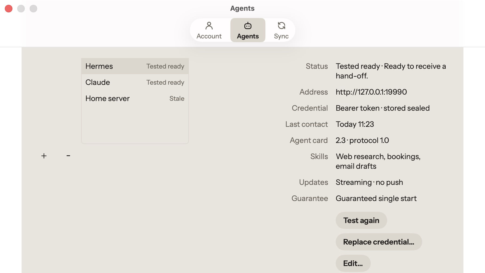
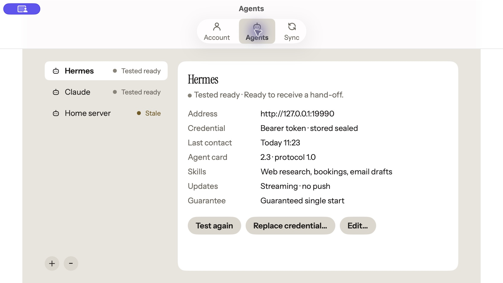

# M29 Agents manager board parity

Accepted outcome: match the manager content to [M29-Mac.png](https://github.com/maxk-lab/brain_buddy/blob/c0e6e638c28695ad19905f4bf5b018a990c7fb85/docs/design/board/mac/M29-Mac.png)
(board 1792165683-83f3, pinned source PR #521), preserving existing actions and restrictions.
The owner confirmed that PNG appearance takes precedence over the older textual
layout description. Settings window and tab chrome are a separate finding.

The before/after captures use a disposable profile, a loopback-only backend and
synthetic agents. No installed owner application or personal workspace was changed.

| Before | After |
| --- | --- |
|  |  |

Native checks: switching agents updates details; Add, Edit and Replace credential
sheets open and Escape dismisses them without modifying data. Keyboard arrows could
not be verified with this host's keyboard navigation setting; existing keyboard
implementation and its tests were retained. No credential was entered or replaced.

Validation on the product candidate: 458 Mac tests and 1,508 native kit tests pass.
Independent visual QA of product commit `d28f220d7e21968fb9e7c2067570ea9a693f196b`
passes for manager content. Dark and passwordless snapshots are included in the
suite. Native snapshot profiles are explicit; CI remains a separate gate.

Known limits: Settings shell/tab chrome remains different from the board. An existing
same-owner reauthentication path did not refresh agent availability in this scratch
profile; a full sign-out/sign-in restored it. This layout change does not address
that behavior. This record does not accept the remaining board screens or claim
production verification.

CI run `39022149434` exercised all 458 Mac tests; its only four issues were the
initially missing `native1x-12h` manager baselines. These four images were decoded
unchanged from that run's snapshot output, visually reviewed, and committed beside
the local `native2x-24h` images. A new exact-head CI run must verify them; this
record does not turn that failed first run into a pass.
