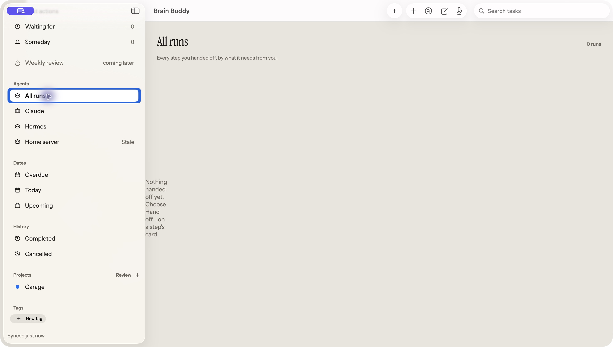
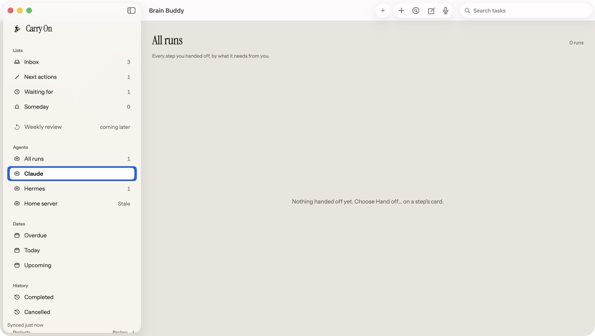

# M22 empty run-list canvas width

Accepted outcome: keep the existing empty message readable across the available
run-list canvas, preserving fetching, grouping, filtering and navigation. The
[M22 board](../../board/mac/M22-Mac.png) establishes the full canvas and side-by-side
groups; it shows populated data, so this correction retains the existing empty
copy and centered overlay instead of inventing cards or a new empty-state design.

| Before: actual native app | After: actual native app |
| --- | --- |
|  |  |

Both actual captures are 1470x833 points. The after capture uses an empty agent
filter; its existing All runs title fallback is unchanged. The parent exercised
All runs with one Running item, then selected an agent with no runs. The empty
message is now one readable centered line. The baseline window chrome in these
captures is outside this correction; the separate Chrome branch was not changed.
These images accept the empty composition, not complete populated-screen parity.

Root cause: an empty groups HStack had only its two 28pt horizontal paddings as
intrinsic width. The native ScrollView and its overlay therefore received 56pt,
even when the canvas was much wider. The original view source is identical on
`origin/main` at `bae38ea826ec069778ea0f9558e082e98ec7ff0a` and the Chrome branch.
One flexible-width frame on the groups HStack makes the scroll content occupy the
available width. No constants, tokens, wording, data logic or callbacks changed.

The native regression failed before the product edit: a 560pt canvas had a 56pt
scroll viewport, as did a 1032pt canvas. After the edit, the real NSScrollView
measures 560pt and 1032pt respectively, with its leading edge at zero. This also
covers the existing minimum canvas width and the board's canvas width.

Reviewed hosted actual-view snapshots:
[light](../../../../macos/Tests/BrainBuddyMacTests/__Snapshots__/mac-all-runs-empty-light-native2x.png)
and [dark](../../../../macos/Tests/BrainBuddyMacTests/__Snapshots__/mac-all-runs-empty-dark-native2x.png).
They capture the actual AgentRunsCanvas at 1032x748 through a native host, rather
than reproducing its contents in a fixture view. The strict snapshot replay and
existing Agents scene, run-store and grouping checks pass 32 tests in four suites.
The final full Mac suite passes 458 tests in 48 suites after 57.822 seconds.

The light/dark native1x references were captured by actual CI run
[39030087778](https://github.com/maxk-lab/brain_buddy/actions/runs/39030087778) at
source `c8e70048a00943049414ce21c62d6fa40d51fad1`, artifact `macos-app-logs-1`
(ID `12099744312`). Its full Mac log ran 458 tests in 48 suites and reported exactly
two issues: these missing references. Both CI images were visually reviewed as
unblank, with the correct header, zero count and readable centered message, then
imported byte-exact. The updated candidate still needs native1x CI replay.
No simulated raster, tolerance change, shared kit change, authentication/backend
change or new feature is included. Exact-SHA independent QA, CI and delivery remain
separate parent-owned gates.
