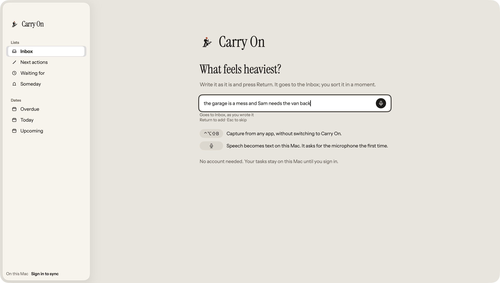
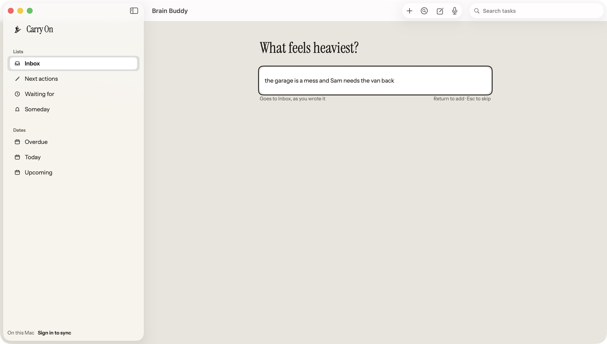

# M02 First capture visual correction

Accepted outcome: when the Welcome field contains non-whitespace text, match the typed
composition in [M02-Mac.png](../../board/mac/M02-Mac.png). Keep the heading and focused
capture field, expand the field to 64 pt, hide the M01 brand, instruction, hint rows,
no-account line and microphone, then show the two helper lines below the field.

| Before | After |
| --- | --- |
|  |  |

The before image is the supplied pre-change app capture. The after image is the actual
native app after the correction. The hosted light 2x snapshot is also saved as
[after-native-typed-light-2x.png](after-native-typed-light-2x.png); the corresponding dark
snapshot is [mac-welcome-typed-dark-native2x.png](../../../../macos/Tests/BrainBuddyMacTests/__Snapshots__/mac-welcome-typed-dark-native2x.png).
The native-host snapshots use the same sample text as the board.

`WelcomeInboxSnapshotTests` covers typed M02 and empty M01 in light and dark appearances.
The native 2x replay passed for all four snapshots. The typed sample is `the garage is a
mess and Sam needs the van back`.

Manual native app checks passed: the field starts focused; pasting the sample enters the
compact state and keeps focus; typing `!` without clicking keeps focus; Cmd+A followed by
Space returns to M01 and keeps focus. Return with only whitespace creates nothing. Return
with valid text creates one Inbox item and focuses its first-step field. Escape from a
fresh typed state opens the empty Inbox and retains the draft, matching existing behavior.

This evidence covers the welcome content only. Main-window chrome and sidebar changes are
outside this finding.

CI run `39025488146` ran all 458 Mac tests and failed only the two missing typed
`native1x` baselines. Both images were decoded from the complete uploaded Mac test
log, inspected in light/dark, and imported unchanged. No product code or comparison
tolerance changed. The failed first run is not a pass; the updated exact head needs
fresh CI and renewed independent QA.
