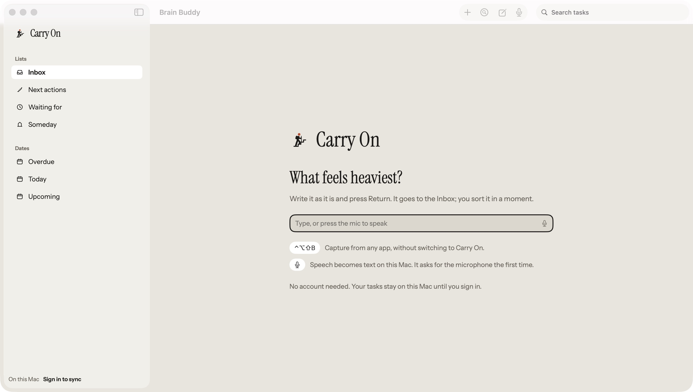
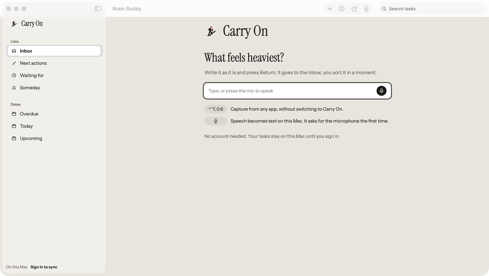

# M01 Welcome content board parity

Accepted outcome: match the Welcome content to [M01-Mac.png](https://github.com/maxk-lab/brain_buddy/blob/c0e6e638c28695ad19905f4bf5b018a990c7fb85/docs/design/board/mac/M01-Mac.png)
(board 1792165683-83f3), preserving capture, speech availability and skip behavior.
The owner confirmed that PNG appearance takes precedence over older visual wording.
Main window chrome and the typed M02 composition are separate findings.

| Before | After |
| --- | --- |
|  |  |

Both captures use disposable local profiles. The content is top-anchored and
horizontally centred; the field has a card surface, an outer focus ring and a dark
microphone control. Both hint chips use the same stone surface and dimensions.

Native checks: the empty field receives focus; Return after entering a synthetic
first capture creates the Inbox item and opens its first-step inspector. Escape on
a fresh empty Welcome skips to the empty Inbox. No microphone permission was requested.

Validation: 457 Mac tests across 48 suites pass, including
`WelcomeInboxSnapshotTests.emptyWelcome`, covering light/dark and explicit native
1x/2x profiles. The shared native kit suite passes 1,508 tests across 154 suites.
The snapshot content viewport is 1,030 by 747 points; it catches horizontal placement
within the reference's content area instead of cropping to the content block.

This bounded record does not accept main window chrome, the other board screens,
CI, release or production behavior.

The first CI run `39022389469` executed all 457 Mac tests and found two snapshot
issues, both confined to rasterization of the small brand mark in the local 1x
references (about 1,230 pixels out of 3,077,640). The exact CI-emitted light/dark 1x
images were reviewed and imported unchanged. Layout, text and controls match; no
comparison tolerance was widened. The local 2x baselines remain unchanged. A fresh
exact-head CI run must pass; the first failed run is not a pass.
