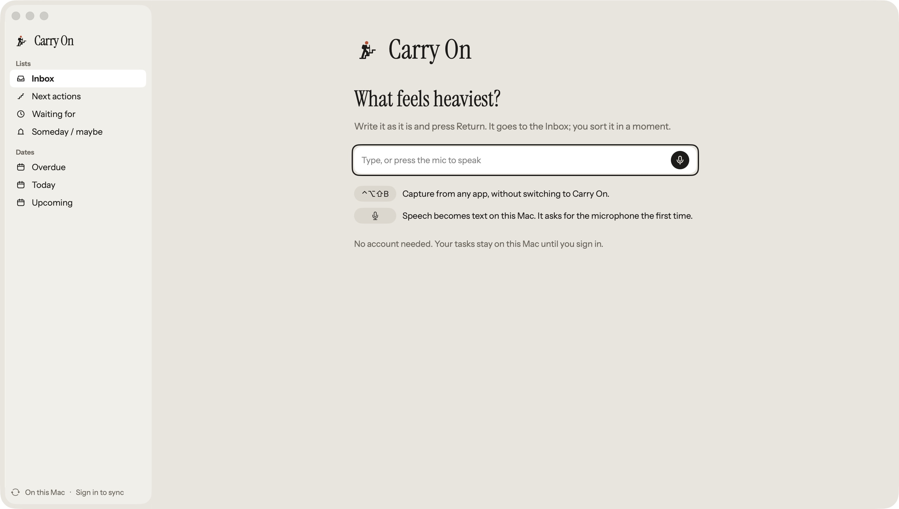
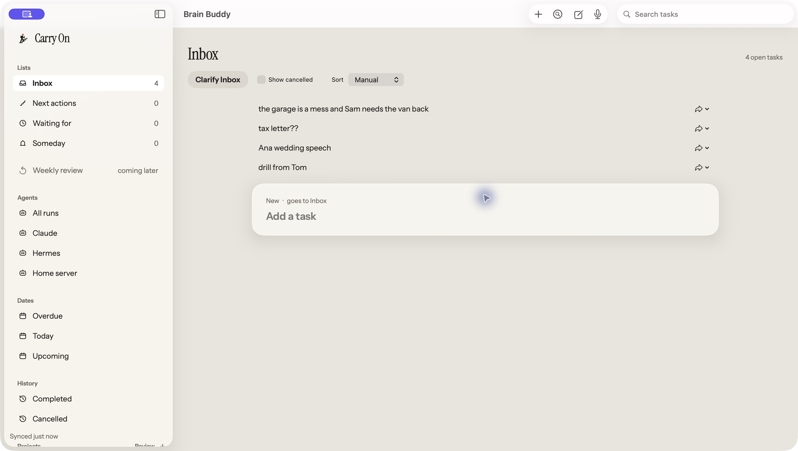
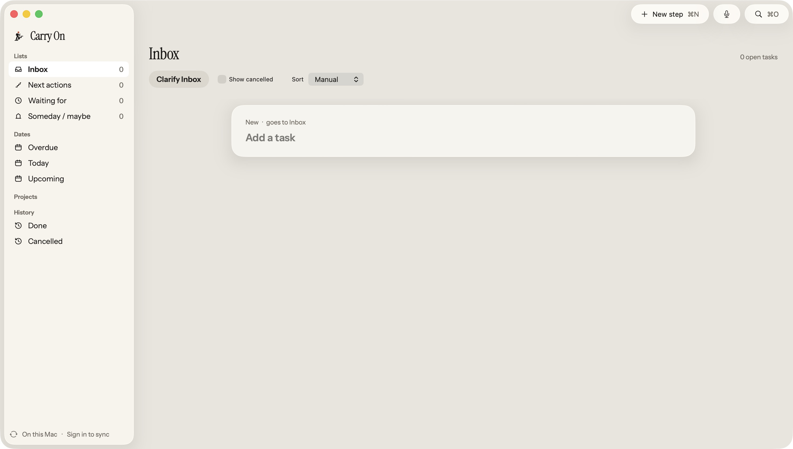
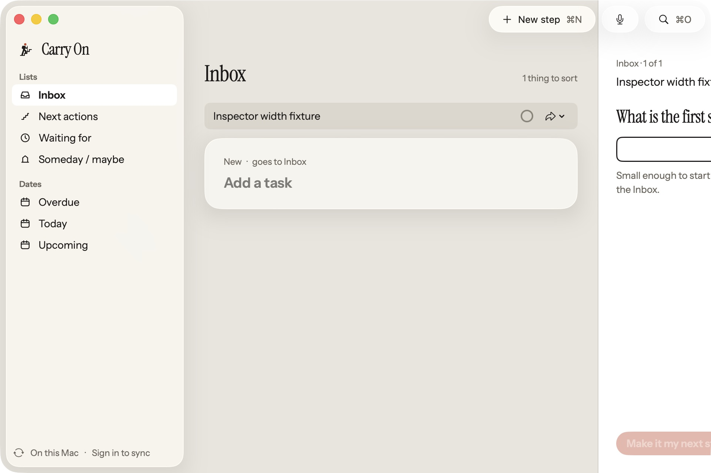
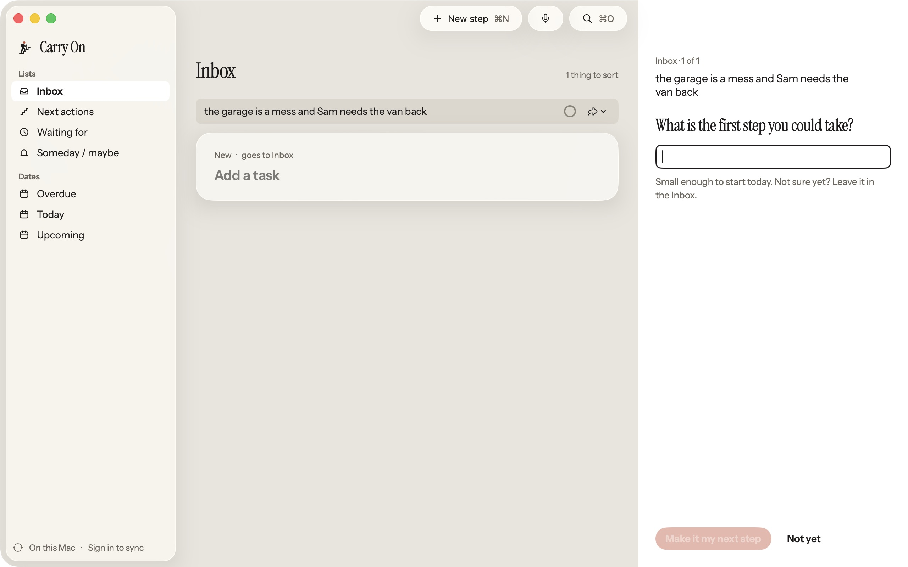

# M01/M07 main-window chrome board parity

Accepted outcome: match the shared window chrome in [M01](../../board/mac/M01-Mac.png)
and [M07](../../board/mac/M07-Mac.png), preserving existing commands, data,
keyboard shortcuts and unsaved-edit protection. PNG appearance is the owner-approved
authority, including the visible command differences.

| Surface | Before | After |
| --- | --- | --- |
| Welcome |  |  |
| Inbox chrome |  |  |
| First-step inspector bounds |  |  |

These are actual app captures from disposable profiles. The original M01/M07 comparison
is at 1470x833 points; the current default and inspector captures are 1280x800. Counts,
projects, tags and Agents follow the existing profile/account/flag state; the board's
fixture data is not imposed on the app. [Fresh 1280x800 Welcome](m01-after-default.png)
confirms the board-sized default has no left clipping. This supersedes the earlier
960x640 default: the owner approved a native 1188pt minimum, derived from the existing
240pt sidebar, 8pt native outer inset, 560pt canvas and widest 380pt inspector.
Native resizing above this minimum and sidebar visibility remain available.

The sidebar plate defaults to 240pt with its native 8pt outer inset, 29pt navigation
rows and the existing selection binding. Native resizing retains the original 400pt
maximum. Projects precedes History; the visible labels are Someday / maybe and Done.
The inactive Weekly review placeholder is absent. Populated/loading/failed Tags stays
available as shown in DSMac; only the empty ready section is hidden. Existing Agents
visibility and collapsed-sidebar sync attention remain. The calm footer uses the
refresh glyph and separate On this Mac / Sign in to sync actions.

M01 keeps native window controls and a 52pt toolbar container with only a flexible
spacer. The welcome brand's first ink is about 64pt below the real window top, against
about 65pt in the PNG. M07 has trailing, untinted glass New step, microphone and Quick
Open controls, with primary ink specified inside their labels and secondary shortcuts.
The previous native inspector presentation double-counted pane safe areas: opening
first-step details on candidate `0f3a0c7f` at 960pt clipped its field and footer. The
same inspector content now occupies an inline trailing SwiftUI panel at its existing
380pt Inbox / 340pt ordinary width. The native detail minimum includes the presented
panel, so widening the sidebar cannot displace it. An accessibility-hidden clear
native toolbar reservation uses that same width to keep commands above the canvas.
Inspector state, actions, content and unsaved-edit routing are unchanged.

Owner-approved command relocation: File retains New step (Command-N), Quick Open
(Command-O), Quick Capture (Control-Option-Shift-B), Voice to task draft, New tag,
New project and Review projects. Edit > Find > Search tasks (Command-F) retains full
task filtering separately from Quick Open. View and Control-Command-S retain native
sidebar visibility. Quick Capture fallback copy now points to File. Creation menus
are disabled while a collection draft is open, and stale callbacks recheck current
presentation/write state before clearing a name.

Native checks passed: fresh 1280x800 default layout, first capture and Return into a
fully visible first-step inspector, typed field preservation across sidebar hide/restore,
Return into Next actions, opening the [ordinary inspector](m13-inspector-after.png),
and Command-Backslash closing it. These captures accept pane bounds and toolbar
ownership; full landing/inspector content parity is outside this correction. Earlier
chrome checks also covered native window zoom, sidebar hide/restore, three distinct
toolbar accessible names, Quick Open and Search focus plus Escape, Quick Capture
open/close, and collection-command disabled/re-enabled behavior.
A unit regression verifies that stale project/tag creation callbacks preserve an
unsaved name and that creation resumes after dismissal. Manual sidebar arrow-key
movement was not verified; native List selection and its existing binding remain.
Actual pointer-driven minimum resizing was unavailable because the UI tool reported
no window for drag events. The native regression verifies the enforced minimum and
moves the real split divider at 1188pt and 1280pt through both inspector variants;
all editable fields stay inside the window and toolbar actions precede the panel.

Validation: 463 Mac tests in 50 suites pass after 48.619 seconds. The shared kit
passes 1,508 tests in 154 suites after 52.913 seconds with the current geometry tokens.
The cleaned native viewport regression passes both cases after 9.561 seconds. The
chrome suite includes actual native split/item
placement assertions and light/dark hosted snapshots. Hosted button snapshots cover
visible label ink and inherited app tint; these live app captures are the glass
compositor authority. Actual native1x baselines remain a first-CI record/review/replay
gate; no simulated 1x raster or snapshot tolerance was added.

This record accepts only the bounded local chrome correction. Exact-SHA independent
QA, CI, rebase, release and production evidence remain separate parent-owned gates.
