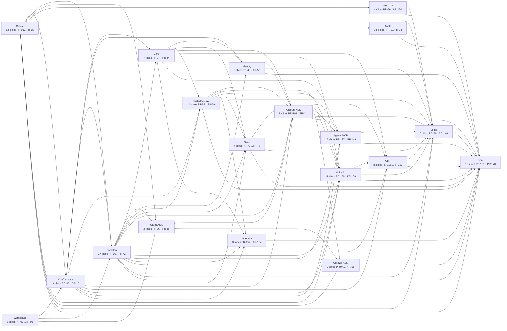

# Tasks: Rust server

**Input**: [spec.md](spec.md), [plan.md](plan.md), [design.md](design.md), [research.md](research.md), [data-model.md](data-model.md), [quickstart.md](quickstart.md), [approval.md](approval.md) and [contracts/](contracts/) — the [capability inventory](contracts/capability-inventory.md) is the porting contract (153 HTTP, 7 MCP, 26 job, 8 CLI, 21 middleware, 13 external, 92 config, 17 store rows).

**Status**: draft slice map for owner approval. The founder-accepted planning review (approval.md) authorizes none of the ASK-class actions below; each `[ASK]` task needs its own exact-SHA recorded approval. This file is portable planning input, not permission to implement, merge or deploy.

**Delivery gates** (non-negotiable, regardless of who executes these tasks): isolated worktree and feature branch per slice; Constitution Principle II; Allure taxonomy on every product test (Rust tests through `bb-allure`) with the feature-qualified id (`027-FR-###`/`027-SC-###`, `027_FR_###` in Rust and Python names) in the test name or story; acceptance graded by an agent that did not write the code; landing class decided by `scripts/classify_path_risk.py` — SHIP/SHOW land PR-less through verified trunk, ASK never lands automatically (ADR-0008, ADR-0030; `AGENTS.md`, `docs/autonomous-delivery-runbook.md`).

Before freeze, the implementation writer MUST produce a typed receipt using `.specify/templates/pre-freeze-receipt.schema.json` and run `python3 scripts/validate_pre_freeze_receipt.py <receipt> --sha <full-lowercase-sha>`. The receipt covers only writer-owned pre-freeze gates; independent review, QA, CI, landing, deploy and production smoke remain post-freeze obligations and are never writer PASS evidence.

**Tests (Principle II)**: reused checks — the 19 Playwright specs, the 026 JSON vectors (moved to `contracts/fixtures/` by the fixtures task), `bb-domain` parity/property tests, `bb-client` protocol fault tests, Swift package tests, the CLI journey. Necessary additions — the black-box conformance suite (one test per inventory row, run first against the frozen Python server, then against Rust; the only way to prove 027-FR-001 1:1) and module tests at the cheapest reliable level. Test-first applies only to the predefined critical invariants that are new code here and is stated in those tasks: owner isolation, session/cookie properties, provider-token verification, idempotent command receipts, job fencing, consent refusal, purge completeness, the control ledger, the 426 no-write rule, the fresh-start reset. The pytest suite is not ported test-by-test (research R4). No other task carries a dedicated test task.

**Conventions that make the lanes disjoint**

- **Stub-first module map.** The skeleton tasks create every module's files as compiling stubs: `bb-app/src/<module>/` (`mod.rs`, `config.rs`, `jobs.rs`, `privacy.rs` and the files named in each task), `bb-api/src/<surface>/`, `bb-store/src/<module>/` (the Tasks owner group as `tasks/{items,organize,review,sync,devices,transfers,snapshots,jobs}`), `bb-server/src/commands/<command>.rs` and `bb-api/src/test_control/<operation>.rs`. A later slice owns exactly the files or directories in its `paths`; it never edits a stub owned by a sibling, `rust/Cargo.toml`, `rust/Cargo.lock`, the router or the wiring. A slice that discovers a needed shared edit or dependency stops and amends this map.
- **Schemas are frozen first and are ASK.** Every file under `rust/crates/bb-store/migrations/` classifies ASK (`migrations` token). The five schema tasks land the whole data model before the repositories; a later schema change is a new numbered migration in its own ASK slice, never bundled with product code. Numbers are reserved per module (01xx identity/flags, 02xx tasks/sync/jobs/control, 03xx crt, 04xx voice, 05xx agents).
- **Generated sqlx offline metadata** (`rust/crates/bb-store/.sqlx/query-*.json`) is content-addressed and never hand-edited; every store slice may add files there (no two slices can produce the same file), so it is listed only once, by the store skeleton. It counts as product lines under `scripts/check_slice_budget.py`, which is why store slices state an `oversize_reason`.
- **Conformance tests** live in `rust/crates/bb-conformance/tests/<section>.rs` (test paths, not product lines). Each section is written against the Python oracle first; the Rust slice for that section depends on it and is done when the same section is green on the Rust server. Evidence ids are fixed in `contracts/capability-dispositions.json` by the inventory task, so no later slice edits that file.
- **ASK-class tasks** (`[ASK]`): schema migrations, `.env.example`, Makefile/gate-integrity and other guarded files, every `.github/` workflow, GDPR export/deletion code, the agent-credential (secret) box, Fly deploy configuration, Postgres/Tigris provisioning, the cutover/erase commits and destructive pilot steps. Each is its own slice with no other product code.

## Format: `[ID] [P?] [Story] Description`

- **[P]**: no dependency on another task in the same phase (it can start as soon as its earlier-phase prerequisites have merged).
- **[USn]**: the user story from spec.md. Setup, Foundational and Final tasks carry no story label.
- Each task ends with the inventory ids it ports (`Covers …`) or tests (`Tests …`), its feature-qualified requirements and its PR slice.

---

## Phase 1 — Setup (shared infrastructure, oracle and governance)

**Purpose**: governance, the frozen inventory, the oracle (test control API on the frozen Python server, the conformance harness, retargeted suites), fixture hygiene and the workspace crates. No product behavior changes.

- [ ] T001 [P] Write docs/decisions/0032-server-in-rust.md (supersedes ADR-0031's "FastAPI stays" and 026's separate PostgreSQL stage PR-55…57; amends ADR-0028 so every account-creation method requires an invite, 027-FR-007; records the differential conformance oracle, research R5 gate equivalents, the schema-per-module ownership rule, the Rust mutation-scope promotion rule and the 027-FR-022 freeze); add status lines to docs/decisions/0031-shared-rust-core-and-task-sync.md and docs/decisions/0028-modern-identity-authority.md; PATCH-amend the `backend/data` Operational Guardrail in .specify/memory/constitution.md with a Sync Impact Report; mark specs/026-rust-core-sync/README.md superseded and close draft PR #377 with a link to the ADR (027-FR-001, 027-FR-002, 027-FR-003, 027-FR-007, 027-FR-022; PR-01).
- [ ] T002 [P] Create specs/027-rust-server/contracts/capability-dispositions.json with one entry for each of the 337 inventory ids (CAP-HTTP 153, CAP-MCP 7, CAP-JOB 26, CAP-CLI 8, CAP-MW 21, CAP-EXT 13, CAP-CFG 92, CAP-STORE 17): disposition `port`|`change`|`remove`, evidence kind (`conformance`, `integration`, `config-test`, `job-test`, `deploy-check`), owning PR slice, a fixed evidence id (test name) so later slices never edit this file, and the 027-FR-001/FR-007/FR-011/FR-018 approval reference for change/remove rows; dispositions follow spec 027-FR-001 and the owner decisions in spec.md Clarifications (tasks session): CAP-CFG-004, CAP-CFG-011, CAP-CFG-012, CAP-CLI-006, CAP-CLI-007 and CAP-JOB-008 are `remove`, CAP-STORE-013 and CAP-CFG-092 are `port`; no row is pending. `pending-owner` exists only as a checker guard. Implement scripts/check_capability_inventory.py (missing row, missing evidence id, change/remove without approval reference, port row whose Python and Rust conformance reports differ, evidence not green; `--final` also fails on any `pending-owner` row, guarding future additions) with scripts/test_check_capability_inventory.py (Covers CAP-CLI-004, CAP-JOB-004, CAP-JOB-021, CAP-STORE-015; 027-FR-001, 027-SC-003; PR-02).
- [ ] T003 [P] Add the workspace members bb-server, bb-api, bb-app, bb-store, bb-providers, bb-conformance and bb-allure to rust/Cargo.toml with crate manifests and one-line lib.rs/main.rs entry points, pinning exactly (`=x.y.z`) every server dependency named in plan Technical Context and research R1–R11 (axum, tokio, tower-http, sqlx postgres+offline, reqwest rustls, rmcp, argon2, jsonwebtoken, p256, lettre, aes-gcm, symphonia, utoipa + utoipa-axum, object_store, tracing, zip, hickory-resolver) in rust/Cargo.lock, so no later slice edits rust/Cargo.toml or rust/Cargo.lock; a slice that needs another dependency stops and amends this map (027-FR-002, 027-FR-003; PR-03).
- [ ] T004 Implement the dev-only Allure writer in rust/crates/bb-allure/src/ (writes allure-results/*-result.json with epic, feature, story, title and named steps through an `allure_test!` wrapper; result directory from ALLURE_RESULTS_DIR) so Rust tests satisfy scripts/validate_allure_taxonomy.py unchanged (research R5) (027-FR-001, 027-SC-003; PR-04).
- [ ] T005 Implement the conformance harness in rust/crates/bb-conformance/src/: base-URL client (BB_CONFORMANCE_BASE_URL), typed test-control client (contracts/test-control.md), synthetic owner factory (invite → signup → cookie), `X-Client-Epoch` injection, CAP-id tagging that writes a run report target/conformance/<server>.json consumed by scripts/check_capability_inventory.py, a log-redaction collector that fails a run when server log lines contain seeded user text (027-FR-016), and bb-allure labels (027-FR-001, 027-FR-016, 027-SC-003; PR-05).
- [ ] T006 [P] Add the test control API to the frozen Python server (test environment only, the 027-FR-022 seam) in backend/app/api/test_control.py, mounted from backend/app/main.py only when BRAIN_BUDDY_ENV=test and refusing to start without BRAIN_BUDDY_TEST_CONTROL_TOKEN (backend/app/core/config.py): POST /api/__test__/invites, POST /api/__test__/admin, PUT /api/__test__/flags/{key}, POST /api/__test__/sweeps/{name}, POST /api/__test__/review/aged-task, GET /api/__test__/owners/{email}/tasks and POST /api/__test__/reconcile per contracts/test-control.md; backend/tests/test_test_control.py proves the prefix is 404 outside test and every operation needs X-Test-Control-Token (027-FR-022, 027-FR-001; PR-06).
- [ ] T007 Extend the Python test control API with POST/DELETE /api/__test__/clock through one test clock seam in backend/app/core/test_clock.py (used by tasks, review, sync retention, jobs and sessions), PUT /api/__test__/providers/{kind} mock scripting with `hold`, GET /api/__test__/providers/{kind}/calls content-free call ledger, POST /api/__test__/providers/{kind}/release and GET /api/__test__/mail, in backend/app/api/test_control_providers.py wired through backend/app/container.py only under BRAIN_BUDDY_ENV=test (027-FR-022, 027-FR-011; PR-07).
- [ ] T008 [P] Fix inventory ambiguity #1 on the frozen Python server first (027-FR-022 defect fix): `GET /api/account` without a trailing slash gets `Cache-Control: no-store` and `Referrer-Policy: no-referrer` in backend/app/api/middleware.py; test-first in backend/tests/test_privacy_headers.py (027-FR-022, 027-FR-009; PR-08).
- [ ] T009 [P] Audit and move the shared JSON/audio vectors (research R15): replace transcript-like text in backend/tests/fixtures/ and specs/026-rust-core-sync/contracts/*.json with clearly synthetic text, replace raw WAV with generated tones/silence plus synthetic WebM/Opus, Ogg/Opus, MP4/AAC and WAV clips for the voice probe, drop content hashes, recompute expected values from the Python oracle only where the synthetic content changed them, `git mv` them to contracts/fixtures/, and update every loader (rust/crates/bb-domain/tests/, rust/crates/bb-protocol/src/lib.rs, rust/crates/bb-protocol/tests/contract/common.rs, rust/bindings/swift/tests/workspace.rs, rust/crates/bb-client/tests/import.rs, the listed backend and iOS tests, frontend/src/features/tasks/__tests__/smartAddVectors.test.ts, scripts/voice_evidence_report.py) (027-FR-003, 027-FR-006, 027-FR-016; PR-09).
- [ ] T010 [P] Add scripts/check_evidence_hygiene.py with scripts/test_check_evidence_hygiene.py: pattern check over contracts/fixtures/ and specs/027-rust-server/evidence/ rejecting emails, invite codes, session/provider credentials, local paths and content hashes (research R13/R15) (027-FR-016, 027-SC-004; PR-10).
- [ ] T011 [P] [ASK] Document the new server configuration in .env.example: DATABASE_URL, BRAIN_BUDDY_OBJECT_STORE_ENDPOINT/_REGION/_ACCESS_KEY_ID/_SECRET_ACCESS_KEY/_VOICE_BUCKET/_CONTROL_BUCKET, BRAIN_BUDDY_MIN_CLIENT_EPOCH (default 1), BRAIN_BUDDY_TEST_CONTROL_TOKEN (test only), and the two undocumented variables of inventory ambiguity #7, BRAIN_BUDDY_AGENT_RELAY_KEYS and BRAIN_BUDDY_ACCOUNT_PURGE_GRACE_SECONDS; no values, no secrets (027-FR-016, 027-FR-018; PR-11).
- [ ] T012 Replace every Python hook in the Playwright suites with the test control API: add frontend/tests/e2e/testControl.ts and use it in frontend/tests/e2e/gtdHelpers.ts (create-invite), frontend/tests/e2e/admin-users.spec.ts (owned-task probe → owner read-back), frontend/tests/e2e/weekly-review.spec.ts (aged task, sweep, clock) and frontend/tests/native-tasks-voice-brain-dump.compose.spec.ts; pass BRAIN_BUDDY_TEST_CONTROL_TOKEN to the E2E backend in compose.yaml and scripts/run_playwright_e2e.sh (027-FR-001, 027-SC-002; PR-12).
- [ ] T013 Retarget the modern-auth E2E to the test control provider mocks: scripts/run_modern_auth_e2e.py starts any server by base URL and scripts identity/SMTP mocks through PUT /api/__test__/providers/{kind}; remove the monkeypatching in backend/tests/modern_auth_e2e_app.py and the inline Python in frontend/tests/modern-auth.spec.ts (027-FR-001, 027-FR-007, 027-SC-002; PR-13).
- [ ] T014 Point the Rust client and CLI backend tests at a server base URL plus the test control API: rust/crates/bb-client/tests/e2e_backend.rs and rust/crates/bb-client/tests/hints_backend.rs (drop the Python interpreter discovery), delete rust/crates/bb-client/tests/support/sse_backend.py and cli/tests/backend_fixture.py, update rust/crates/bb-client/tests/support/mod.rs and cli/tests/task_journey.rs (027-FR-001, 027-FR-006; PR-14).
- [ ] T015 Retarget the 026 rehearsal harness to the test control API (seed_stalled → clock, seeding → invites/admin/flags): scripts/rehearsal/run.py, scripts/rehearsal/rehearsal_backend.py, scripts/rehearsal/ui_backend.py, ios/scripts/rehearsal_backend.py, ios/BrainBuddyUITests/Support/Rehearsal.swift and macos/Tests/BrainBuddyMacTests/MacRehearsalTests.swift (027-FR-006, 027-SC-004; PR-15).

**Checkpoint**: all 15 tasks of this phase merged.

---

## Phase 2 — Foundational (server skeleton, schemas, session layer, jobs, gates)

**Purpose**: the frozen schemas, the server/app/api/store/provider skeletons, cross-cutting middleware and the release epoch, the control ledger, flags, the session layer, the job ledger and worker, local stack, and the Rust gate equivalents (research R5).

**⚠️ CRITICAL**: story lanes start when the Foundational slices they depend on have merged; see the slice map, not this heading, for exact edges.

### Conformance tests (necessary additions under Principle II)

- [ ] T043 [P] Write the black-box conformance tests for health, docs, correlation IDs, request logging, privacy headers, error envelopes, body caps, Idempotency-Key and (Rust-only) the release epoch, /api/meta and the exempt set in rust/crates/bb-conformance/tests/platform.rs, one test per inventory row named `cap_<kind>_<nnn>_*` (the evidence ids already fixed in capability-dispositions.json) plus two-owner probes where the row is owner-scoped (foreign id indistinguishable from missing, 027-FR-008); seed only through the test control API; green against the frozen Python server first. Rows with a `change` disposition are marked Rust-only (Tests CAP-HTTP-001..006, CAP-MW-001..008, CAP-MW-015..016 and the release-epoch contract; 027-FR-001, 027-FR-016, 027-FR-018, 027-SC-003, 027-FR-008; PR-39).
- [ ] T044 [P] Write the black-box conformance tests for password signup/login/logout/me, cookie attributes, the login limiter and session validity rules in rust/crates/bb-conformance/tests/identity.rs, one test per inventory row named `cap_<kind>_<nnn>_*` (the evidence ids already fixed in capability-dispositions.json) plus two-owner probes where the row is owner-scoped (foreign id indistinguishable from missing, 027-FR-008); seed only through the test control API; green against the frozen Python server first. Rows with a `change` disposition are marked Rust-only (Tests CAP-HTTP-040..043, CAP-MW-012, CAP-MW-014 (login), CAP-MW-019; 027-FR-001, 027-FR-007, 027-FR-008, 027-SC-003; PR-43).

### Implementation

- [ ] T016 [P] [ASK] Write the `identity` and `flags` schema migrations rust/crates/bb-store/migrations/0100_identity.sql and rust/crates/bb-store/migrations/0150_flags.sql: users (Argon2id hash), sessions (hashed opaque token, auth_version), invites (single use), auth attempts/challenges/proofs/handoffs/identity bindings/mail jobs/budgets, Apple grants/cleanup jobs/notification receipts, cli_device_grants, pending_signups (contracts/invite-handoff.md: "stored hashed", "expiry of 10 minutes. Single use."), flags modes and selected owners; no rate-limit tables ("Login rate limits stay in process memory"). Quote data-model.md verbatim: "Every owner-scoped table carries `owner_id` and every query filters on it"; "Timestamps are `timestamptz` in UTC; identifiers keep their current wire format (prefix + random)"; forward-only, expand-only (Covers CAP-STORE-005, CAP-STORE-010, CAP-STORE-014; 027-FR-007, 027-FR-008, 027-FR-015; PR-16).
- [ ] T017 [P] [ASK] Write the `tasks` schema migration rust/crates/bb-store/migrations/0200_tasks.sql: tasks, projects, tags, task_tags, subtasks, comments, idempotency records, review settings/sessions/decisions/receipts/park acks/bulk releases, navigator consents/usage (the navigator and ai modules join the Tasks owner group and use `bb_store::tasks`), with the 026 command-catalog length limits as CHECK constraints ("task title 500, details/comment 20,000, name 500, project outcome 1,000 Unicode scalar values" enforced in bb-domain, mirrored as column bounds). Quote data-model.md verbatim: "Every owner-scoped table carries `owner_id` and every query filters on it"; "Timestamps are `timestamptz` in UTC; identifiers keep their current wire format (prefix + random)"; forward-only, expand-only (Covers CAP-STORE-001, CAP-STORE-002; 027-FR-003, 027-FR-008; PR-17).
- [ ] T018 [P] [ASK] Write the `sync`, `jobs` and `control` schema migrations rust/crates/bb-store/migrations/0210_sync.sql, rust/crates/bb-store/migrations/0220_jobs.sql and rust/crates/bb-store/migrations/0230_control.sql: scopes, devices, device epochs, command receipts, change transactions/records, record versions, legacy keys, snapshots/pages, transfers/pages, per-scope commit sequence; jobs, leases, fencing counter, dead letters, owner generations; and the `control` schema owned by the Control module holding `control_applied` (applied ledger sequence numbers, research R11) and the maintenance state; the ledger entries themselves stay in object storage. Quote data-model.md verbatim: "Every owner-scoped table carries `owner_id` and every query filters on it"; "Timestamps are `timestamptz` in UTC; identifiers keep their current wire format (prefix + random)"; forward-only, expand-only (Covers CAP-STORE-003, CAP-STORE-004; 027-FR-006, 027-FR-017; PR-18).
- [ ] T019 [P] [ASK] Write the `crt` schema migration rust/crates/bb-store/migrations/0300_crt.sql: trees, nodes (`jsonb` payload), relations, versions, tree index, validation history, validation provider registry (today's data-dir config.json), command receipts with the 30-day response body and tombstone column (ADR-0026). Quote data-model.md verbatim: "Every owner-scoped table carries `owner_id` and every query filters on it"; "Timestamps are `timestamptz` in UTC; identifiers keep their current wire format (prefix + random)"; forward-only, expand-only (Covers CAP-STORE-009, CAP-STORE-012, CAP-STORE-013; 027-FR-013, 027-FR-008; PR-19).
- [ ] T020 [P] [ASK] Write the `voice` and `agents` schema migrations rust/crates/bb-store/migrations/0400_voice.sql and rust/crates/bb-store/migrations/0500_agents.sql: voice operations, stages, idempotency, audio object keys with a `deleting` state (research R11), provisional items; agent connections, sealed credentials, runs, run events, run commands, idempotency, audit and audit buckets. Quote data-model.md verbatim: "Every owner-scoped table carries `owner_id` and every query filters on it"; "Timestamps are `timestamptz` in UTC; identifiers keep their current wire format (prefix + random)"; forward-only, expand-only (Covers CAP-STORE-006, CAP-STORE-008; 027-FR-012, 027-FR-014, 027-FR-008; PR-20).
- [ ] T021 Implement the bb-store skeleton in rust/crates/bb-store/src/: PgPool construction, `migrate::run` over `sqlx::migrate!` (applied only by `bb-server migrate`, never at request time), the Tasks-group UnitOfWork, per-module namespaces as empty modules (identity, flags, control, crt, voice, agents, and tasks/{items,organize,review,sync,devices,transfers,snapshots,jobs}), and the schema-ownership test that parses every sqlx query and fails when a module touches another module's schema (research R3), with exactly one allowed exception: any `bb_store::<module>` may call `bb_store::control::mark_applied(&mut tx, seq)` inside its own transaction. Generated `rust/crates/bb-store/.sqlx/query-*.json` metadata starts here (Covers CAP-JOB-023; 027-FR-002, 027-FR-008; PR-21).
- [ ] T022 [P] Implement the bb-providers skeleton in rust/crates/bb-providers/src/: traits for chat completion, transcription, mail, identity provider, A2A transport and object storage; mock providers with a content-free call ledger and the hold/release seam (contracts/test-control.md); the S3-compatible object-store adapter (object_store; MinIO locally, Tigris in Fly) with buckets `voice` and `control` and a startup bucket check; API key indirection (`*_API_KEY_ENV`, OPENAI_API_KEY, DEEPGRAM_API_KEY); empty adapter modules smtp, identity, openai, stt, reconciler, a2a (Covers CAP-CFG-090, CAP-CFG-091, CAP-CFG-092; 027-FR-011, 027-FR-012; PR-22).
- [ ] T023 Implement the bb-app skeleton in rust/crates/bb-app/src/: `Deps` (pool, object store, providers, clock, config) and `AppServices` with one field per module built by `<module>::Service::new(&deps)`; the server clock with a test override (clock.rs); cross-module ports (ports.rs: task command port, flag port, owner generation, control ledger, export/purge contributor, restore reconciliation hook); and the module file map as compiling stubs (identity, modern_auth, cli_auth, flags, control, account, admin, tasks, review, navigator, ai, sync, jobs, crt, voice, agents, mcp — each `mod.rs`, `config.rs`, and the files each lane task names; see Conventions), including the job-handler stubs (`<module>/jobs.rs`) the jobs registry calls (027-FR-002, 027-FR-003, 027-FR-008; PR-23).
- [ ] T024 Implement the bb-api skeleton in rust/crates/bb-api/src/: AppState over `AppServices`, router.rs composing one `OpenApiRouter` per surface (auth, modern_auth, cli_auth, account, admin, crt, trees, tasks, organize, title, voice, review, navigator, agents, a2a_push, sync, mcp, meta, test_control) as empty stub modules, a stub `session.rs`, the standard error envelope `{message, detail, reference_id}` with today's status mapping (ValidationFailure 400, request validation 422 without `input`), and `/health` + `/api/health` returning status, environment and schema_version (Covers CAP-HTTP-001, CAP-HTTP-002, CAP-MW-007, CAP-MW-008, CAP-STORE-016; 027-FR-016, 027-FR-005; PR-24).
- [ ] T025 Implement the cross-cutting middleware in rust/crates/bb-api/src/middleware/: correlation ID (accept `^[0-9A-Za-z._-]{1,64}$` from X-Correlation-ID then X-Request-ID, else uuid4; echo on every response, set `reference_id`), the `api_request` log line with path sanitization (auth/account paths without query, A2A push token `[redacted]`, content-free class names under /api/review/navigator), privacy headers on `/api/auth/`, `/api/account/` and exact `/api/account`, and no CORS/TrustedHost/HSTS/CSP layers (Covers CAP-MW-001, CAP-MW-003, CAP-MW-004, CAP-MW-005, CAP-MW-006; 027-FR-016, 027-FR-005; PR-40).
- [ ] T026 Implement shared extractors and docs in rust/crates/bb-api/src/extract/ and rust/crates/bb-api/src/docs.rs: Idempotency-Key (missing → 400 ValidationFailure), JSON content-type and streamed body caps, the in-process rate limiter primitive (token buckets keyed per route family; per-process as today, inventory #11), and `/api/openapi.json` (info.version = schema_version, sync routes excluded), `/api/docs`, `/api/docs/oauth2-redirect`, `/api/redoc` generated by utoipa (Covers CAP-HTTP-003, CAP-HTTP-004, CAP-HTTP-005, CAP-HTTP-006, CAP-MW-014, CAP-MW-015, CAP-MW-016, CAP-STORE-017; 027-FR-001, 027-FR-005; PR-41).
- [ ] T027 Implement the bb-server binary in rust/crates/bb-server/src/: subcommands `serve`, `worker`, `migrate` and stubs for `create-invite`, `purge-due-accounts`, `restore-control-plane`, `reconcile`, `review-metrics`, `openapi` under rust/crates/bb-server/src/commands/; configuration from the .env.example names (BRAIN_BUDDY_ENV, BRAIN_BUDDY_API_PREFIX, BRAIN_BUDDY_LOG_LEVEL; BRAIN_BUDDY_DATA_DIR is not read — a set value logs a startup warning and is ignored, CAP-CFG-004 `remove`, proven by the config test `config::tests::data_dir_is_ignored_with_warning`) plus DATABASE_URL and object-store settings, refusing to start with a named, value-free error when they are missing (research R13); tracing that redacts credential-bearing URLs; one ordered graceful shutdown (stop accepting, drain requests, stop worker leases, close SSE/MCP, flush logs; inventory #16) (Covers CAP-CLI-001, CAP-CFG-001, CAP-CFG-002, CAP-CFG-003, CAP-CFG-004, CAP-JOB-026; 027-FR-002, 027-FR-016; PR-25).
- [ ] T028 Implement the Rust test control surface in rust/crates/bb-api/src/test_control/ behind `cfg(feature = "test-control")` and BRAIN_BUDDY_ENV=test: token check, startup refusal without BRAIN_BUDDY_TEST_CONTROL_TOKEN, clock set/advance/reset over bb-app's clock, provider scripting/hold/release/call ledger, and one stub file per remaining operation (invites.rs, admin.rs, flags.rs, sweeps.rs, aged_task.rs, owner_tasks.rs, mail.rs, reconcile.rs) owned by the lanes below; the test-only review-seed and sweep CLIs are removed (CAP-CLI-006/007 `remove`) in favour of these operations (Covers CAP-CLI-006, CAP-CLI-007; 027-FR-001, 027-FR-022; PR-26).
- [ ] T029 Implement the release-epoch contract test-first (the 426 no-write rule is a critical invariant) in rust/crates/bb-api/src/epoch.rs, rust/crates/bb-api/src/client_header.rs and rust/crates/bb-api/src/meta/: BRAIN_BUDDY_MIN_CLIENT_EPOCH; gated routes reject a missing, non-integer or lower X-Client-Epoch with 426 `UPGRADE_REQUIRED` before authentication and before any handler, with the design.md message chosen by X-Client surface; the exempt set as one constant (health, provider callbacks/notifications, A2A push, docs, /api/meta, MCP, /api/__test__/*); `GET /api/meta` → `{server_epoch, min_client_epoch}`; `X-Server-Epoch` on every response; X-Client parsing for logs only (Covers CAP-MW-002; 027-FR-018, 027-FR-016; PR-42).
- [ ] T030 Implement the restore control ledger test-first (critical invariant, research R11) in rust/crates/bb-app/src/control/ and rust/crates/bb-store/src/control/: object `control/HEAD` with conditional create of `control/<seq>` (If-None-Match) and HEAD advance (If-Match), write-ahead then apply with the sequence recorded in the Control-owned `control` schema through `bb_store::control::mark_applied(&mut tx, seq)` inside the applying module's own transaction (the only cross-module store call), `bb_app` modules reaching control only through `bb_app::ports::control`, a 10-second and boot reconciler applying every missing entry, gap detection that keeps the server closed, `control/FLOOR` pruning bookkeeping, and the request-path check that rejects a session whose revocation entry is not yet applied; entry kinds: deletion requested/cancelled, purge started/completed, session revocation, credential epoch bump, invite consumption, agent credential rotation, flag mode change (Covers CAP-STORE-011; 027-FR-006, 027-FR-009, 027-FR-010; PR-27).
- [ ] T031 Port runtime feature flags in rust/crates/bb-store/src/flags/, rust/crates/bb-app/src/flags/ and rust/crates/bb-api/src/test_control/flags.rs: modes OFF/ON/SELECTED_USERS per owner, `is_effective`, degraded store fails closed, `cli_auth` as an optional managed flag (inventory #10), `delivery_canary` runtime cohort from BRAIN_BUDDY_FEATURE_FLAG_INTERNAL_USERS, one-time seed from BRAIN_BUDDY_FEATURE_FLAGS when the flags schema is empty, mode changes logged to stdout and written to the control ledger; `rust_core_sync` is always effective (Covers CAP-CFG-005, CAP-CFG-006, CAP-JOB-022; 027-FR-015, 027-FR-003; PR-28).
- [ ] T032 Implement Identity repositories in rust/crates/bb-store/src/identity/: users, sessions (hashed opaque tokens, auth_version), invites (mint 256-bit URL-safe code, consume once in the creating transaction) (027-FR-007, 027-FR-008; PR-29).
- [ ] T033 Implement the session layer test-first (session/cookie properties and owner isolation are critical invariants) in rust/crates/bb-app/src/identity/, rust/crates/bb-api/src/session.rs, rust/crates/bb-api/src/test_control/invites.rs and rust/crates/bb-api/src/test_control/admin.rs: Argon2id passwords, opaque session cookie `brainbuddy_session` (30 days, HttpOnly, SameSite=Lax, Path=/, Secure only in production), the `S`/`S/svc` extractors, session rejection and deletion on auth_version change, pending deletion, operator email on a non-password method or an inactive provider binding; revocations written to the control ledger first (Covers CAP-MW-012, CAP-MW-019; 027-FR-007, 027-FR-008; PR-30).
- [ ] T034 Port password auth in rust/crates/bb-api/src/auth/: POST /api/auth/signup (invite required, 400 bad invite, 409 duplicate email, 201 MeResponse + cookie), POST /api/auth/login (10 failures per 10 min per IP reservation limiter; login during the grace period cancels deletion), POST /api/auth/logout (204, clears cookie), GET /api/auth/me (feature_flags over all known flags) (Covers CAP-HTTP-040, CAP-HTTP-041, CAP-HTTP-042, CAP-HTTP-043; 027-FR-007, 027-FR-008, 027-FR-016; PR-44).
- [ ] T035 Implement the job ledger test-first (fencing is a critical invariant) in rust/crates/bb-store/src/tasks/jobs/: claim with `FOR UPDATE SKIP LOCKED`, lease and heartbeat, monotonically increasing fencing token, bounded retry with jittered backoff, dead letters, owner generations that stop job writes once deletion begins (026 PR-20/21 semantics) (027-FR-017; PR-31).
- [ ] T036 Implement the worker role in rust/crates/bb-app/src/jobs/ and rust/crates/bb-api/src/test_control/sweeps.rs: `bb-server worker` runner (idle poll 1 s, reconcile 30 s, shutdown grace 5 s), `ensure_schedules(due_now)` at boot replacing the boot maintenance sweep, the job-type registry calling each module's `jobs.rs` stub, non-failing wake hooks, the privacy-maintenance and voice lanes; the durable mode is the only mode (CAP-CFG-011 and CAP-CFG-012 `remove`: a config test shows both variables are ignored), and the sweeps test-control operation runs one named job and returns its counters (Covers CAP-JOB-001, CAP-JOB-017, CAP-JOB-018, CAP-CFG-011, CAP-CFG-012; 027-FR-017; PR-32).
- [ ] T037 Add PostgreSQL and MinIO services plus `server` (bb-server serve) and `worker` services under a `rust` profile to compose.yaml, and a multi-stage rust/Dockerfile whose production target has no Python and no `test-control` feature while the test target enables it (027-FR-002, 027-SC-001; PR-33).
- [ ] T038 [P] Add scripts/check_crate_graph.py with scripts/test_check_crate_graph.py over `cargo metadata`: allowed edges bb-api → bb-app → {bb-store, bb-providers, bb-domain, bb-protocol}, bb-api never → bb-store, bb-domain/bb-protocol without I/O crates, and `bb_app::<module>` importing only `bb_store::<module>` (the Tasks owner group — tasks, review, navigator, ai, sync, jobs — shares `bb_store::tasks`), with exactly one tested exception: `bb_store::<module>` calling `bb_store::control::mark_applied`; `bb_app` modules reach control only via `bb_app::ports::control`; plus rust/clippy.toml ceilings mirroring the ruff ratchet (too-many-arguments 16, cognitive complexity, too-many-lines) (027-FR-008, 027-SC-006; PR-34).
- [ ] T039 Teach scripts/validate_coverage_floor.py to read cargo-llvm-cov lcov/cobertura (line and region) and add rust/coverage-floor.json at the first green measurement of each new crate (ratchet up only, target ≥95% line on bb-app/bb-store), with scripts/test_validate_coverage_floor.py cases (027-FR-001; PR-35).
- [ ] T040 [ASK] Add Makefile targets `dev-server`, `test-server` (cargo test with bb-allure results + llvm-cov floor), `conformance BASE_URL=… [FILTER=…]`, and wire scripts/check_capability_inventory.py and scripts/check_evidence_hygiene.py into `check-specs` and scripts/check_crate_graph.py into `validate-ci`; re-record .specify/gate-integrity.json with `python3 scripts/check_gate_integrity.py --update` in the same commit (guarded file) (027-FR-001, 027-SC-003; PR-36).
- [ ] T041 [ASK] Extend .github/workflows/ci.yml with a `rust-server` lane (PostgreSQL + MinIO service containers, fmt, clippy -D warnings, `make test-server`, llvm-cov floor, crate graph, sqlx offline check), `conformance-python` and `conformance-rust` jobs that upload run reports for scripts/check_capability_inventory.py, upload of Rust Allure results into the `allure-report` job, and a production-image check that the test-control routes and any Python interpreter are absent (027-FR-001, 027-SC-001, 027-SC-003; PR-37).
- [ ] T042 [ASK] Add a cargo-mutants `outcomes.json` parser to scripts/mutation_gate.py with scripts/test_mutation_gate.py cases, rust/mutation-observed-scope.txt naming the Rust critical-invariant modules (owner isolation, sessions/auth, provider-token verification, command receipts/idempotency, job fencing, purge, control ledger), and a nightly observed job in .github/workflows/mutation-quality.yml; re-record .specify/gate-integrity.json (guarded file). Thresholds are not changed (027-FR-001, 027-FR-017; PR-38).

**Checkpoint**: all 29 tasks of this phase merged.

---

## Phase 3 — User Story 1: the primary loop works end to end on the new server (P1) 🎯 MVP

**Goal**: Sign up with an invite by any method, capture, clarify, organize, complete, park and review on the web — served by the Rust server with the unchanged UI.

**Independent Test**: The primary-loop Playwright specs pass against the Rust Compose stack (the `e2e-primary` task) and the identity, modern-auth, tasks and review conformance sections are green on both servers.

### Conformance tests (necessary additions under Principle II)

- [ ] T045 [P] [US1] Write the black-box conformance tests for email codes, recovery, re-authentication, Google/Apple start/callback/complete/notifications and account auth methods (with mock identity providers), plus the Rust-only `change` rows of contracts/invite-handoff.md (INVITE_REQUIRED, /api/auth/signup/complete outcomes) in rust/crates/bb-conformance/tests/modern_auth.rs, one test per inventory row named `cap_<kind>_<nnn>_*` (the evidence ids already fixed in capability-dispositions.json) plus two-owner probes where the row is owner-scoped (foreign id indistinguishable from missing, 027-FR-008); seed only through the test control API; green against the frozen Python server first. Rows with a `change` disposition are marked Rust-only (Tests CAP-HTTP-010..024, CAP-MW-010, CAP-MW-013; 027-FR-001, 027-FR-007, 027-FR-008, 027-SC-003; PR-45).
- [ ] T046 [P] [US1] Write the black-box conformance tests for projects, Tags, Smart Add, task detail, subtasks, comments, edits with stale revisions, transitions, creation and the filtered list in rust/crates/bb-conformance/tests/tasks.rs, one test per inventory row named `cap_<kind>_<nnn>_*` (the evidence ids already fixed in capability-dispositions.json) plus two-owner probes where the row is owner-scoped (foreign id indistinguishable from missing, 027-FR-008); seed only through the test control API; green against the frozen Python server first. Rows with a `change` disposition are marked Rust-only (Tests CAP-HTTP-121..142; 027-FR-001, 027-FR-003, 027-FR-008, 027-SC-003; PR-46).
- [ ] T047 [P] [US1] Write the black-box conformance tests for Weekly Review decisions, undo, auto-park, acknowledgements, settings, explainer, state, sessions, queues and bulk releases in rust/crates/bb-conformance/tests/review.rs, one test per inventory row named `cap_<kind>_<nnn>_*` (the evidence ids already fixed in capability-dispositions.json) plus two-owner probes where the row is owner-scoped (foreign id indistinguishable from missing, 027-FR-008); seed only through the test control API; green against the frozen Python server first. Rows with a `change` disposition are marked Rust-only (Tests CAP-HTTP-150..156, CAP-HTTP-161..167, CAP-MW-009; 027-FR-001, 027-FR-003, 027-FR-008, 027-SC-003; PR-47).

### Implementation

- [ ] T048 [P] [US1] Port the modern-auth core in rust/crates/bb-store/src/identity/modern.rs, rust/crates/bb-app/src/modern_auth/{mod.rs,config.rs,crypto.rs,origin.rs,jobs.rs}: BRAIN_BUDDY_AUTH_PUBLIC_ORIGIN/API_ORIGIN, the keyring (BRAIN_BUDDY_AUTH_KEYRING, BRAIN_BUDDY_AUTH_CURRENT_KEY_ID; malformed or duplicate keys → unusable), the `json_origin` guard (403 `invalid_proof`, 400 non-JSON), attempts/challenges/proofs/handoffs/bindings/mail-job repositories, and the metadata cleanup job (stuck `exchanging` attempts, expiry, limit 100); declares empty email.rs, providers.rs, apple.rs, methods.rs and handoff.rs (Covers CAP-CFG-018, CAP-CFG-019, CAP-CFG-033, CAP-CFG-034, CAP-JOB-003; 027-FR-007; PR-48).
- [ ] T049 [US1] Port email delivery in rust/crates/bb-providers/src/smtp/, rust/crates/bb-app/src/modern_auth/delivery.rs and rust/crates/bb-api/src/test_control/mail.rs: lettre SMTP (BRAIN_BUDDY_AUTH_SMTP_HOST/_PORT 587/_SENDER/_USERNAME/_PASSWORD/_TLS starttls|tls), the auth-delivery loop sending one leased mail job per tick only when crypto is ready and dispatching Apple cleanup jobs, and the mail capture operation for tests (Covers CAP-EXT-007, CAP-JOB-016, CAP-CFG-027, CAP-CFG-028, CAP-CFG-029, CAP-CFG-030, CAP-CFG-031, CAP-CFG-032; 027-FR-007; PR-49).
- [ ] T050 [US1] Port email-code sign-in, recovery and re-authentication in rust/crates/bb-app/src/modern_auth/email.rs and rust/crates/bb-api/src/modern_auth/{mod.rs,email.rs}: request (202, keyed by IP), resend, verify (sets the cookie, AuthCompletion with MeResponse), recovery reset (204), confirm password (sensitive limiter), with the modern-auth error envelope; declares empty providers.rs, apple.rs, methods.rs and handoff.rs in the api surface (Covers CAP-HTTP-011, CAP-HTTP-012, CAP-HTTP-013, CAP-HTTP-014, CAP-HTTP-015, CAP-MW-010; 027-FR-007, 027-FR-016; PR-50).
- [ ] T051 [P] [US1] Implement provider-token verification test-first (research R14 invariant set) in rust/crates/bb-providers/src/identity/jose.rs and rust/crates/bb-providers/src/identity/jwks.rs with locally signed JWS fixtures in rust/crates/bb-providers/tests/jose_invariants.rs: reject wrong issuer, wrong audience/client id, missing or mismatched nonce, `alg: none` and non-allow-listed algorithms, bad signature, unknown `kid`, expired or not-yet-valid tokens, replayed browser/device-grant handoffs and a handoff used by another session; JWKS rotation and fetch failure fail closed (027-FR-007; PR-51).
- [ ] T052 [US1] Port Google sign-in in rust/crates/bb-providers/src/identity/google.rs, rust/crates/bb-app/src/modern_auth/providers.rs and rust/crates/bb-api/src/modern_auth/providers.rs: provider start (binder cookie `brainbuddy_auth_binder`, HttpOnly, Secure, SameSite=None, path /api/auth/providers, max-age 600), GET Google callback (input-shape check, 303, binder deleted), POST /api/auth/providers/complete (handoff exchange, cookie); BRAIN_BUDDY_AUTH_GOOGLE_CLIENT_ID/_SECRET (Covers CAP-HTTP-016, CAP-HTTP-017, CAP-HTTP-019, CAP-MW-013, CAP-EXT-008, CAP-CFG-020, CAP-CFG-021; 027-FR-007; PR-52).
- [ ] T053 [US1] Port Sign in with Apple in rust/crates/bb-providers/src/identity/apple.rs, rust/crates/bb-app/src/modern_auth/apple.rs and rust/crates/bb-api/src/modern_auth/apple.rs: web `form_post` callback (urlencoded, ≤32768 bytes, ≤5 fields, id_token ≤16384), native complete, server-to-server notifications (204), P-256 client secret, token revoke and Apple cleanup jobs; BRAIN_BUDDY_AUTH_APPLE_TEAM_ID/_KEY_ID/_PRIVATE_KEY/_SERVICES_ID/_NATIVE_APP_ID (Covers CAP-HTTP-018, CAP-HTTP-020, CAP-HTTP-021, CAP-EXT-009, CAP-CFG-022, CAP-CFG-023, CAP-CFG-024, CAP-CFG-025, CAP-CFG-026; 027-FR-007; PR-53).
- [ ] T054 [US1] Port auth-method discovery and account auth methods in rust/crates/bb-app/src/modern_auth/methods.rs and rust/crates/bb-api/src/modern_auth/methods.rs: GET /api/auth/methods?client=, GET /api/account/auth-methods, POST /api/account/auth-methods/{provider}/unlink (clears cookie when signed out), POST /api/account/auth-password (204) (Covers CAP-HTTP-010, CAP-HTTP-022, CAP-HTTP-023, CAP-HTTP-024; 027-FR-007, 027-FR-009; PR-54).
- [ ] T055 [US1] Implement the invite step test-first (owner-approved `change`, 027-FR-007, contracts/invite-handoff.md) in rust/crates/bb-app/src/modern_auth/handoff.rs and rust/crates/bb-api/src/modern_auth/handoff.rs: email verify, provider complete and Apple native complete answer 403 `INVITE_REQUIRED` with an opaque single-use 10-minute pending token for an identity without an account (nothing created, no invite consumed); POST /api/auth/signup/complete creates user, identity, session and consumes invite and pending token in one transaction, or answers 400 `INVITE_INVALID`, 410 `SIGNUP_EXPIRED` or 429 with Retry-After (027-FR-007, 027-FR-005; PR-55).
- [ ] T056 [P] [US1] Send `X-Client-Epoch: 1` (constant in frontend/src/api/clientEpoch.ts) and `X-Client: brainbuddy-web/<build>` on every /api request from frontend/src/api/client.ts, frontend/src/api/modernAuth.ts and frontend/src/api/auth.ts, with a Vitest case in frontend/src/api/__tests__/clientEpoch.test.ts (027-FR-018, 027-FR-020; PR-56).
- [ ] T057 [P] [US1] Implement design D-04 (states .01–.10, focus rules) for an `INVITE_REQUIRED` completion in frontend/src/features/auth/InviteStep.tsx, wired from frontend/src/features/auth/ProviderCompletionPage.tsx and frontend/src/features/auth/authFlow.ts, resubmitting through `signupComplete()` in frontend/src/api/invite.ts; Vitest in frontend/src/features/auth/__tests__/InviteStep.test.tsx (027-FR-007, 027-FR-016, 027-FR-020; PR-57).
- [ ] T058 [P] [US1] Implement command receipts and the change feed in rust/crates/bb-store/src/tasks/sync/ (026 PR-26 semantics): owner-scoped immutable command digest and identity, terminal outcomes, per-scope commit sequence and complete transaction records written in the same Tasks unit of work as the aggregate, and `NOTIFY` on commit for hint fan-out (027-FR-006, 027-FR-003; PR-58).
- [ ] T059 [P] [US1] Implement task repositories in rust/crates/bb-store/src/tasks/items/: tasks, task_tags, subtasks, comments, revisions, and the list query for CAP-HTTP-142 filters (state, project_id, tag_id, unassigned_project, include_completed, include_cancelled, q, priority[], due_before/on/after, sort, cursor, limit 1–200 default 50) (027-FR-003, 027-FR-008; PR-59).
- [ ] T060 [P] [US1] Implement organization repositories in rust/crates/bb-store/src/tasks/organize/: projects (open-task counts, archive state), Tags, and idempotency records (027-FR-003, 027-FR-008; PR-60).
- [ ] T061 [US1] Implement the one Task command boundary test-first (idempotent receipts and owner serialization are critical invariants) in rust/crates/bb-app/src/tasks/commands.rs: every writer (REST, sync, MCP, voice, agents, jobs) decides through `bb_domain::dispatch` — no second rule implementation (027-FR-003) — under a per-owner advisory lock, maps Idempotency-Key to one receipt, and commits aggregate + receipt + feed in one unit of work; stale revisions return `StaleRevisionDetail` (027-FR-003, 027-FR-006, 027-FR-008; PR-61).
- [ ] T062 [US1] Implement task, project and Tag queries in rust/crates/bb-app/src/tasks/queries.rs over `bb_domain` list/order/project-display decisions (detail with subtasks and comments, project open counts) (027-FR-003; PR-62).
- [ ] T063 [US1] Port task routes in rust/crates/bb-api/src/tasks/ and rust/crates/bb-api/src/test_control/owner_tasks.rs: Smart Add, detail, subtasks (create, patch, transitions), comments (create, patch), task patch (409 StaleRevisionDetail), transitions, create and the filtered list; owner read-back for tests (Covers CAP-HTTP-132, CAP-HTTP-133, CAP-HTTP-134, CAP-HTTP-135, CAP-HTTP-136, CAP-HTTP-137, CAP-HTTP-138, CAP-HTTP-139, CAP-HTTP-140, CAP-HTTP-141, CAP-HTTP-142; 027-FR-003, 027-FR-008, 027-FR-005; PR-63).
- [ ] T064 [US1] Port project and Tag routes in rust/crates/bb-api/src/organize/: create/list/patch/archive/unarchive/get projects, create/list/patch/delete/get Tags (`DELETE /api/tags/{id}` keeps its 200-with-body, inventory #14) (Covers CAP-HTTP-121, CAP-HTTP-122, CAP-HTTP-123, CAP-HTTP-124, CAP-HTTP-125, CAP-HTTP-126, CAP-HTTP-127, CAP-HTTP-128, CAP-HTTP-129, CAP-HTTP-130, CAP-HTTP-131; 027-FR-003, 027-FR-008; PR-64).
- [ ] T065 [P] [US1] Implement Review repositories in rust/crates/bb-store/src/tasks/review/: settings, sessions, decisions, receipts, park acknowledgements, bulk releases, navigator consents and usage (027-FR-003, 027-FR-008; PR-65).
- [ ] T066 [US1] Port Review decisions in rust/crates/bb-app/src/review/decisions.rs through the Task command boundary and bb-domain review rules: decision-card choice, undo, auto-park (applied:false when weekly_review is off), park acknowledgement, settings, explainer acknowledgement (activates the owner), state (027-FR-003; PR-66).
- [ ] T067 [US1] Port the Review flow in rust/crates/bb-app/src/review/flow.rs: sessions (start, get, patch replay-safe by progress_id, finish), queues per step, bulk releases (partial result still 200) and undo (027-FR-003; PR-67).
- [ ] T068 [US1] Port Review routes in rust/crates/bb-api/src/review/ and rust/crates/bb-api/src/test_control/aged_task.rs with the `{message, detail:{reason}}` envelope and the `weekly_review_disabled` 404 gate, plus the aged-task seeding operation (Covers CAP-HTTP-150, CAP-HTTP-151, CAP-HTTP-152, CAP-HTTP-153, CAP-HTTP-154, CAP-HTTP-155, CAP-HTTP-156, CAP-HTTP-161, CAP-HTTP-162, CAP-HTTP-163, CAP-HTTP-164, CAP-HTTP-165, CAP-HTTP-166, CAP-HTTP-167, CAP-MW-009; 027-FR-003, 027-FR-008, 027-FR-016; PR-68).
- [ ] T069 [US1] Port the weekly-review maintenance job in rust/crates/bb-app/src/review/jobs.rs as `tasks.review_maintenance`: retention (idempotency records past 24 h, 7-day snapshots, idle runs, 35-day navigator usage) and, for activated owners with weekly_review, sweep-gap floor, clock repair and auto-park; errors logged by type only (Covers CAP-JOB-012; 027-FR-010, 027-FR-017, 027-FR-003; PR-69).
- [ ] T070 [US1] Make the Playwright stack selectable with BRAIN_BUDDY_E2E_SERVER=rust in compose.yaml and scripts/run_playwright_e2e.sh (server + worker + PostgreSQL + MinIO behind the same nginx `/api` proxy) and run the primary-loop specs (auth, task-capture, completed-tasks, compact-task-rows, task-detail-autosave, vnext, mobile, weekly-review, security, account-menu-focus) green against Rust; record the run in specs/027-rust-server/evidence/e2e-primary.md (027-FR-005, 027-FR-020, 027-SC-002; PR-70).

**Checkpoint**: The primary-loop Playwright specs pass against the Rust Compose stack (the `e2e-primary` task) and the identity, modern-auth, tasks and review conformance sections are green on both servers.

---

## Phase 4 — User Story 2: iPhone and Mac run one runtime against the new server (P1)

**Goal**: Sync v1 on the Rust server, the Apple apps on one runtime, the invite step on iPhone and the confirmed fresh start.

**Independent Test**: Sync conformance green on both servers; `rg isRustSelected ios macos` empty; the automated 026 Q01–Q12 rehearsal (except Q06) passes against the Rust stack; the reference-device run follows after cutover (Phase 10).

### Conformance tests (necessary additions under Principle II)

- [ ] T071 [P] [US2] Write the black-box conformance tests for sync v1 devices, commands (replay before checks, size caps, UPGRADE_REQUIRED), receipt lookup, capabilities, delta, transfers, snapshots and SSE hints; the `rust_core_sync` always-on behavior is Rust-only (inventory #3) in rust/crates/bb-conformance/tests/sync.rs, one test per inventory row named `cap_<kind>_<nnn>_*` (the evidence ids already fixed in capability-dispositions.json) plus two-owner probes where the row is owner-scoped (foreign id indistinguishable from missing, 027-FR-008); seed only through the test control API; green against the frozen Python server first. Rows with a `change` disposition are marked Rust-only (Tests CAP-HTTP-190..198, CAP-MW-011, CAP-MW-021; 027-FR-001, 027-FR-006, 027-FR-008, 027-SC-003; PR-71).

### Implementation

- [ ] T072 [US2] Port sync admission in rust/crates/bb-store/src/tasks/devices/, rust/crates/bb-app/src/sync/admission.rs and rust/crates/bb-api/src/sync/{mod.rs,devices.rs} (declaring commands.rs, delta.rs, snapshots.rs, hints.rs): `scope_id` must equal the owner scope, admission bound to `auth_version`, device and epoch registration (≤64 KiB), capabilities (protocol versions (1,)), and `ErrorBody` with `Cache-Control: no-store` for every sync failure (Covers CAP-HTTP-190, CAP-HTTP-193, CAP-MW-011, CAP-MW-021; 027-FR-006, 027-FR-008; PR-72).
- [ ] T073 [US2] Port sync command submission and receipt lookup in rust/crates/bb-app/src/sync/commands.rs and rust/crates/bb-api/src/sync/commands.rs: read ≤16 MiB strict JSON object, answer a known replay before any other check, then executable ≤4 MiB and version policy (`UPGRADE_REQUIRED`), decode with bb-protocol and execute through the Task command boundary (Covers CAP-HTTP-191, CAP-HTTP-192; 027-FR-006, 027-FR-003; PR-73).
- [ ] T074 [US2] Port the delta feed and oversized-transaction transfers in rust/crates/bb-store/src/tasks/transfers/, rust/crates/bb-app/src/sync/delta.rs and rust/crates/bb-api/src/sync/delta.rs: opaque owner/access/feed-generation cursors, next_cursor/has_more, immutable chunk manifests (≤1 MiB decoded chunks) and RESET_REQUIRED on expiry/generation/deletion (Covers CAP-HTTP-194, CAP-HTTP-195; 027-FR-006; PR-74).
- [ ] T075 [US2] Port snapshots in rust/crates/bb-store/src/tasks/snapshots/, rust/crates/bb-app/src/sync/snapshots.rs and rust/crates/bb-api/src/sync/snapshots.rs: one consistent owner-scoped snapshot and watermark (create ≤64 KiB body), immutable pages with the transfer chunk manifests, authorization rechecked per page, approved TTL expiry (Covers CAP-HTTP-196, CAP-HTTP-197; 027-FR-006; PR-75).
- [ ] T076 [US2] Port SSE hints in rust/crates/bb-app/src/sync/hints.rs and rust/crates/bb-api/src/sync/hints.rs over PostgreSQL LISTEN/NOTIFY fan-out across instances: `event: scope_changed`, heartbeat 15 s, maximum age 15 min, admission re-checked during the stream, `X-Accel-Buffering: no`, closed on shutdown (Covers CAP-HTTP-198, CAP-JOB-024; 027-FR-006; PR-76).
- [ ] T077 [US2] Implement the restore protocol (research R11) in rust/crates/bb-app/src/control/restore.rs and rust/crates/bb-server/src/commands/restore_control_plane.rs: maintenance mode (all routes 503 except /health), replay of every ledger decision missing from the restored `control_applied`, credential-epoch bumps that invalidate restored sessions, sync and job generation advance, per-module reconciliation hooks (CRT restore generation, A2A `uncertain_after_restore`, voice orphan/AUDIO_UNAVAILABLE) through the port, fail closed on an unreadable ledger; `bb-server restore-control-plane --writers-stopped (--backup-taken-at … | --reopen [--external-effects-reconciled])` (Covers CAP-CLI-005; 027-FR-006, 027-FR-009; PR-77).
- [ ] T078 [P] [US2] Implement the SC-007 reconciliation in rust/crates/bb-app/src/sync/reconcile.rs, rust/crates/bb-server/src/commands/reconcile.rs and rust/crates/bb-api/src/test_control/reconcile.rs: every accepted command has exactly one recorded outcome and one change-feed entry, every feed entry traces to one accepted command; counters for accepted, outcomes, feed entries, orphans and duplicates (027-FR-006; PR-78).
- [ ] T079 [P] [US2] Send `X-Client-Epoch` on every request from ios/BrainBuddyKit/Sources/BrainBuddyAPI/BrainBuddyAPIClient.swift, ios/BrainBuddyKit/Sources/BrainBuddyAPI/HTTPTransport.swift, ios/BrainBuddyKit/Sources/BrainBuddySync/RustSyncURLSession.swift and macos/Sources/BrainBuddyMacCore/WorkspaceHost.swift; add ios/BrainBuddyKit/Sources/BrainBuddyAPI/ServerEpochProbe.swift (GET /api/meta before any sign-in, session use or sync push; 404 = epoch 0; observe `X-Server-Epoch` on any response) with tests in ios/BrainBuddyKit/Tests/BrainBuddyAPITests/ServerEpochProbeTests.swift (027-FR-018, 027-FR-021; PR-79).
- [ ] T080 [US2] Implement the fresh-start reset engine test-first (durable state) in ios/BrainBuddyKit/Sources/BrainBuddyWorkspace/LegacyArtifacts.swift and ios/BrainBuddyKit/Sources/BrainBuddyWorkspace/FreshStartReset.swift: the committed legacy artifact inventory of data-model.md (document store and backups, outbox and replay journal, drafts and conflict drafts, quarantine files, 026 import reports and markers, pre-Rust and Rust client SQLite, sync cursor and hint state, recent searches, URLCache, legacy UserDefaults keys and pilot switch, old-session Keychain items, App Group widget snapshot; macOS importer folders and cookie state), counts of tasks/waiting changes/drafts, `reset=confirmed` first, fixed-order idempotent steps, `reset=done` last, resume without asking, no network until done; ios/BrainBuddyKit/Tests/BrainBuddyWorkspaceTests/FreshStartResetTests.swift asserts every listed artifact is gone and that the list covers every path the legacy code writes (run while that code still exists) (027-FR-021, 027-FR-004; PR-80).
- [ ] T081 [US2] Implement design M-02 (.00–.11, focus and VoiceOver rules) in ios/BrainBuddy/Screens/Settings/FreshStartScreen.swift, gated from ios/BrainBuddy/App/RootView.swift before sign-in and sync; UI test ios/BrainBuddyUITests/FreshStartUITests.swift (confirm, Not now, resume, failure Try again) (027-FR-021; PR-81).
- [ ] T082 [US2] Implement design D-03 (.00–.11, window-modal sheet, 'Not now' default and Escape) in macos/Sources/BrainBuddyMac/FreshStartSheet.swift, gated from macos/Sources/BrainBuddyMac/BrainBuddyMacApp.swift before sign-in and sync; tests in macos/Tests/BrainBuddyMacTests/FreshStartSheetTests.swift (027-FR-021; PR-82).
- [ ] T083 [P] [US2] Implement design M-03 (.01–.10) for `INVITE_REQUIRED` in ios/BrainBuddy/Screens/Settings/SignInSheet.swift and ios/BrainBuddy/Screens/Settings/ModernAuthCoordinator.swift, resubmitting through `signupComplete` in ios/BrainBuddyKit/Sources/BrainBuddyAPI/NativeAuthentication.swift; tests in ios/BrainBuddyKit/Tests/BrainBuddyAPITests/InviteHandoffTests.swift (027-FR-007, 027-FR-016; PR-83).
- [ ] T171 [P] [US2] Wire `INVITE_REQUIRED` into the remaining entry points (map amendment 2026-10-15): web email-code signup in frontend/src/features/auth/AuthEntry.tsx shows D-04 (test frontend/src/features/auth/__tests__/AuthEntryInvite.test.tsx); the Rust-runtime continuation arm in ios/BrainBuddyKit/Sources/BrainBuddyWorkspace/APIRustAccountServer.swift returns the M-03 step (the legacy SyncEngine path is deleted by PR-88) (test ios/BrainBuddyKit/Tests/BrainBuddyWorkspaceTests/InviteContinuationTests.swift) (027-FR-007; PR-171).
- [ ] T084 [US2] Collapse BrainBuddyWorkspace to the Rust runtime: remove every `isRustSelected` branch and the legacy path in ios/BrainBuddyKit/Sources/BrainBuddyWorkspace/Workspace.swift, Workspace+ProjectDisplay.swift, Workspace+ReviewContentStamps.swift, Workspace+ReviewAI.swift and RustAccountLifecycle.swift, and delete RustRuntimeSelectionStore.swift (027-FR-004, 027-SC-006; PR-84).
- [ ] T085 [US2] Remove the 72 `isRustSelected` branches and the legacy Review path from ios/BrainBuddyKit/Sources/BrainBuddyWorkspace/Workspace+Review.swift (027-FR-004, 027-SC-006; PR-85).
- [ ] T086 [US2] Remove runtime selection from the iPhone app: ios/BrainBuddy/Screens/Capture/CaptureSheet.swift, Detail/TaskDetailScreen.swift, Review/FormulationSection.swift, Lists/TaskListScreen.swift, Review/RestartScreen.swift, Settings/SettingsScreen.swift, Settings/SyncIssuesScreen.swift, ios/BrainBuddy/Components/TaskRow.swift, and delete ios/BrainBuddy/Screens/Settings/RustRuntimePilotRow.swift (027-FR-004, 027-SC-006; PR-86).
- [ ] T087 [US2] Remove runtime selection and the legacy importers from the Mac app: macos/Sources/BrainBuddyMacCore/BrainBuddyModel.swift, macos/Sources/BrainBuddyMac/ProjectReviewView.swift; delete macos/Sources/BrainBuddyMacCore/LegacyStoreImporter.swift, LegacySnapshot.swift, LegacyImportDecision.swift and macos/Tests/BrainBuddyMacTests/MacRustSelectionTests.swift, LegacyStoreImporterTests.swift (027-FR-004, 027-FR-021, 027-SC-006; PR-87).
- [ ] T088 [US2] Delete the legacy BrainBuddySync engine (SyncEngine*.swift, PushPlanner.swift, StoreDocument+Merge.swift, GTDCommand+Sync.swift, SyncScheduler.swift, PeriodicSyncTicker.swift and BrainBuddySync.swift where unreferenced) under ios/BrainBuddyKit/Sources/BrainBuddySync/, keeping RustSyncHost.swift, RustSyncURLSession.swift and SyncConfiguration.swift; update ios/BrainBuddyKit/Package.swift and remove their tests under ios/BrainBuddyKit/Tests/BrainBuddySyncTests/ (027-FR-004, 027-SC-006; PR-88).
- [ ] T089 [US2] Delete the legacy document store and the 026 importers: ios/BrainBuddyKit/Sources/BrainBuddyPersistence/ (DocumentStore, FileDocumentStore, InMemoryDocumentStore, DocumentFile, StoreDocumentCoding, RustStoreImporter, RustOutboxImporter; keep only what the Rust runtime still uses), rust/crates/bb-client/src/import.rs and rust/crates/bb-client/src/legacy_outbox.rs with their tests, the import exports in rust/bindings/swift/src/workspace.rs; update ios/BrainBuddyKit/Package.swift (027-FR-021: legacy store import removed; 026 Q06 retired) (027-FR-021, 027-FR-004, 027-SC-006; PR-89).
- [ ] T090 [US2] Delete the legacy reducer, outbox and replay from ios/BrainBuddyKit/Sources/BrainBuddyCore/ (Reducer*.swift, Outbox.swift, Replay.swift, Compaction.swift and their callers in BrainBuddyFakeServer where unreferenced) and their tests under ios/BrainBuddyKit/Tests/BrainBuddyCoreTests/, keeping the Rust bridge, presentation and query helpers (027-FR-003, 027-FR-004, 027-SC-006; PR-90).
- [ ] T091 [US2] Run the automated 026 Q01–Q12 rehearsal except Q06 (scripts/rehearsal/run.py, iPhone UI rehearsal tests, MacRehearsalTests) plus the 026 SC-003/SC-004 measurements against the Rust Compose stack and record the result in specs/027-rust-server/evidence/rehearsal-rust.md (synthetic owners only) (027-FR-006, 027-FR-004, 027-SC-004; PR-91).

**Checkpoint**: Sync conformance green on both servers; `rg isRustSelected ios macos` empty; the automated 026 Q01–Q12 rehearsal (except Q06) passes against the Rust stack; the reference-device run follows after cutover (Phase 10).

---

## Phase 5 — User Story 3: cutover machinery — production can run only the new server (P1)

**Goal**: Every first-party client handles 426; the cutover, rollback and erase machinery exists, is ASK-gated and rehearsable; production resources are provisioned. The production switch itself runs in Phase 10 once every other story has met its dispositions (027-FR-019).

**Independent Test**: Vitest/XCTest/CLI tests for the refusal; dry-run tests of `scripts/fly_cutover.sh`; the staging rehearsal (Phase 10) proves no overlap of writers.

- [ ] T092 [P] [US3] Implement design D-02 (.01–.07) in frontend/src/components/shell/shellToast.ts and frontend/src/components/shell/UpdateRequiredToast.tsx: a persistent `role="alert"` toast variant with Reload and Dismiss, raised from frontend/src/api/client.ts only on 426 `UPGRADE_REQUIRED`, the sign-in error line variant, 300 ms spinner onset and the focus/Escape rules; Vitest in frontend/src/components/shell/__tests__/UpdateRequiredToast.test.tsx (027-FR-018, 027-FR-016, 027-FR-020; PR-92).
- [ ] T093 [P] [US3] Implement design M-01/D-01: map 426 `UPGRADE_REQUIRED` in ios/BrainBuddyKit/Sources/BrainBuddyAPI/APIError.swift to the existing update state, the new M-01.01 body copy in ios/BrainBuddyKit/Sources/BrainBuddyCore/RuntimeIssuePresentation.swift, clear on app update or a later successful request, Mac popover and status line in macos/Sources/BrainBuddyMacCore/SyncPopoverModel.swift and SyncStatusLineModel.swift; tests in ios/BrainBuddyKit/Tests/BrainBuddyCoreTests/UpdateRequiredTests.swift and macos/Tests/BrainBuddyMacTests/SyncStatusPopoverModelTests.swift (027-FR-018, 027-FR-016; PR-93).
- [ ] T094 [P] [US3] Make scripts/production_smoke.sh send `X-Client-Epoch` on gated routes and mint its invite with `bb-server create-invite` when the target is the Rust app, with cases in scripts/test_production_smoke.py (027-FR-018, 027-FR-019; PR-94).
- [ ] T095 [US3] Implement research R10 as scripts/fly_cutover.sh (subcommands cutover, rollback, erase; stop-first in both directions with `fly machines list` verification, deploy brain-buddy-api with its release command, switch frontend BACKEND_ORIGIN, smoke, automatic stop-first rollback on failed smoke, erase of the volume, every snapshot, forks, the old app and every operator-listed off-platform copy made with `flyctl ssh sftp`, with a final listing; per-step evidence with identifiers and timestamps only) and a dry-run test scripts/test_fly_cutover.py asserting the step order (027-FR-019; PR-95).
- [ ] T096 [P] [US3] [ASK] Add fly.api.toml for app `brain-buddy-api` (ams; `release_command = "bb-server migrate"`; process groups serve and worker; /health check; no secrets in the file) building rust/Dockerfile's production target, and adjust deploy/nginx/default.conf for the MCP v2 path and unbuffered SSE on /api/sync/v1/hints if needed (027-FR-019, 027-FR-002; PR-96).
- [ ] T097 [US3] [ASK] Provision the staging Fly org for the rehearsal: Managed PostgreSQL, Tigris buckets `voice` and `control`, staging copies of the Python and Rust apps and their secrets; record resource identifiers only in specs/027-rust-server/evidence/provisioning-staging.md (027-FR-019; PR-97).
- [ ] T098 [US3] [ASK] Provision production: Fly Managed PostgreSQL in ams with 7-day PITR, Tigris buckets `voice` and `control`, Fly secrets DATABASE_URL and object-store credentials for brain-buddy-api (never in fly.*.toml); record identifiers only in specs/027-rust-server/evidence/provisioning-production.md (027-FR-019, 027-FR-009; PR-98).
- [ ] T099 [P] [US3] [ASK] Add deploy/production-backend.toml (`target = "python"`, `erase_old = false`) and classify it ASK as an exact path in scripts/classify_path_risk.py with scripts/test_classify_path_risk.py cases; re-record .specify/gate-integrity.json (landing-gate files) (027-FR-019; PR-103).
- [ ] T100 [US3] [ASK] Teach .github/workflows/deploy-fly-production.yml to read deploy/production-backend.toml for the exact landed main SHA in the `production` environment and concurrency group, run scripts/fly_cutover.sh when `target` or `erase_old` changes, deploy only the app the file names afterwards, refuse to deploy either backend app when the file's `target` differs from the live state recorded by the last successful cutover/rollback run (a GitHub deployment status `backend-live`; fail closed when it is unknown), upload per-step evidence, and send the client epoch in reachability checks; no manual trigger (027-FR-019, 027-FR-018; PR-104).
- [ ] T101 [US3] [ASK] Add .github/workflows/cutover-rehearsal.yml bound to the `staging` environment and Fly org (never `production`) that runs scripts/fly_cutover.sh cutover → rollback → cutover → erase against staging and uploads the overlap timestamps (027-FR-019; PR-99).
- [ ] T102 [US3] Document the cutover, rollback (available only until the erase; after an automatic in-run rollback the follow-up ASK commit sets `target = "python"`; the workflow refuses to deploy while file and recorded live state differ) and erase procedure (including operator-listed off-platform copies made with `flyctl ssh sftp`), the authorization points and the evidence fields of the cutover record in docs/runbooks/rust-cutover.md, and link it from docs/fly-deployment.md (027-FR-019; PR-105).

**Checkpoint**: Vitest/XCTest/CLI tests for the refusal; dry-run tests of `scripts/fly_cutover.sh`; the staging rehearsal (Phase 10) proves no overlap of writers.

---

## Phase 6 — User Story 4: account, privacy and consent carry over unchanged (P2)

**Goal**: Account management, GDPR export and deletion/purge with per-module contributors, retention sweeps and the privacy job.

**Independent Test**: The account conformance section and the end-to-end export/purge test (`privacy_e2e`) pass; retention job tests use the test clock; docs/data-retention.md matches.

### Conformance tests (necessary additions under Principle II)

- [ ] T103 [P] [US4] Write the black-box conformance tests for account read, profile, email and password changes, ZIP export categories, deletion request and the expected-owner binding in rust/crates/bb-conformance/tests/account.rs, one test per inventory row named `cap_<kind>_<nnn>_*` (the evidence ids already fixed in capability-dispositions.json) plus two-owner probes where the row is owner-scoped (foreign id indistinguishable from missing, 027-FR-008); seed only through the test control API; green against the frozen Python server first. Rows with a `change` disposition are marked Rust-only (Tests CAP-HTTP-025, CAP-HTTP-026, CAP-HTTP-050..055, CAP-MW-017; 027-FR-001, 027-FR-009, 027-FR-008, 027-SC-003; PR-100).

### Implementation

- [ ] T104 [US4] Port account management in rust/crates/bb-app/src/account/profile.rs and rust/crates/bb-api/src/account/{mod.rs,profile.rs} (never flag-gated): GET /api/account (completed_task_count, purge_at), PATCH profile, POST email (current_password; keeps caller's session, revokes others via the control ledger), POST password (204), the `X-BrainBuddy-Expected-Owner` 404 binding and the sensitive limiter (10 per 10 min per user) (Covers CAP-HTTP-050, CAP-HTTP-051, CAP-HTTP-052, CAP-HTTP-053, CAP-MW-017; 027-FR-009, 027-FR-008; PR-101).
- [ ] T105 [P] [US4] [ASK] Classify the Rust GDPR and secret surfaces ASK in scripts/classify_path_risk.py (ASK_EXACT_PATHS): rust/crates/bb-app/src/account/export.rs, deletion.rs, purge.rs and jobs.rs; the purge contributors rust/crates/bb-app/src/tasks/privacy.rs, crt/privacy.rs, voice/privacy.rs and agents/privacy.rs; the account routes rust/crates/bb-api/src/account/export.rs and deletion.rs; rust/crates/bb-server/src/commands/purge_due_accounts.rs; and the agent-credential box rust/crates/bb-app/src/agents/credentials.rs; with cases in scripts/test_classify_path_risk.py; re-record .specify/gate-integrity.json with `python3 scripts/check_gate_integrity.py --update`. No product code (027-FR-009, 027-FR-014; PR-102).
- [ ] T106 [US4] [ASK] Port the GDPR ZIP export orchestration in rust/crates/bb-app/src/account/export.rs and rust/crates/bb-api/src/account/export.rs: one streamed ZIP built from registered export contributors (ports.rs), the Identity and flags contributor, GET /api/account/export and the JSON-origin POST /api/account/auth-export (Content-Disposition attachment) (Covers CAP-HTTP-025, CAP-HTTP-054; 027-FR-009; PR-106).
- [ ] T107 [US4] [ASK] Port deletion and purge test-first (purge completeness and job-write stop are critical invariants) in rust/crates/bb-app/src/account/{deletion.rs,purge.rs,jobs.rs}, rust/crates/bb-api/src/account/deletion.rs and rust/crates/bb-server/src/commands/purge_due_accounts.rs: POST /api/account/delete and JSON-origin POST /api/account/auth-delete (202 deletion_requested_at/purge_at, revoke all sessions, clear cookie, ledger entry first), owner-generation bump so job writes stop, the purge job after the 14-day grace (BRAIN_BUDDY_ACCOUNT_PURGE_GRACE_SECONDS override) calling every registered purge contributor, and the completion rule (pending until the last restore point holding the owner expires and no object-store item remains); `bb-server purge-due-accounts` prints `Purged N account(s).` (Covers CAP-HTTP-026, CAP-HTTP-055, CAP-JOB-006, CAP-CLI-003, CAP-CFG-010; 027-FR-009, 027-FR-017, 027-FR-010; PR-107).
- [ ] T108 [US4] [ASK] Register the Tasks-group export and purge contributor in rust/crates/bb-app/src/tasks/privacy.rs: tasks, projects, Tags, children, Review records, sync receipts, feed, snapshots, transfers, devices and jobs; content-free command metadata kept until purge per ADR-0031 (027-FR-009, 027-FR-010; PR-108).
- [ ] T109 [P] [US4] Port sync retention and the control-ledger prune in rust/crates/bb-app/src/sync/jobs.rs and rust/crates/bb-app/src/control/jobs.rs: full command responses 24 h then content-free metadata, feed rows past 90 days, receipt/snapshot/transfer copies; ledger entries older than the oldest live restore point pruned from the oldest end with `control/FLOOR` (purge entries only after deletion is reported complete) — the Rust worker runs the full step set (inventory #9) (Covers CAP-JOB-010, CAP-JOB-011; 027-FR-010, 027-FR-006; PR-109).
- [ ] T110 [P] [US4] Port the privacy-maintenance job in rust/crates/bb-app/src/jobs/privacy.rs: the ordered, isolated step list (auth metadata cleanup, CLI grant cleanup, account purge, relay retention, CRT receipt retention, sync retention, control-ledger prune, review maintenance) run by job type name through the registry every BRAIN_BUDDY_AGENT_RETENTION_SWEEP_INTERVAL_SECONDS (default 60, clamped 1–3600); one step's failure never stops the rest (Covers CAP-JOB-002, CAP-CFG-039; 027-FR-010, 027-FR-017; PR-110).
- [ ] T111 [US4] Add the end-to-end export/purge acceptance (User Story 4) in rust/crates/bb-conformance/tests/privacy_e2e.rs: an owner with tasks, Review history, a canvas, voice operations with stored audio and agent runs exports a ZIP with every category the Python export has; after deletion and a clock advance past the grace, every schema holds zero owner rows and both buckets hold zero owner objects; deletion stays pending until the restore-point horizon passes; consent-declined AI requests make zero provider calls (027-FR-009, 027-FR-010, 027-FR-011, 027-FR-012; PR-146).
- [ ] T112 [US4] Update docs/data-retention.md (PostgreSQL and object storage, deletion pending until the last restore point expires, CRT 30-day tombstones, ledger retention, voice objects) and docs/auth.md (invite required for every account-creation method, Rust session layer, `bb-server create-invite`) (027-FR-009, 027-FR-010, 027-FR-007; PR-111).

**Checkpoint**: The account conformance section and the end-to-end export/purge test (`privacy_e2e`) pass; retention job tests use the test clock; docs/data-retention.md matches.

---

## Phase 7 — User Story 5: canvas, voice and AI work as before (P2)

**Goal**: CRT canvas with ADR-0026 receipts and the server-side validation consent change, voice brain dump with object-stored audio, title completion and the Review navigator.

**Independent Test**: CRT, voice and AI conformance sections green (consent refusal with zero provider calls); the two-process audio durability test passes; the 200-node latency check holds.

### Conformance tests (necessary additions under Principle II)

- [ ] T113 [P] [US5] Write the black-box conformance tests for CRT command routes, legacy trees/nodes/relations/versions, deterministic ai-feedback, validation history, the CRT correlation strictness, a 200-node tree latency check, and the Rust-only consent refusal of node validation (027-FR-011 `change`) in rust/crates/bb-conformance/tests/crt.rs, one test per inventory row named `cap_<kind>_<nnn>_*` (the evidence ids already fixed in capability-dispositions.json) plus two-owner probes where the row is owner-scoped (foreign id indistinguishable from missing, 027-FR-008); seed only through the test control API; green against the frozen Python server first. Rows with a `change` disposition are marked Rust-only (Tests CAP-HTTP-080..087, CAP-HTTP-090..109, CAP-MW-016 (CRT UUID), CAP-MW-018; 027-FR-001, 027-FR-013, 027-FR-011, 027-FR-008, 027-SC-003; PR-112).
- [ ] T114 [P] [US5] Write the black-box conformance tests for voice operations, chunk upload rules, seal, proposals, every action, provider categories, consent withdrawal and late-result discard with held providers in rust/crates/bb-conformance/tests/voice.rs, one test per inventory row named `cap_<kind>_<nnn>_*` (the evidence ids already fixed in capability-dispositions.json) plus two-owner probes where the row is owner-scoped (foreign id indistinguishable from missing, 027-FR-008); seed only through the test control API; green against the frozen Python server first. Rows with a `change` disposition are marked Rust-only (Tests CAP-HTTP-113..120; 027-FR-001, 027-FR-012, 027-FR-011, 027-FR-008, 027-SC-003; PR-113).
- [ ] T115 [P] [US5] Write the black-box conformance tests for title completion and the Review navigator: provider categories, consent mismatch 400 with zero provider calls in the ledger, limiters with Retry-After, cost caps and discard of a result that returns after consent is revoked in rust/crates/bb-conformance/tests/ai.rs, one test per inventory row named `cap_<kind>_<nnn>_*` (the evidence ids already fixed in capability-dispositions.json) plus two-owner probes where the row is owner-scoped (foreign id indistinguishable from missing, 027-FR-008); seed only through the test control API; green against the frozen Python server first. Rows with a `change` disposition are marked Rust-only (Tests CAP-HTTP-110..112, CAP-HTTP-157..160; 027-FR-001, 027-FR-011, 027-FR-008, 027-SC-003; PR-114).

### Implementation

- [ ] T116 [P] [US5] Implement CRT repositories in rust/crates/bb-store/src/crt/: trees, nodes (`jsonb`), relations, index, versions, validation history, provider registry and command receipts (027-FR-013, 027-FR-008; PR-115).
- [ ] T117 [US5] Port the tree service in rust/crates/bb-app/src/crt/trees.rs: trees, import/export, nodes (cascade delete), relations, versions (create, list, restore, delete) under a per-owner PostgreSQL advisory lock that re-reads the account (missing or pending deletion → 404), the ADR-0026 revision protocol and the restore-generation hook (027-FR-013, 027-FR-008; PR-116).
- [ ] T118 [US5] Port the CRT command path in rust/crates/bb-app/src/crt/{commands.rs,jobs.rs}: canonical-UUID Idempotency-Key with `missing_idempotency_key`/`invalid_idempotency_key`, receipts committed in the same transaction as the tree write, `crt_canvas` exposure (404 disabled, 503 flag store failure), and the owner-approved removal of the CRT command reconciliation step (CAP-JOB-008 `remove`): a test proves the receipt and the tree write commit in one transaction, so no pending receipt can exist and no reconciliation job is registered (Covers CAP-JOB-008; 027-FR-013; PR-117).
- [ ] T119 [US5] Port /api/crt routes in rust/crates/bb-api/src/crt/: exposure (204), list, create, import, get, put, delete, export, with the canonical-UUID correlation rule (400 `invalid_correlation_id`) (Covers CAP-HTTP-080, CAP-HTTP-081, CAP-HTTP-082, CAP-HTTP-083, CAP-HTTP-084, CAP-HTTP-085, CAP-HTTP-086, CAP-HTTP-087, CAP-MW-018; 027-FR-013, 027-FR-016; PR-118).
- [ ] T120 [US5] Port the legacy tree routes in rust/crates/bb-api/src/trees/: trees, import/export, deterministic ai-feedback (body consent must be true, no provider call; inventory #13), nodes, relations and versions (Covers CAP-HTTP-090, CAP-HTTP-091, CAP-HTTP-092, CAP-HTTP-093, CAP-HTTP-094, CAP-HTTP-095, CAP-HTTP-096, CAP-HTTP-097, CAP-HTTP-098, CAP-HTTP-099, CAP-HTTP-100, CAP-HTTP-101, CAP-HTTP-102, CAP-HTTP-103, CAP-HTTP-104, CAP-HTTP-105, CAP-HTTP-106, CAP-HTTP-107; 027-FR-013, 027-FR-008; PR-119).
- [ ] T121 [US5] Port title completion in rust/crates/bb-providers/src/openai/{mod.rs,chat.rs,title.rs}, rust/crates/bb-app/src/ai/ and rust/crates/bb-api/src/title/: provider category route, completions (provider configured else 503; consent must match the provider else 400 with zero provider calls; 20 per 60 s with Retry-After: 60; `deterministic` refused in production), accepted (204, log only, UUID request_id), and discard of a result that returns after consent is revoked (Covers CAP-HTTP-110, CAP-HTTP-111, CAP-HTTP-112, CAP-EXT-001, CAP-CFG-051, CAP-CFG-052, CAP-CFG-053; 027-FR-011, 027-FR-005; PR-120).
- [ ] T122 [US5] Port CRT node validation in rust/crates/bb-providers/src/openai/crt_validation.rs, rust/crates/bb-app/src/crt/validation.rs and rust/crates/bb-api/src/trees/validation.rs with the owner-approved `change` (027-FR-011): explicit consent in every request, refused with 400 "Valid provider consent is required" and zero provider calls; mock or OpenAI provider from the registry; history stored; late results discarded (Covers CAP-HTTP-108, CAP-HTTP-109, CAP-EXT-003; 027-FR-011, 027-FR-013; PR-121).
- [ ] T123 [US5] Port CRT receipt retention in rust/crates/bb-app/src/crt/retention.rs: after 30 days redact each receipt's response body to a content-free tombstone kept until account purge (ADR-0026) (Covers CAP-JOB-009; 027-FR-010, 027-FR-013; PR-122).
- [ ] T124 [US5] [ASK] Register the CRT export and purge contributor in rust/crates/bb-app/src/crt/privacy.rs (trees, nodes, relations, versions, validation history, receipts and tombstones) (027-FR-009; PR-123).
- [ ] T125 [P] [US5] Implement voice storage in rust/crates/bb-store/src/voice/ and the audio object contract in rust/crates/bb-app/src/voice/audio_store.rs (research R11): put object then commit the row, missing object → visible `AUDIO_UNAVAILABLE`, delete by marking `deleting` → delete objects → delete rows (resumable), orphan sweep for unreferenced objects older than 24 h; integration test rust/crates/bb-app/tests/voice_audio_durability.rs with two server processes and a restart between upload and transcription (Covers CAP-STORE-007; 027-FR-012, 027-FR-008; PR-124).
- [ ] T126 [P] [US5] Validate early the research R8 risk: implement container identity and duration probing with symphonia plus a minimal Matroska/EBML duration reader for WebM/Opus in rust/crates/bb-app/src/voice/probe.rs, tested against the synthetic WebM/Opus, Ogg/Opus, MP4/AAC and WAV clips in contracts/fixtures/ (027-FR-012; PR-125).
- [ ] T127 [P] [US5] Port speech-to-text adapters in rust/crates/bb-providers/src/stt/: OpenAI transcription (default when OPENAI_API_KEY is set; model gpt-4o-mini-transcribe) and Deepgram /v1/listen (nova-3), with timeouts, retries and backoff, per-operation cost caps and estimated cost per MB; a missing key degrades the role to `disabled` (Covers CAP-EXT-004, CAP-EXT-005, CAP-CFG-062, CAP-CFG-063, CAP-CFG-064, CAP-CFG-065, CAP-CFG-066, CAP-CFG-067, CAP-CFG-068, CAP-CFG-069; 027-FR-012, 027-FR-011; PR-126).
- [ ] T128 [P] [US5] Port the voice text reconciler adapter in rust/crates/bb-providers/src/reconciler/ (disabled|deterministic|openai; model gpt-4o; endpoint, timeouts, retries, backoff, cost caps) (Covers CAP-EXT-006, CAP-CFG-070, CAP-CFG-071, CAP-CFG-072, CAP-CFG-073, CAP-CFG-074, CAP-CFG-075, CAP-CFG-076, CAP-CFG-077, CAP-CFG-078; 027-FR-012, 027-FR-011; PR-127).
- [ ] T129 [US5] Port voice operations in rust/crates/bb-app/src/voice/operations.rs (ADR-0002): start with consent (Idem), get (privacy authority, not flag-gated), client transcript append, seal (wakes the voice job), proposal edits; capture items are created only through the Task command port after confirmation (027-FR-012, 027-FR-011; PR-128).
- [ ] T130 [US5] Port operation actions in rust/crates/bb-app/src/voice/actions.rs: commit, retry, review_provisional, reconcile_preview (vendor call), withdraw_consent, delete_raw_audio, pause, resume, finish, cancel (unknown → 400; withdraw_consent, cancel and delete_raw_audio allowed with the flag off) (027-FR-012, 027-FR-011; PR-129).
- [ ] T131 [US5] Port the voice sweep job in rust/crates/bb-app/src/voice/{jobs.rs,config.rs}: recover expired provider leases, advance due provider runs (STT and reconciler), resume operations frozen mid-commit, purge raw audio past BRAIN_BUDDY_VOICE_RAW_AUDIO_RETENTION_SECONDS and working artifacts past BRAIN_BUDDY_VOICE_WORKING_ARTIFACT_RETENTION_SECONDS through the object contract; interval BRAIN_BUDDY_VOICE_SWEEP_INTERVAL_SECONDS (0 disables), early wake on seal/commit, recovery and cost limits; results re-check consent and owner generation (Covers CAP-JOB-013, CAP-CFG-013, CAP-CFG-079, CAP-CFG-080, CAP-CFG-087, CAP-CFG-088, CAP-CFG-089; 027-FR-012, 027-FR-011, 027-FR-017, 027-FR-010; PR-130).
- [ ] T132 [US5] Port voice routes in rust/crates/bb-api/src/voice/: start, provider categories, get, transcript, chunk upload (X-Content-SHA256 required, MIME allow-list, streamed BRAIN_BUDDY_VOICE_AUDIO_MAX_CHUNK_BYTES cap; total, count and duration caps), seal, proposal patch and actions (Covers CAP-HTTP-113, CAP-HTTP-114, CAP-HTTP-115, CAP-HTTP-116, CAP-HTTP-117, CAP-HTTP-118, CAP-HTTP-119, CAP-HTTP-120, CAP-CFG-081, CAP-CFG-082, CAP-CFG-083, CAP-CFG-084, CAP-CFG-085, CAP-CFG-086; 027-FR-012, 027-FR-008; PR-131).
- [ ] T133 [US5] [ASK] Register the voice export and purge contributor in rust/crates/bb-app/src/voice/privacy.rs: operations, provisional items and stored audio deleted rows→`deleting`→objects→rows; purge is not done while any `deleting` row or owner object remains (027-FR-009, 027-FR-012; PR-132).
- [ ] T134 [US5] Port the Review navigator in rust/crates/bb-providers/src/openai/navigator.rs, rust/crates/bb-app/src/navigator/ and rust/crates/bb-api/src/navigator/: state (provider, consent, availability), consent grant (24 h replay) and revoke through the command boundary, suggestions with per-call and daily cost caps, 20 per 10 min per owner limiter with Retry-After, provider deadline on a short-lived task, token caps, and discard of late results (Covers CAP-HTTP-157, CAP-HTTP-158, CAP-HTTP-159, CAP-HTTP-160, CAP-EXT-002, CAP-JOB-025, CAP-CFG-054, CAP-CFG-055, CAP-CFG-056, CAP-CFG-057, CAP-CFG-058, CAP-CFG-059, CAP-CFG-060, CAP-CFG-061; 027-FR-011, 027-FR-003; PR-133).

**Checkpoint**: CRT, voice and AI conformance sections green (consent refusal with zero provider calls); the two-process audio durability test passes; the 200-node latency check holds.

---

## Phase 8 — User Story 6: agents, MCP and the agent CLI keep working (P2)

**Goal**: Agents and the A2A relay, the MCP server at /api/mcp/v2/ with the old path refusing, CLI device sign-in and the updated CLI.

**Independent Test**: Agents, MCP and CLI-auth conformance sections green against the Compose A2A reference peers; `cd cli && cargo test` passes including exit 12.

### Conformance tests (necessary additions under Principle II)

- [ ] T135 [P] [US6] Write the black-box conformance tests for agent connections, runs, replies, delivery checks, cancel and A2A push against the Compose a2a-helloworld/hermes-a2a reference peers (spec 014 wire contract, egress limits, identical 403 on push rejection) in rust/crates/bb-conformance/tests/agents.rs, one test per inventory row named `cap_<kind>_<nnn>_*` (the evidence ids already fixed in capability-dispositions.json) plus two-owner probes where the row is owner-scoped (foreign id indistinguishable from missing, 027-FR-008); seed only through the test control API; green against the frozen Python server first. Rows with a `change` disposition are marked Rust-only (Tests CAP-HTTP-170..185; 027-FR-001, 027-FR-014, 027-FR-008, 027-SC-003; PR-134).
- [ ] T136 [P] [US6] Write the black-box conformance tests for the MCP server (bearer session, task_mcp scope, host allow-list, instructions, tools list_tasks/get_task/create_task/delete_task), and the Rust-only `change` rows: endpoint at /api/mcp/v2/ and the old /api/mcp/ path refusing every call with the design.md text in rust/crates/bb-conformance/tests/mcp.rs, one test per inventory row named `cap_<kind>_<nnn>_*` (the evidence ids already fixed in capability-dispositions.json) plus two-owner probes where the row is owner-scoped (foreign id indistinguishable from missing, 027-FR-008); seed only through the test control API; green against the frozen Python server first. Rows with a `change` disposition are marked Rust-only (Tests CAP-HTTP-007, CAP-MCP-001..007; 027-FR-001, 027-FR-018, 027-FR-008, 027-SC-003; PR-135).
- [ ] T137 [P] [US6] Write the black-box conformance tests for CLI device authorization (availability rule, content type/size/JSON errors, limits, decision conflicts, token exchange) in rust/crates/bb-conformance/tests/cli_auth.rs, one test per inventory row named `cap_<kind>_<nnn>_*` (the evidence ids already fixed in capability-dispositions.json) plus two-owner probes where the row is owner-scoped (foreign id indistinguishable from missing, 027-FR-008); seed only through the test control API; green against the frozen Python server first. Rows with a `change` disposition are marked Rust-only (Tests CAP-HTTP-030..033; 027-FR-001, 027-FR-007, 027-SC-003, 027-FR-008; PR-136).

### Implementation

- [ ] T138 [P] [US6] Implement agent repositories in rust/crates/bb-store/src/agents/: connections, runs, run events, run commands, idempotency, audit and audit buckets (027-FR-014, 027-FR-008; PR-137).
- [ ] T139 [P] [US6] [ASK] Port the sealed agent-credential box in rust/crates/bb-app/src/agents/credentials.rs (secret handling): aes-gcm sealing with BRAIN_BUDDY_AGENT_RELAY_KEYS and key rotation, required in production once relay data exists or the relay is not OFF; relay is effective only when the flag is on and the box is constructible; rotations recorded in the control ledger (Covers CAP-CFG-035; 027-FR-014; PR-138).
- [ ] T140 [P] [US6] Port A2A egress and agent-card fetch in rust/crates/bb-providers/src/a2a/{mod.rs,egress.rs,card.rs}: pinned DNS, no redirects, bounded bodies (BRAIN_BUDDY_AGENT_CONNECTOR_MAX_RESPONSE_BYTES), timeouts (BRAIN_BUDDY_AGENT_CONNECTOR_TIMEOUT_SECONDS), private destinations only with BRAIN_BUDDY_AGENT_ALLOW_PRIVATE_DESTINATIONS=1 and never in production; `GET <addr>/.well-known/agent-card.json` (Covers CAP-EXT-010, CAP-CFG-040, CAP-CFG-041, CAP-CFG-042; 027-FR-014; PR-139).
- [ ] T141 [US6] Port the A2A JSON-RPC client in rust/crates/bb-providers/src/a2a/client.rs: SendMessage, GetTask, ListTasks, CancelTask, CreateTaskPushNotificationConfig with server-minted correlation ids, push URL from BRAIN_BUDDY_PUBLIC_BASE_URL + /api/a2a/push/{run}/{token}, reply window and GetTask body cap (Covers CAP-EXT-011, CAP-CFG-017, CAP-CFG-044, CAP-CFG-050; 027-FR-014; PR-140).
- [ ] T142 [US6] Port agent connections in rust/crates/bb-app/src/agents/connections.rs and rust/crates/bb-api/src/agents/{mod.rs,connections.rs}: list, create (relay gate, Idem, password re-check sharing the sensitive limiter, fetch card, no secret in the response), get, update, egress test, credential rotation, disconnect (not gated) (Covers CAP-HTTP-170, CAP-HTTP-171, CAP-HTTP-172, CAP-HTTP-173, CAP-HTTP-174, CAP-HTTP-175, CAP-HTTP-176; 027-FR-014, 027-FR-008; PR-141).
- [ ] T143 [US6] Port agent runs in rust/crates/bb-app/src/agents/runs.rs and rust/crates/bb-api/src/agents/runs.rs: hand-off preview, create (SendMessage on the bounded exchange pool, at most N per connection, response waits at most BRAIN_BUDDY_AGENT_DISPATCH_WAIT_SECONDS), list per task, summaries, get, reply, check-delivery (lookup then rules-bound resend), cancel on the control pool; agent results never change tasks without the required confirmation (027-FR-014) (Covers CAP-HTTP-177, CAP-HTTP-178, CAP-HTTP-179, CAP-HTTP-180, CAP-HTTP-181, CAP-HTTP-182, CAP-HTTP-183, CAP-HTTP-184, CAP-JOB-019, CAP-CFG-045, CAP-CFG-046, CAP-CFG-047, CAP-CFG-048, CAP-CFG-049; 027-FR-014, 027-FR-008; PR-142).
- [ ] T144 [US6] Port A2A push and the observer in rust/crates/bb-app/src/agents/{observer.rs,jobs.rs} and rust/crates/bb-api/src/a2a_push/: POST /api/a2a/push/{run}/{token} (64 000-byte cap, 600/min global before any read then 30/min per run with 1024 keys, identical 403 `Notification rejected.`, token redacted, body discarded, only wakes the observer), the observation job (claim due runs, GetTask falling back to ListTasks, stale/reporting windows), boot interrupted-exchange recovery (lookups, never resends) and the `uncertain_after_restore` hook (Covers CAP-HTTP-185, CAP-EXT-012, CAP-JOB-014, CAP-JOB-015, CAP-CFG-036, CAP-CFG-037, CAP-CFG-043; 027-FR-014, 027-FR-017; PR-143).
- [ ] T145 [US6] Port relay retention in rust/crates/bb-app/src/agents/retention.rs: prune undispatched runs older than 1 h, expire relayed content after BRAIN_BUDDY_AGENT_CONTENT_RETENTION_SECONDS (30 days), expire identifier-tier runs, bound the audit log (Covers CAP-JOB-007, CAP-CFG-038; 027-FR-010, 027-FR-014; PR-144).
- [ ] T146 [US6] [ASK] Register the agents export and purge contributor in rust/crates/bb-app/src/agents/privacy.rs (connections, sealed credentials, runs, events, commands, audit) (027-FR-009, 027-FR-014; PR-145).
- [ ] T147 [US6] Port the MCP server with rmcp (stateless streamable HTTP, JSON responses) in rust/crates/bb-app/src/mcp/ and rust/crates/bb-api/src/mcp/ at the new path /api/mcp/v2/ (owner-approved `change`): `Authorization: Bearer <session token>`, scope `tasks` only when task_mcp is effective, re-validation before each tool call, fixed `instructions`, Host allow-list BRAIN_BUDDY_MCP_ALLOWED_HOSTS with no allowed origins, mounted only when BRAIN_BUDDY_MCP_ENABLED=1, closed in graceful shutdown; tools list_tasks and get_task through the task queries (Covers CAP-HTTP-007, CAP-MCP-001, CAP-MCP-002, CAP-MCP-005, CAP-MCP-006, CAP-MCP-007, CAP-CFG-014, CAP-CFG-015; 027-FR-008, 027-FR-018, 027-FR-001; PR-147).
- [ ] T148 [US6] Add MCP write tools and the old-path refusal in rust/crates/bb-app/src/mcp/tools_write.rs and rust/crates/bb-api/src/mcp/legacy_path.rs: create_task and delete_task (soft delete via `cancel`, stale revision fails) through the Task command boundary with their idempotency keys; every request on /api/mcp/ answered with the design.md refusal text and no tool executed; update docs/mcp.md to the new address (Covers CAP-MCP-003, CAP-MCP-004; 027-FR-008, 027-FR-018, 027-FR-003; PR-148).
- [ ] T149 [US6] Port CLI device authorization in rust/crates/bb-app/src/cli_auth/ and rust/crates/bb-api/src/cli_auth/: available only when BRAIN_BUDDY_CLI_VERIFICATION_ORIGIN is set, `cli_auth` is not off and the flag store is healthy (else 404 `cli_auth_unavailable`); 415/413/422 body rules and the device-flow 422 shape; start, browser request and decision (Origin must equal the verification origin; 409 on conflicts), token exchange setting the session cookie; per-IP, per-`ip:user` and global limits with Retry-After and no-store; expired-grant cleanup job (Covers CAP-HTTP-030, CAP-HTTP-031, CAP-HTTP-032, CAP-HTTP-033, CAP-JOB-005, CAP-CFG-016; 027-FR-007, 027-FR-008; PR-149).
- [ ] T150 [P] [US6] Make the bb CLI send `X-Client-Epoch: 1` and `X-Client: brainbuddy-cli/<crate version>` in cli/src/request.rs and map 426 `UPGRADE_REQUIRED` to the design.md `update_required` JSON error with exit code 12 before the generic 4xx arm in cli/src/error.rs; add the row to cli/README.md and specs/024-agent-cli/contracts/cli.md; tests in cli/tests/contract.rs (027-FR-018, 027-FR-005; PR-150).

**Checkpoint**: Agents, MCP and CLI-auth conformance sections green against the Compose A2A reference peers; `cd cli && cargo test` passes including exit 12.

---

## Phase 9 — User Story 7: the operator can run the service (P3)

**Goal**: Operator account administration, live flag toggles, invite minting and review metrics from `bb-server`.

**Independent Test**: Admin conformance green; an invite from `bb-server create-invite` works for exactly one signup; a flag toggle takes effect without a redeploy.

### Conformance tests (necessary additions under Principle II)

- [ ] T151 [P] [US7] Write the black-box conformance tests for operator account administration, capability probe, session revocation, flag modes and selected users, and the operator denial audit in rust/crates/bb-conformance/tests/admin.rs, one test per inventory row named `cap_<kind>_<nnn>_*` (the evidence ids already fixed in capability-dispositions.json) plus two-owner probes where the row is owner-scoped (foreign id indistinguishable from missing, 027-FR-008); seed only through the test control API; green against the frozen Python server first. Rows with a `change` disposition are marked Rust-only (Tests CAP-HTTP-060..070, CAP-MW-020; 027-FR-001, 027-FR-015, 027-SC-003, 027-FR-008; PR-151).

### Implementation

- [ ] T152 [US7] Port operator administration in rust/crates/bb-app/src/admin/{mod.rs,config.rs,accounts.rs} and rust/crates/bb-api/src/admin/{mod.rs,accounts.rs}: OP access (session and email in BRAIN_BUDDY_ADMIN_OPERATOR_EMAILS; 401 then 403 `Not authorized.`), audit lines with the canonical route template, correlation id and outcome (caller id on 403), accounts list/create/update/delete/lookup (404 `No account found.`)/revoke sessions and the status probe (ADR-0017/0021 narrow exception) (Covers CAP-HTTP-060, CAP-HTTP-061, CAP-HTTP-062, CAP-HTTP-063, CAP-HTTP-064, CAP-HTTP-065, CAP-HTTP-066, CAP-MW-020, CAP-CFG-007; 027-FR-015, 027-FR-016; PR-152).
- [ ] T153 [US7] Port operator flag routes in rust/crates/bb-api/src/admin/flags.rs: list modes and cohorts, set mode OFF/ON/SELECTED_USERS (degraded store error), add an exact-match selected account (404 if absent), remove by id (idempotent); changes take effect without a redeploy (Covers CAP-HTTP-067, CAP-HTTP-068, CAP-HTTP-069, CAP-HTTP-070; 027-FR-015; PR-153).
- [ ] T154 [US7] Port operator commands in rust/crates/bb-server/src/commands/create_invite.rs, rust/crates/bb-server/src/commands/review_metrics.rs and rust/crates/bb-app/src/admin/seed.rs: `bb-server create-invite` (prints one 256-bit URL-safe code), `bb-server review-metrics --owner --since` (content-free aggregates with minimum samples), and the boot admin seed from BRAIN_BUDDY_ADMIN_EMAIL/_PASSWORD (startup fails on a policy violation) (Covers CAP-CLI-002, CAP-CLI-008, CAP-JOB-020, CAP-CFG-008, CAP-CFG-009; 027-FR-015; PR-154).

**Checkpoint**: Admin conformance green; an invite from `bb-server create-invite` works for exactly one signup; a flag toggle takes effect without a redeploy.

---

## Phase 10 — Final: full validation, cutover, removal, pilot and polish

**Purpose**: full-suite validation on the Rust stack, the staging rehearsal, the ASK-gated production cutover and erase, removal of Python, the bridge and the legacy gates, documentation, and the post-cutover pilot and watch (SC-004, SC-007).

- [ ] T155 [P] Implement `bb-server openapi` in rust/crates/bb-server/src/commands/openapi.rs and commit the generated specs/027-rust-server/contracts/openapi.yaml (027-FR-005, 027-FR-001; PR-155).
- [ ] T156 [P] Run all 19 Playwright specs (including crt, agent-relay.compose, admin-users, admin-ux-affordances, cli-auth, account, modern-auth and native voice) against the Rust Compose stack; fix only harness differences; record specs/027-rust-server/evidence/e2e-full.md (027-SC-002, 027-FR-005, 027-FR-020; PR-156).
- [ ] T157 Implement the SC-005 bench in rust/crates/bb-conformance/src/bin/bench_web_flows.rs per quickstart V7 (10,000 tasks, 200 projects, 50 Tags, a 200-node tree; 11 flows × 50 requests after 20 warm-up; concurrency 1 then 8; 10 runs; pooled p95) and record both servers on the same machine in specs/027-rust-server/evidence/bench.md (027-SC-005, 027-FR-013; PR-157).
- [ ] T158 Run scripts/check_capability_inventory.py --final against the Python and Rust conformance reports and the job/config/integration evidence; confirm no row is `pending-owner` (the guard stays) and that the owner-decided remove/port rows carry their evidence; write specs/027-rust-server/evidence/dispositions.md (027-SC-003, 027-FR-001, 027-FR-019; PR-158).
- [ ] T159 Run quickstart V8 on staging through .github/workflows/cutover-rehearsal.yml: cutover, rollback (stop Rust first, verify the pre-cutover data), cutover again, erase; record per-step timestamps of the last write by one server and the first by the other in specs/027-rust-server/evidence/cutover-rehearsal.md (027-FR-019; PR-159).
- [ ] T160 [ASK] Production cutover: with the owner's recorded approval for the exact candidate SHA, commit `target = "rust"` in deploy/production-backend.toml; the release workflow stops Python, starts brain-buddy-api on the empty store, switches the origin and runs the smoke (automatic stop-first rollback on failure); after an automatic rollback, land the follow-up ASK commit setting `target = "python"` so the file matches production before any retry; write the cutover record in specs/027-rust-server/evidence/cutover.md (authorizer role and time, SHA and image digest, stop/start timestamps, smoke counters, outcome, correlation IDs) (027-FR-019, 027-FR-018; PR-160).
- [ ] T161 [ASK] Erase: after the production smoke passes and with the owner's authorization at that moment, commit `erase_old = true` in deploy/production-backend.toml; the workflow destroys the brain_buddy_data volume, every snapshot, any fork or copy, and the brain-buddy-backend app, and the operator erases every listed off-platform copy made with `flyctl ssh sftp` (none expected); append each destroyed identifier and the final empty listing to specs/027-rust-server/evidence/cutover.md (027-FR-019; PR-161).
- [ ] T162 [ASK] After two consecutive scheduled cargo-mutants runs ≥95% on an unchanged Rust scope (ADR-0016), promote it to rust/mutation-enforced-scope.txt, replace the six-module Python enforced-scope invariant in scripts/check_gate_integrity.py with the Rust scope and remove `backend/mutation-enforced-scope.txt` from GUARDED_FILES (scripts/test_check_gate_integrity.py), switch .github/workflows/mutation-quality.yml, and re-record .specify/gate-integrity.json under ADR-0032; thresholds unchanged (027-FR-002, 027-FR-001; PR-162).
- [ ] T163 [ASK] Remove the Python lanes and conformance-python job from .github/workflows/ci.yml, add the R12 `migration-compat` job (head migrations + previous release image conformance smoke), the OpenAPI diff and the image check for SC-001; remove Python targets from the Makefile and add `bench-web-flows`; re-record .specify/gate-integrity.json (027-FR-002, 027-SC-001; PR-163).
- [ ] T164 [ASK] Delete the Python server: backend/ (including the ASK-class backend/app/services/account_service.py and backend/mutation-enforced-scope.txt), backend/bb_core.pyi, fly.backend.toml, and the `backend` service and volume in compose.yaml; the erase is complete, so no rollback path depends on them (027-FR-002, 027-SC-001; PR-164).
- [ ] T165 Delete the PyO3 bridge and the runtime switch: rust/bindings/python, its workspace member in rust/Cargo.toml and rust/Cargo.lock entries, and the remaining `bb_core`/`rust_core_sync` reference in rust/crates/bb-client/tests/protocol_faults.rs (quickstart V4 search over rust, cli, frontend/src, ios and macos) (Covers CAP-EXT-013; 027-FR-002, 027-FR-003, 027-SC-006; PR-165).
- [ ] T166 Delete Python tooling that only served the old server: scripts/select_backend_tests.py and its test, scripts/rehearsal/rehearsal_backend.py, scripts/rehearsal/ui_backend.py, ios/scripts/rehearsal_backend.py (all replaced by the test control API), and the bridge build step in scripts/rehearsal/run_ios_ui.sh; keep repository tooling that does not depend on backend/ (027-FR-002; PR-166).
- [ ] T167 [ASK] Delete scripts/auth_migration_guard.py and scripts/test_auth_migration_guard.py (legacy auth-migration guard; no auth migration remains) as its own slice (027-FR-002; PR-167).
- [ ] T168 Update CLAUDE.md and AGENTS.md (architecture, commands: `bb-server create-invite`, make targets, Active Technologies), README.md, docs/fly-deployment.md, docs/native-ios-app.md and docs/native-macos-app.md (one runtime, fresh start) and ios/AGENTS.md for the Rust server (027-FR-002, 027-FR-004; PR-168).
- [ ] T169 [ASK] Run the production pilot (quickstart V9): 026 Q01–Q12 except Q06 on the reference iPhone 11/iOS 26 and MacBook Air M1/macOS 26 with synthetic pilot accounts, including Q03, Q08 and Q10 with an authorization receipt per destructive step (step id, authorizer role, timestamp, target app and SHA, outcome, correlation IDs), quickstart V6 steps 2–3 on both devices, and the 026 SC-003/SC-004 measurements; record in specs/027-rust-server/evidence/apple-pilot.md (027-SC-004, 027-FR-004, 027-FR-006, 027-FR-021; PR-169).
- [ ] T170 Run the seven-day production watch: daily `fly ssh console -a brain-buddy-api -C "bb-server reconcile"`, deployed SHA and image digest, `fly status` for both app names, reference-device pending-queue sizes; record in specs/027-rust-server/evidence/production-watch.md; any orphan or duplicate restarts the seven days after the fix (027-SC-007, 027-FR-019; PR-170).

**Checkpoint**: all 16 tasks of this phase merged.

---

## Capability coverage (inventory id → porting task)

Every one of the 337 inventory ids is ported, changed or removed by exactly one task below (the conformance tasks test them; `contracts/capability-dispositions.json` records the same mapping). Ranges are inclusive.

| Inventory ids | Task (slice) |
|---|---|
| CAP-CLI-004, CAP-JOB-004, CAP-JOB-021, CAP-STORE-015 | T002 (PR-02) |
| CAP-STORE-005, CAP-STORE-010, CAP-STORE-014 | T016 (PR-16) |
| CAP-STORE-001..002 | T017 (PR-17) |
| CAP-STORE-003..004 | T018 (PR-18) |
| CAP-STORE-009, CAP-STORE-012..013 | T019 (PR-19) |
| CAP-STORE-006, CAP-STORE-008 | T020 (PR-20) |
| CAP-JOB-023 | T021 (PR-21) |
| CAP-CFG-090..092 | T022 (PR-22) |
| CAP-HTTP-001..002, CAP-MW-007..008, CAP-STORE-016 | T024 (PR-24) |
| CAP-MW-001, CAP-MW-003..006 | T025 (PR-40) |
| CAP-HTTP-003..006, CAP-MW-014..016, CAP-STORE-017 | T026 (PR-41) |
| CAP-CFG-001..004, CAP-CLI-001, CAP-JOB-026 | T027 (PR-25) |
| CAP-CLI-006..007 | T028 (PR-26) |
| CAP-MW-002 | T029 (PR-42) |
| CAP-STORE-011 | T030 (PR-27) |
| CAP-CFG-005..006, CAP-JOB-022 | T031 (PR-28) |
| CAP-MW-012, CAP-MW-019 | T033 (PR-30) |
| CAP-HTTP-040..043 | T034 (PR-44) |
| CAP-CFG-011..012, CAP-JOB-001, CAP-JOB-017..018 | T036 (PR-32) |
| CAP-CFG-018..019, CAP-CFG-033..034, CAP-JOB-003 | T048 (PR-48) |
| CAP-CFG-027..032, CAP-EXT-007, CAP-JOB-016 | T049 (PR-49) |
| CAP-HTTP-011..015, CAP-MW-010 | T050 (PR-50) |
| CAP-CFG-020..021, CAP-EXT-008, CAP-HTTP-016..017, CAP-HTTP-019, CAP-MW-013 | T052 (PR-52) |
| CAP-CFG-022..026, CAP-EXT-009, CAP-HTTP-018, CAP-HTTP-020..021 | T053 (PR-53) |
| CAP-HTTP-010, CAP-HTTP-022..024 | T054 (PR-54) |
| CAP-HTTP-132..142 | T063 (PR-63) |
| CAP-HTTP-121..131 | T064 (PR-64) |
| CAP-HTTP-150..156, CAP-HTTP-161..167, CAP-MW-009 | T068 (PR-68) |
| CAP-JOB-012 | T069 (PR-69) |
| CAP-HTTP-190, CAP-HTTP-193, CAP-MW-011, CAP-MW-021 | T072 (PR-72) |
| CAP-HTTP-191..192 | T073 (PR-73) |
| CAP-HTTP-194..195 | T074 (PR-74) |
| CAP-HTTP-196..197 | T075 (PR-75) |
| CAP-HTTP-198, CAP-JOB-024 | T076 (PR-76) |
| CAP-CLI-005 | T077 (PR-77) |
| CAP-HTTP-050..053, CAP-MW-017 | T104 (PR-101) |
| CAP-HTTP-025, CAP-HTTP-054 | T106 (PR-106) |
| CAP-CFG-010, CAP-CLI-003, CAP-HTTP-026, CAP-HTTP-055, CAP-JOB-006 | T107 (PR-107) |
| CAP-JOB-010..011 | T109 (PR-109) |
| CAP-CFG-039, CAP-JOB-002 | T110 (PR-110) |
| CAP-JOB-008 | T118 (PR-117) |
| CAP-HTTP-080..087, CAP-MW-018 | T119 (PR-118) |
| CAP-HTTP-090..107 | T120 (PR-119) |
| CAP-CFG-051..053, CAP-EXT-001, CAP-HTTP-110..112 | T121 (PR-120) |
| CAP-EXT-003, CAP-HTTP-108..109 | T122 (PR-121) |
| CAP-JOB-009 | T123 (PR-122) |
| CAP-STORE-007 | T125 (PR-124) |
| CAP-CFG-062..069, CAP-EXT-004..005 | T127 (PR-126) |
| CAP-CFG-070..078, CAP-EXT-006 | T128 (PR-127) |
| CAP-CFG-013, CAP-CFG-079..080, CAP-CFG-087..089, CAP-JOB-013 | T131 (PR-130) |
| CAP-CFG-081..086, CAP-HTTP-113..120 | T132 (PR-131) |
| CAP-CFG-054..061, CAP-EXT-002, CAP-HTTP-157..160, CAP-JOB-025 | T134 (PR-133) |
| CAP-CFG-035 | T139 (PR-138) |
| CAP-CFG-040..042, CAP-EXT-010 | T140 (PR-139) |
| CAP-CFG-017, CAP-CFG-044, CAP-CFG-050, CAP-EXT-011 | T141 (PR-140) |
| CAP-HTTP-170..176 | T142 (PR-141) |
| CAP-CFG-045..049, CAP-HTTP-177..184, CAP-JOB-019 | T143 (PR-142) |
| CAP-CFG-036..037, CAP-CFG-043, CAP-EXT-012, CAP-HTTP-185, CAP-JOB-014..015 | T144 (PR-143) |
| CAP-CFG-038, CAP-JOB-007 | T145 (PR-144) |
| CAP-CFG-014..015, CAP-HTTP-007, CAP-MCP-001..002, CAP-MCP-005..007 | T147 (PR-147) |
| CAP-MCP-003..004 | T148 (PR-148) |
| CAP-CFG-016, CAP-HTTP-030..033, CAP-JOB-005 | T149 (PR-149) |
| CAP-CFG-007, CAP-HTTP-060..066, CAP-MW-020 | T152 (PR-152) |
| CAP-HTTP-067..070 | T153 (PR-153) |
| CAP-CFG-008..009, CAP-CLI-002, CAP-CLI-008, CAP-JOB-020 | T154 (PR-154) |
| CAP-EXT-013 | T165 (PR-165) |

Owner decisions (spec.md Clarifications, tasks session) close every disposition: `remove` for CAP-CFG-004 (data directory without file stores), CAP-CFG-011 and CAP-CFG-012 (durable scheduler and test-loop switches with one durable mode), CAP-CLI-006 and CAP-CLI-007 (test-only CLIs replaced by test-control operations), CAP-JOB-008 (CRT reconciliation when receipt and write share one transaction) ; `port` for CAP-STORE-013/CAP-CFG-092 (the provider registry and its `api_key_ref` indirection move into the `crt` schema). No row is `pending-owner`; the state remains only as a checker guard.

## Dependencies & Execution Order

The JSON map below is the scheduling authority; phases group tasks by story and some story tasks depend on slices of a later phase (for example the US4 end-to-end purge test joins the CRT, voice and agents contributors of US5/US6). A slice is ready when every `depends_on` slice is accepted and merged; the conductor starts every ready slice up to the worker limit, with no phase barrier.

- **Setup → Foundational**: 18 slices have no prerequisites and start at once (T001, T002, T003, T006, T008, T009, T010, T011, T016, T017, T018, T019, T020, T056, T057, T079, T083, T094): governance, inventory, crates, the Python oracle, the five ASK schema slices (contract first) and the web, iPhone, CLI and smoke-script slices that only consume frozen contracts.
- **Foundational fan-out**: after `crates` and the identity schema, the store, providers, app, api and server skeletons follow; then the control ledger, flags, session layer and job worker. Conformance sections need only the harness and the Python test control API, so all fourteen sections can be written in parallel early.
- **Lanes** (parallel once their bases merge): identity/modern auth → web/iPhone invite step; tasks + review → MCP, voice, agents, navigator; sync endpoints → restore → rehearsal; CRT; voice (probe and providers start right after the provider skeleton); agents (egress and A2A client start early); account/GDPR (ASK); Apple removal chain; web and CLI client slices (independent of the server from day one); cutover machinery (ASK).
- **Join points**: `e2e-primary` (US1), `rehearsal-rust` (US2), `privacy-e2e` (US4), `e2e-full` → `dispositions-final` → `rehearsal-run` → `cutover` → `erase` → removal → `pilot` → `watch`.

### Critical path (longest dependency chain, 25 slices)

PR-03 `crates` → PR-21 `store-skel` → PR-23 `app-skel` → PR-24 `api-skel` → PR-25 `server-skel` → PR-33 `compose` → PR-36 `make` → PR-38 `mutation` → PR-102 `classify-gdpr` → PR-138 `agents-credentials` → PR-141 `agents-connections` → PR-142 `agents-runs` → PR-145 `contrib-agents` → PR-146 `privacy-e2e` → PR-156 `e2e-full` → PR-158 `dispositions-final` → PR-159 `rehearsal-run` → PR-160 `cutover` → PR-161 `erase` → PR-162 `mutation-scope-swap` → PR-163 `remove-python-ci` → PR-164 `remove-python-server` → PR-165 `remove-bridge` → PR-168 `docs-final` → PR-170 `watch`

### Delivery graph (lanes; each arrow is a `depends_on` edge group)



### Parallel example (first wave, no prerequisites)

```text
PR-01 T001 gov (feature-implementer)
PR-02 T002 inventory (feature-implementer)
PR-03 T003 crates (feature-implementer)
PR-06 T006 py-tc1 (feature-implementer)
PR-08 T008 py-fix (feature-implementer)
PR-09 T009 fixtures (mechanical-implementer)
PR-10 T010 hygiene (feature-implementer)
PR-11 T011 env (mechanical-implementer)
PR-16 T016 schema-identity (feature-implementer)
PR-17 T017 schema-tasks (feature-implementer)
PR-18 T018 schema-sync (feature-implementer)
PR-19 T019 schema-crt (feature-implementer)
PR-20 T020 schema-voice-agents (feature-implementer)
PR-56 T056 web-epoch (feature-implementer)
PR-57 T057 web-invite (feature-implementer)
PR-79 T079 apple-epoch (feature-implementer)
PR-83 T083 ios-invite (feature-implementer)
PR-94 T094 smoke-epoch (feature-implementer)
```

## Implementation Strategy

1. **Oracle and contract first**: Setup plus the schema, skeleton and conformance slices freeze the inventory, the data model, the module file map and today's behavior as executable tests.
2. **MVP = User Story 1** on the Rust stack (`e2e-primary`): the session layer, modern auth with the invite step, tasks, organization and Weekly Review, proven by conformance on both servers and the primary-loop Playwright specs. Nothing reaches production before the single cutover.
3. **Incremental lanes**: US2 (sync and the Apple runtime), US5 (CRT, voice, AI), US6 (agents, MCP, CLI), US7 (operator) and US4 (GDPR, ASK) proceed in parallel; every slice is dark on the Rust server until cutover, so slices merge independently.
4. **Switch once**: `e2e-full`, `bench`, `dispositions-final` and the staging `rehearsal-run` gate the ASK `cutover` commit; `erase` follows a passed smoke with the owner's authorization at that moment; removal, the reference-device `pilot` and the seven-day `watch` close the feature.

## Notes

- Budgets are declared estimates; every slice runs `python3 scripts/check_slice_budget.py specs/027-rust-server/tasks.md PR-NN --base <accepted-base-sha>` after commit. A measured overrun without an `oversize_reason` stops the slice for re-splitting.
- `oversize_reason` is used only for generated lockfile/sqlx metadata, one-line module stubs and pure deletions of unreachable code.
- A slice's tests that target `http://localhost:8001` run against the Rust Compose stack (`docker compose --profile rust up`); `:8000` is the frozen Python server with `BRAIN_BUDDY_ENV=test`.
- Generated tasks.md is portable planning input only. It does not bypass isolated worktrees, Principle II, independent review, CI, landing or release gates.

## Map amendment 2026-10-15 (owner-approved)

- PR-03 keeps one Rust workspace: `rusqlite` in bb-client goes =0.40.2 → =0.39.0 because no `sqlx` release accepts `libsqlite3-sys` 0.38 (owner: "цель была в унификации").
- PR-02 and PR-10 own the Makefile line that runs their new script tests (the orphan-test guard) and re-record gate integrity; serialized PR-02 → PR-09 → PR-10.
- PR-09 gains the Makefile `cmp` lines and the iOS/web fixture copies, becomes feature-implementer; PR-36 follows PR-09.
- New PR-171 wires the invite step into web email-code signup and the Rust-runtime iOS continuation path (the legacy SyncEngine path is deleted by PR-88).

## Map amendment 2 2026-10-15 (owner-approved)

- PR-02 budget 3 product files (Makefile and gate-integrity.json count as product files); it also pre-registers later 027 script tests in the Makefile.
- PR-92 mounts the update-required toast in frontend/src/components/shell/AppShell.tsx (4 files).
- PR-171 also edits frontend/src/features/auth/AuthControls.tsx (the 403 surfaces in CodeStep) and its iOS test lives in BrainBuddyWorkspaceTests (3 files); it therefore follows PR-84, which owns that test directory.

## PR-срезы

The Russian heading is the required parser key; the map and prose are English. **Draft for owner approval** — not an instruction to implement. Each slice owns exactly one task.

```json
{
  "schema_version": "brainbuddy-pr-slices/v2",
  "status": "proposed",
  "slices": [
    {
      "id": "PR-01",
      "outcome": "Write docs/decisions/0032-server-in-rust.md (supersedes ADR-0031's \"FastAPI stays\" and 026's separate PostgreSQL stage PR-55…57",
      "tasks": [
        "T001"
      ],
      "requirements": [
        "027-FR-001",
        "027-FR-002",
        "027-FR-003",
        "027-FR-007",
        "027-FR-022"
      ],
      "paths": [
        "docs/decisions/0032-server-in-rust.md",
        "docs/decisions/0031-shared-rust-core-and-task-sync.md",
        "docs/decisions/0028-modern-identity-authority.md",
        ".specify/memory/constitution.md",
        "specs/026-rust-core-sync/README.md"
      ],
      "depends_on": [],
      "tests": [
        "python3 scripts/check_spec_kit_specs.py"
      ],
      "acceptance": [
        "ADR-0032 exists with status proposed and the owner's acceptance recorded; constitution version bumped as PATCH; 026 README points to 027."
      ],
      "budget": {
        "product_loc": 1,
        "files": 1
      },
      "implementer": "feature-implementer"
    },
    {
      "id": "PR-02",
      "outcome": "Create specs/027-rust-server/contracts/capability-dispositions.json with one entry for each of the 337 inventory ids (CAP-HTTP 153, CAP-MCP 7, CAP-JOB 26, CAP-CLI 8, CAP-MW 21,…",
      "tasks": [
        "T002"
      ],
      "requirements": [
        "027-FR-001",
        "027-SC-003"
      ],
      "paths": [
        "specs/027-rust-server/contracts/capability-dispositions.json",
        "scripts/check_capability_inventory.py",
        "scripts/test_check_capability_inventory.py",
        "Makefile",
        ".specify/gate-integrity.json"
      ],
      "depends_on": [],
      "tests": [
        "python3 -m pytest scripts/test_check_capability_inventory.py",
        "python3 scripts/check_capability_inventory.py"
      ],
      "acceptance": [
        "337 rows present with a final disposition; no row is pending-owner; the checker passes in default and `--final` mode on dispositions."
      ],
      "budget": {
        "product_loc": 300,
        "files": 3
      },
      "implementer": "feature-implementer"
    },
    {
      "id": "PR-03",
      "outcome": "Add the workspace members bb-server, bb-api, bb-app, bb-store, bb-providers, bb-conformance and bb-allure to rust/Cargo.toml with crate manifests and one-line lib.rs/main.rs…",
      "tasks": [
        "T003"
      ],
      "requirements": [
        "027-FR-002",
        "027-FR-003"
      ],
      "paths": [
        "rust/Cargo.toml",
        "rust/Cargo.lock",
        "rust/crates/bb-server/Cargo.toml",
        "rust/crates/bb-api/Cargo.toml",
        "rust/crates/bb-app/Cargo.toml",
        "rust/crates/bb-store/Cargo.toml",
        "rust/crates/bb-providers/Cargo.toml",
        "rust/crates/bb-conformance/Cargo.toml",
        "rust/crates/bb-allure/Cargo.toml",
        "rust/crates/bb-client/Cargo.toml"
      ],
      "depends_on": [],
      "tests": [
        "cd rust && cargo build --workspace && cargo clippy --workspace --all-targets -- -D warnings"
      ],
      "acceptance": [
        "Workspace builds with the new empty crates; no feature code; every new dependency is exact-pinned."
      ],
      "budget": {
        "product_loc": 4100,
        "files": 17
      },
      "implementer": "feature-implementer",
      "oversize_reason": "rust/Cargo.lock is generated and counts as product lines (several thousand for axum/sqlx/reqwest/rmcp/object_store); handwritten manifests and entry points stay under 250 lines. Splitting would make parallel lanes edit the lockfile. Includes rusqlite =0.40.2 -> =0.39.0 in bb-client (owner decision 2026-10-15: one workspace; no sqlx release accepts libsqlite3-sys 0.38)."
    },
    {
      "id": "PR-04",
      "outcome": "Implement the dev-only Allure writer in rust/crates/bb-allure/src/ (writes allure-results/*-result.json with epic, feature, story, title and named steps through an…",
      "tasks": [
        "T004"
      ],
      "requirements": [
        "027-FR-001",
        "027-SC-003"
      ],
      "paths": [
        "rust/crates/bb-allure/src"
      ],
      "depends_on": [
        "PR-03"
      ],
      "tests": [
        "cd rust && cargo test -p bb-allure",
        "python3 scripts/validate_allure_taxonomy.py --help"
      ],
      "acceptance": [
        "A sample Rust test emits a result the existing taxonomy validator accepts."
      ],
      "budget": {
        "product_loc": 220,
        "files": 3
      },
      "implementer": "feature-implementer"
    },
    {
      "id": "PR-05",
      "outcome": "Implement the conformance harness in rust/crates/bb-conformance/src/",
      "tasks": [
        "T005"
      ],
      "requirements": [
        "027-FR-001",
        "027-FR-016",
        "027-SC-003"
      ],
      "paths": [
        "rust/crates/bb-conformance/src"
      ],
      "depends_on": [
        "PR-03",
        "PR-04"
      ],
      "tests": [
        "cd rust && cargo test -p bb-conformance --lib"
      ],
      "acceptance": [
        "A smoke conformance test against the Python server writes a run report keyed by CAP id."
      ],
      "budget": {
        "product_loc": 380,
        "files": 6
      },
      "implementer": "feature-implementer"
    },
    {
      "id": "PR-06",
      "outcome": "Add the test control API to the frozen Python server (test environment only, the 027-FR-022 seam) in backend/app/api/test_control.py, mounted from backend/app/main.py only when…",
      "tasks": [
        "T006"
      ],
      "requirements": [
        "027-FR-022",
        "027-FR-001"
      ],
      "paths": [
        "backend/app/api/test_control.py",
        "backend/app/main.py",
        "backend/app/core/config.py",
        "backend/tests/test_test_control.py"
      ],
      "depends_on": [],
      "tests": [
        "cd backend && pytest tests/test_test_control.py"
      ],
      "acceptance": [
        "Operations behave as the contract; production configuration never routes the prefix."
      ],
      "budget": {
        "product_loc": 380,
        "files": 3
      },
      "implementer": "feature-implementer"
    },
    {
      "id": "PR-07",
      "outcome": "Extend the Python test control API with POST/DELETE /api/__test__/clock through one test clock seam in backend/app/core/test_clock.py (used by tasks, review, sync retention,…",
      "tasks": [
        "T007"
      ],
      "requirements": [
        "027-FR-022",
        "027-FR-011"
      ],
      "paths": [
        "backend/app/api/test_control_providers.py",
        "backend/app/core/test_clock.py",
        "backend/app/container.py",
        "backend/app/main.py",
        "backend/tests/test_test_control_providers.py"
      ],
      "depends_on": [
        "PR-06"
      ],
      "tests": [
        "cd backend && pytest tests/test_test_control.py tests/test_test_control_providers.py"
      ],
      "acceptance": [
        "A held provider call can be released after consent is revoked; the call ledger carries no content."
      ],
      "budget": {
        "product_loc": 400,
        "files": 4
      },
      "implementer": "feature-implementer"
    },
    {
      "id": "PR-08",
      "outcome": "Fix inventory ambiguity #1 on the frozen Python server first (027-FR-022 defect fix)",
      "tasks": [
        "T008"
      ],
      "requirements": [
        "027-FR-022",
        "027-FR-009"
      ],
      "paths": [
        "backend/app/api/middleware.py",
        "backend/tests/test_privacy_headers.py"
      ],
      "depends_on": [],
      "tests": [
        "cd backend && pytest tests/test_privacy_headers.py"
      ],
      "acceptance": [
        "The new test fails before and passes after the one-line fix; both servers will agree on CAP-MW-005."
      ],
      "budget": {
        "product_loc": 20,
        "files": 1
      },
      "implementer": "feature-implementer"
    },
    {
      "id": "PR-09",
      "outcome": "Audit and move the shared JSON/audio vectors (research R15)",
      "tasks": [
        "T009"
      ],
      "requirements": [
        "027-FR-003",
        "027-FR-006",
        "027-FR-016"
      ],
      "paths": [
        "contracts/fixtures",
        "backend/tests/fixtures",
        "specs/026-rust-core-sync/contracts/primitive-vectors.json",
        "specs/026-rust-core-sync/contracts/reference-store.json",
        "specs/026-rust-core-sync/contracts/web-presentation-vectors.json",
        "specs/026-rust-core-sync/contracts/web-presentation-resolutions.json",
        "rust/crates/bb-domain/tests",
        "rust/crates/bb-protocol/src/lib.rs",
        "rust/crates/bb-protocol/tests/contract/common.rs",
        "rust/bindings/swift/tests/workspace.rs",
        "rust/crates/bb-client/tests/import.rs",
        "backend/tests/test_review_formulation_vectors.py",
        "backend/tests/test_review_traces.py",
        "backend/tests/test_review_wire_fixtures.py",
        "backend/tests/test_sync_device_review.py",
        "backend/tests/test_sync_writer_boundary.py",
        "backend/tests/test_026_oracle_contracts.py",
        "backend/tests/test_026_primitive_vectors.py",
        "backend/tests/test_project_archive_traces.py",
        "backend/tests/test_review_flow_vectors.py",
        "backend/tests/test_sync_commands_api.py",
        "ios/BrainBuddyKit/Package.swift",
        "ios/BrainBuddyKit/Tests/BrainBuddyCoreTests/RustLegacyReviewPrivateCodecTests.swift",
        "ios/BrainBuddyKit/Tests/BrainBuddyCoreTests/RustWorkspaceBridgeTests.swift",
        "ios/BrainBuddyKit/Tests/BrainBuddyCoreTests/TestSupport/ReviewVectors.swift",
        "ios/BrainBuddyKit/Tests/BrainBuddySyncTests/ReviewTraceReplayTests.swift",
        "ios/BrainBuddyKit/Tests/BrainBuddySyncTests/ProjectArchiveTraceReplayTests.swift",
        "ios/BrainBuddyKit/Tests/BrainBuddyAPITests/ReviewWireTests.swift",
        "ios/BrainBuddyKit/Tests/BrainBuddySyncTests/ReviewTaskTraceReplayTests.swift",
        "frontend/src/features/tasks/__tests__/smartAddVectors.test.ts",
        "scripts/voice_evidence_report.py",
        "Makefile",
        ".specify/gate-integrity.json",
        "ios/BrainBuddyKit/Tests/BrainBuddyCoreTests/Resources",
        "ios/BrainBuddyKit/Tests/BrainBuddyAPITests/Resources",
        "ios/BrainBuddyKit/Tests/BrainBuddySyncTests/Resources",
        "frontend/src/features/review/__tests__"
      ],
      "depends_on": [
        "PR-02"
      ],
      "tests": [
        "cd backend && pytest tests/test_026_oracle_contracts.py tests/test_review_formulation_vectors.py tests/test_review_flow_vectors.py tests/test_project_archive_traces.py",
        "cd rust && cargo test -p bb-domain -p bb-protocol",
        "sh ios/scripts/swift-linux.sh test --filter BrainBuddyCoreTests",
        "cd frontend && npm run test -- src/features/tasks/__tests__/smartAddVectors.test.ts"
      ],
      "acceptance": [
        "Every oracle test still passes from contracts/fixtures/; no transcript-like text, real WAV or content hash remains; any recomputed expectation is listed with its oracle."
      ],
      "budget": {
        "product_loc": 40,
        "files": 5
      },
      "implementer": "feature-implementer"
    },
    {
      "id": "PR-10",
      "outcome": "Add scripts/check_evidence_hygiene.py with scripts/test_check_evidence_hygiene.py",
      "tasks": [
        "T010"
      ],
      "requirements": [
        "027-FR-016",
        "027-SC-004"
      ],
      "paths": [
        "scripts/check_evidence_hygiene.py",
        "scripts/test_check_evidence_hygiene.py",
        "Makefile",
        ".specify/gate-integrity.json"
      ],
      "depends_on": [
        "PR-09"
      ],
      "tests": [
        "python3 -m pytest scripts/test_check_evidence_hygiene.py"
      ],
      "acceptance": [
        "Planted violations fail; the current tree passes."
      ],
      "budget": {
        "product_loc": 140,
        "files": 2
      },
      "implementer": "feature-implementer"
    },
    {
      "id": "PR-11",
      "outcome": "Document the new server configuration in .env.example",
      "tasks": [
        "T011"
      ],
      "requirements": [
        "027-FR-016",
        "027-FR-018"
      ],
      "paths": [
        ".env.example"
      ],
      "depends_on": [],
      "tests": [
        "python3 scripts/classify_path_risk.py --help"
      ],
      "acceptance": [
        "Every variable the Rust server reads at startup is documented; classified ASK and landed with recorded approval. ASK-class: lands only with recorded owner approval for the exact SHA."
      ],
      "budget": {
        "product_loc": 30,
        "files": 1
      },
      "implementer": "mechanical-implementer"
    },
    {
      "id": "PR-12",
      "outcome": "Replace every Python hook in the Playwright suites with the test control API",
      "tasks": [
        "T012"
      ],
      "requirements": [
        "027-FR-001",
        "027-SC-002"
      ],
      "paths": [
        "frontend/tests/e2e/testControl.ts",
        "frontend/tests/e2e/gtdHelpers.ts",
        "frontend/tests/e2e/admin-users.spec.ts",
        "frontend/tests/e2e/weekly-review.spec.ts",
        "frontend/tests/native-tasks-voice-brain-dump.compose.spec.ts",
        "compose.yaml",
        "scripts/run_playwright_e2e.sh"
      ],
      "depends_on": [
        "PR-06",
        "PR-07"
      ],
      "tests": [
        "make test-e2e"
      ],
      "acceptance": [
        "No Playwright spec shells into a container or runs Python; the suite is green against the Python stack."
      ],
      "budget": {
        "product_loc": 30,
        "files": 2
      },
      "implementer": "mechanical-implementer"
    },
    {
      "id": "PR-13",
      "outcome": "Retarget the modern-auth E2E to the test control provider mocks",
      "tasks": [
        "T013"
      ],
      "requirements": [
        "027-FR-001",
        "027-FR-007",
        "027-SC-002"
      ],
      "paths": [
        "scripts/run_modern_auth_e2e.py",
        "backend/tests/modern_auth_e2e_app.py",
        "frontend/tests/modern-auth.spec.ts"
      ],
      "depends_on": [
        "PR-06",
        "PR-07"
      ],
      "tests": [
        "python3 scripts/run_modern_auth_e2e.py"
      ],
      "acceptance": [
        "The modern-auth spec passes against the Python server with no monkeypatched app."
      ],
      "budget": {
        "product_loc": 200,
        "files": 1
      },
      "implementer": "feature-implementer"
    },
    {
      "id": "PR-14",
      "outcome": "Point the Rust client and CLI backend tests at a server base URL plus the test control API",
      "tasks": [
        "T014"
      ],
      "requirements": [
        "027-FR-001",
        "027-FR-006"
      ],
      "paths": [
        "rust/crates/bb-client/tests/e2e_backend.rs",
        "rust/crates/bb-client/tests/hints_backend.rs",
        "rust/crates/bb-client/tests/support/sse_backend.py",
        "rust/crates/bb-client/tests/support/mod.rs",
        "cli/tests/backend_fixture.py",
        "cli/tests/task_journey.rs"
      ],
      "depends_on": [
        "PR-06",
        "PR-07",
        "PR-09"
      ],
      "tests": [
        "cd rust && BB_BACKEND_BASE_URL=http://localhost:8000 cargo test -p bb-client --test e2e_backend --test hints_backend",
        "cd cli && BB_BACKEND_BASE_URL=http://localhost:8000 cargo test --test task_journey"
      ],
      "acceptance": [
        "The same tests pass against the Python server via base URL; no Python is spawned."
      ],
      "budget": {
        "product_loc": 1,
        "files": 1
      },
      "implementer": "mechanical-implementer"
    },
    {
      "id": "PR-15",
      "outcome": "Retarget the 026 rehearsal harness to the test control API (seed_stalled → clock, seeding → invites/admin/flags)",
      "tasks": [
        "T015"
      ],
      "requirements": [
        "027-FR-006",
        "027-SC-004"
      ],
      "paths": [
        "scripts/rehearsal/run.py",
        "scripts/rehearsal/rehearsal_backend.py",
        "scripts/rehearsal/ui_backend.py",
        "ios/scripts/rehearsal_backend.py",
        "ios/BrainBuddyUITests/Support/Rehearsal.swift",
        "macos/Tests/BrainBuddyMacTests/MacRehearsalTests.swift"
      ],
      "depends_on": [
        "PR-06",
        "PR-07"
      ],
      "tests": [
        "python3 scripts/rehearsal/run.py --help",
        "cd macos && swift test --filter MacRehearsalTests"
      ],
      "acceptance": [
        "The rehearsal drives any server by base URL; no in-process Python fixture remains in the harness path."
      ],
      "budget": {
        "product_loc": 250,
        "files": 4
      },
      "implementer": "mechanical-implementer"
    },
    {
      "id": "PR-16",
      "outcome": "Write the `identity` and `flags` schema migrations rust/crates/bb-store/migrations/0100_identity.sql and rust/crates/bb-store/migrations/0150_flags.sql",
      "tasks": [
        "T016"
      ],
      "requirements": [
        "027-FR-007",
        "027-FR-008",
        "027-FR-015"
      ],
      "paths": [
        "rust/crates/bb-store/migrations/0100_identity.sql",
        "rust/crates/bb-store/migrations/0150_flags.sql"
      ],
      "depends_on": [],
      "tests": [
        "cd rust && sqlx migrate run --source crates/bb-store/migrations --database-url $DATABASE_URL"
      ],
      "acceptance": [
        "Migrations apply to an empty PostgreSQL; tables map 1:1 to CAP-STORE-005/010/014. ASK-class: lands only with recorded owner approval for the exact SHA."
      ],
      "budget": {
        "product_loc": 260,
        "files": 2
      },
      "implementer": "feature-implementer"
    },
    {
      "id": "PR-17",
      "outcome": "Write the `tasks` schema migration rust/crates/bb-store/migrations/0200_tasks.sql",
      "tasks": [
        "T017"
      ],
      "requirements": [
        "027-FR-003",
        "027-FR-008"
      ],
      "paths": [
        "rust/crates/bb-store/migrations/0200_tasks.sql"
      ],
      "depends_on": [],
      "tests": [
        "cd rust && sqlx migrate run --source crates/bb-store/migrations --database-url $DATABASE_URL"
      ],
      "acceptance": [
        "Applies after 0100; every table carries owner_id. ASK-class: lands only with recorded owner approval for the exact SHA."
      ],
      "budget": {
        "product_loc": 240,
        "files": 1
      },
      "implementer": "feature-implementer"
    },
    {
      "id": "PR-18",
      "outcome": "Write the `sync`, `jobs` and `control` schema migrations rust/crates/bb-store/migrations/0210_sync.sql, rust/crates/bb-store/migrations/0220_jobs.sql and…",
      "tasks": [
        "T018"
      ],
      "requirements": [
        "027-FR-006",
        "027-FR-017"
      ],
      "paths": [
        "rust/crates/bb-store/migrations/0210_sync.sql",
        "rust/crates/bb-store/migrations/0220_jobs.sql",
        "rust/crates/bb-store/migrations/0230_control.sql"
      ],
      "depends_on": [],
      "tests": [
        "cd rust && sqlx migrate run --source crates/bb-store/migrations --database-url $DATABASE_URL"
      ],
      "acceptance": [
        "Applies after 0200; matches CAP-STORE-003/004 and the R11 applied set. ASK-class: lands only with recorded owner approval for the exact SHA."
      ],
      "budget": {
        "product_loc": 300,
        "files": 3
      },
      "implementer": "feature-implementer"
    },
    {
      "id": "PR-19",
      "outcome": "Write the `crt` schema migration rust/crates/bb-store/migrations/0300_crt.sql",
      "tasks": [
        "T019"
      ],
      "requirements": [
        "027-FR-013",
        "027-FR-008"
      ],
      "paths": [
        "rust/crates/bb-store/migrations/0300_crt.sql"
      ],
      "depends_on": [],
      "tests": [
        "cd rust && sqlx migrate run --source crates/bb-store/migrations --database-url $DATABASE_URL"
      ],
      "acceptance": [
        "Applies after 0230; replaces the JSON tree files and crt_commands.sqlite3. ASK-class: lands only with recorded owner approval for the exact SHA."
      ],
      "budget": {
        "product_loc": 180,
        "files": 1
      },
      "implementer": "feature-implementer"
    },
    {
      "id": "PR-20",
      "outcome": "Write the `voice` and `agents` schema migrations rust/crates/bb-store/migrations/0400_voice.sql and rust/crates/bb-store/migrations/0500_agents.sql",
      "tasks": [
        "T020"
      ],
      "requirements": [
        "027-FR-012",
        "027-FR-014",
        "027-FR-008"
      ],
      "paths": [
        "rust/crates/bb-store/migrations/0400_voice.sql",
        "rust/crates/bb-store/migrations/0500_agents.sql"
      ],
      "depends_on": [],
      "tests": [
        "cd rust && sqlx migrate run --source crates/bb-store/migrations --database-url $DATABASE_URL"
      ],
      "acceptance": [
        "Applies after 0300; matches CAP-STORE-006/008. ASK-class: lands only with recorded owner approval for the exact SHA."
      ],
      "budget": {
        "product_loc": 260,
        "files": 2
      },
      "implementer": "feature-implementer"
    },
    {
      "id": "PR-21",
      "outcome": "Implement the bb-store skeleton in rust/crates/bb-store/src/",
      "tasks": [
        "T021"
      ],
      "requirements": [
        "027-FR-002",
        "027-FR-008"
      ],
      "paths": [
        "rust/crates/bb-store/src",
        "rust/crates/bb-store/.sqlx",
        "rust/crates/bb-store/tests/schema_ownership.rs"
      ],
      "depends_on": [
        "PR-03",
        "PR-16"
      ],
      "tests": [
        "cd rust && cargo test -p bb-store"
      ],
      "acceptance": [
        "Migrations embed and run; the ownership test passes on the empty modules and fails on a planted cross-schema query."
      ],
      "budget": {
        "product_loc": 300,
        "files": 16
      },
      "implementer": "feature-implementer",
      "oversize_reason": "Fifteen one-line module stubs fix the module/file ownership map so parallel store lanes never share a file; handwritten logic stays under 300 lines."
    },
    {
      "id": "PR-22",
      "outcome": "Implement the bb-providers skeleton in rust/crates/bb-providers/src/",
      "tasks": [
        "T022"
      ],
      "requirements": [
        "027-FR-011",
        "027-FR-012"
      ],
      "paths": [
        "rust/crates/bb-providers/src"
      ],
      "depends_on": [
        "PR-03"
      ],
      "tests": [
        "cd rust && cargo test -p bb-providers"
      ],
      "acceptance": [
        "Mocks record calls without content; a held call blocks until released; a missing bucket fails startup with a named, value-free error."
      ],
      "budget": {
        "product_loc": 380,
        "files": 12
      },
      "implementer": "feature-implementer"
    },
    {
      "id": "PR-23",
      "outcome": "Implement the bb-app skeleton in rust/crates/bb-app/src/",
      "tasks": [
        "T023"
      ],
      "requirements": [
        "027-FR-002",
        "027-FR-003",
        "027-FR-008"
      ],
      "paths": [
        "rust/crates/bb-app/src"
      ],
      "depends_on": [
        "PR-21",
        "PR-22"
      ],
      "tests": [
        "cd rust && cargo test -p bb-app && python3 scripts/check_crate_graph.py"
      ],
      "acceptance": [
        "All module stubs compile; no handler or SQL lives in bb-app."
      ],
      "budget": {
        "product_loc": 380,
        "files": 90
      },
      "implementer": "feature-implementer",
      "oversize_reason": "About ninety one-line stub files fix the module/file ownership map up front so every later lane owns disjoint files; real logic stays under 380 lines."
    },
    {
      "id": "PR-24",
      "outcome": "Implement the bb-api skeleton in rust/crates/bb-api/src/",
      "tasks": [
        "T024"
      ],
      "requirements": [
        "027-FR-016",
        "027-FR-005"
      ],
      "paths": [
        "rust/crates/bb-api/src"
      ],
      "depends_on": [
        "PR-23"
      ],
      "tests": [
        "cd rust && cargo test -p bb-api"
      ],
      "acceptance": [
        "Health answers like Python; error mapping table is unit-tested."
      ],
      "budget": {
        "product_loc": 320,
        "files": 24
      },
      "implementer": "feature-implementer",
      "oversize_reason": "Twenty surface stub modules are one line each; they let surface lanes own disjoint directories."
    },
    {
      "id": "PR-25",
      "outcome": "Implement the bb-server binary in rust/crates/bb-server/src/",
      "tasks": [
        "T027"
      ],
      "requirements": [
        "027-FR-002",
        "027-FR-016"
      ],
      "paths": [
        "rust/crates/bb-server/src"
      ],
      "depends_on": [
        "PR-11",
        "PR-21",
        "PR-24"
      ],
      "tests": [
        "cd rust && cargo test -p bb-server config::tests::data_dir_is_ignored_with_warning",
        "cd rust && cargo test -p bb-server",
        "cd rust && cargo run -p bb-server -- serve; test $? -ne 0"
      ],
      "acceptance": [
        "`bb-server serve` without DATABASE_URL exits non-zero naming the variable; with Compose services it serves /health."
      ],
      "budget": {
        "product_loc": 380,
        "files": 10
      },
      "implementer": "feature-implementer"
    },
    {
      "id": "PR-26",
      "outcome": "Implement the Rust test control surface in rust/crates/bb-api/src/test_control/ behind `cfg(feature = \"test-control\")` and BRAIN_BUDDY_ENV=test",
      "tasks": [
        "T028"
      ],
      "requirements": [
        "027-FR-001",
        "027-FR-022"
      ],
      "paths": [
        "rust/crates/bb-api/src/test_control"
      ],
      "depends_on": [
        "PR-24",
        "PR-25"
      ],
      "tests": [
        "cd rust && cargo test -p bb-api --features test-control test_control",
        "cd rust && cargo build -p bb-server --release && ! strings target/release/bb-server | grep -q '/__test__/'"
      ],
      "acceptance": [
        "Without the feature the binary contains no test-control route; with it, the clock and provider operations match the contract."
      ],
      "budget": {
        "product_loc": 300,
        "files": 11
      },
      "implementer": "feature-implementer"
    },
    {
      "id": "PR-27",
      "outcome": "Implement the restore control ledger test-first (critical invariant, research R11) in rust/crates/bb-app/src/control/ and rust/crates/bb-store/src/control/",
      "tasks": [
        "T030"
      ],
      "requirements": [
        "027-FR-006",
        "027-FR-009",
        "027-FR-010"
      ],
      "paths": [
        "rust/crates/bb-app/src/control/mod.rs",
        "rust/crates/bb-app/src/control/ledger.rs",
        "rust/crates/bb-app/src/control/reconciler.rs",
        "rust/crates/bb-store/src/control"
      ],
      "depends_on": [
        "PR-18",
        "PR-23"
      ],
      "tests": [
        "cd rust && cargo test -p bb-app control",
        "cd rust && cargo test -p bb-store control"
      ],
      "acceptance": [
        "Concurrent writers produce a gapless sequence; a crash between entry and HEAD is repaired; a planted gap keeps the server closed."
      ],
      "budget": {
        "product_loc": 400,
        "files": 5
      },
      "implementer": "feature-implementer",
      "oversize_reason": "Generated sqlx offline metadata for the control_applied queries counts as product lines; handwritten Rust stays under 400."
    },
    {
      "id": "PR-28",
      "outcome": "Port runtime feature flags in rust/crates/bb-store/src/flags/, rust/crates/bb-app/src/flags/ and rust/crates/bb-api/src/test_control/flags.rs",
      "tasks": [
        "T031"
      ],
      "requirements": [
        "027-FR-015",
        "027-FR-003"
      ],
      "paths": [
        "rust/crates/bb-store/src/flags",
        "rust/crates/bb-app/src/flags",
        "rust/crates/bb-api/src/test_control/flags.rs"
      ],
      "depends_on": [
        "PR-16",
        "PR-26",
        "PR-27"
      ],
      "tests": [
        "cd rust && cargo test -p bb-app flags && cargo test -p bb-store flags"
      ],
      "acceptance": [
        "Effective resolution matches Python for every mode; a store failure answers fail-closed."
      ],
      "budget": {
        "product_loc": 340,
        "files": 6
      },
      "implementer": "feature-implementer",
      "oversize_reason": "Generated sqlx offline metadata counts as product lines; handwritten Rust stays under 340."
    },
    {
      "id": "PR-29",
      "outcome": "Implement Identity repositories in rust/crates/bb-store/src/identity/",
      "tasks": [
        "T032"
      ],
      "requirements": [
        "027-FR-007",
        "027-FR-008"
      ],
      "paths": [
        "rust/crates/bb-store/src/identity"
      ],
      "depends_on": [
        "PR-16",
        "PR-21"
      ],
      "tests": [
        "cd rust && cargo test -p bb-store identity"
      ],
      "acceptance": [
        "Every query filters by owner where owner-scoped; ownership test green."
      ],
      "budget": {
        "product_loc": 320,
        "files": 4
      },
      "implementer": "feature-implementer",
      "oversize_reason": "Generated sqlx offline metadata counts as product lines; handwritten Rust stays under 320."
    },
    {
      "id": "PR-30",
      "outcome": "Implement the session layer test-first (session/cookie properties and owner isolation are critical invariants) in rust/crates/bb-app/src/identity/,…",
      "tasks": [
        "T033"
      ],
      "requirements": [
        "027-FR-007",
        "027-FR-008"
      ],
      "paths": [
        "rust/crates/bb-app/src/identity",
        "rust/crates/bb-api/src/session.rs",
        "rust/crates/bb-api/src/test_control/invites.rs",
        "rust/crates/bb-api/src/test_control/admin.rs"
      ],
      "depends_on": [
        "PR-26",
        "PR-27",
        "PR-29"
      ],
      "tests": [
        "cd rust && cargo test -p bb-app identity && cargo test -p bb-api session"
      ],
      "acceptance": [
        "Tests for each validity rule failed before implementation; cookie attributes asserted in both environments."
      ],
      "budget": {
        "product_loc": 380,
        "files": 7
      },
      "implementer": "feature-implementer"
    },
    {
      "id": "PR-31",
      "outcome": "Implement the job ledger test-first (fencing is a critical invariant) in rust/crates/bb-store/src/tasks/jobs/",
      "tasks": [
        "T035"
      ],
      "requirements": [
        "027-FR-017"
      ],
      "paths": [
        "rust/crates/bb-store/src/tasks/jobs"
      ],
      "depends_on": [
        "PR-18",
        "PR-21"
      ],
      "tests": [
        "cd rust && cargo test -p bb-store jobs"
      ],
      "acceptance": [
        "Two concurrent claimers never run one job twice; a stale fence is rejected at commit."
      ],
      "budget": {
        "product_loc": 360,
        "files": 3
      },
      "implementer": "feature-implementer",
      "oversize_reason": "Generated sqlx offline metadata counts as product lines; handwritten Rust stays under 360."
    },
    {
      "id": "PR-32",
      "outcome": "Implement the worker role in rust/crates/bb-app/src/jobs/ and rust/crates/bb-api/src/test_control/sweeps.rs",
      "tasks": [
        "T036"
      ],
      "requirements": [
        "027-FR-017"
      ],
      "paths": [
        "rust/crates/bb-app/src/jobs/mod.rs",
        "rust/crates/bb-app/src/jobs/config.rs",
        "rust/crates/bb-app/src/jobs/runner.rs",
        "rust/crates/bb-app/src/jobs/registry.rs",
        "rust/crates/bb-api/src/test_control/sweeps.rs"
      ],
      "depends_on": [
        "PR-26",
        "PR-31"
      ],
      "tests": [
        "cd rust && cargo test -p bb-app jobs"
      ],
      "acceptance": [
        "Two worker processes against one database run each due job exactly once; job writes after an owner-generation bump are rejected."
      ],
      "budget": {
        "product_loc": 380,
        "files": 5
      },
      "implementer": "feature-implementer"
    },
    {
      "id": "PR-33",
      "outcome": "Add PostgreSQL and MinIO services plus `server` (bb-server serve) and `worker` services under a `rust` profile to compose.yaml, and a multi-stage rust/Dockerfile whose…",
      "tasks": [
        "T037"
      ],
      "requirements": [
        "027-FR-002",
        "027-SC-001"
      ],
      "paths": [
        "compose.yaml",
        "rust/Dockerfile",
        "rust/.dockerignore"
      ],
      "depends_on": [
        "PR-12",
        "PR-25"
      ],
      "tests": [
        "docker compose --profile rust up -d --build && curl -fsS localhost:8001/health"
      ],
      "acceptance": [
        "The Rust stack starts locally beside the Python one; `command -v python3` is empty in the production target."
      ],
      "budget": {
        "product_loc": 160,
        "files": 3
      },
      "implementer": "feature-implementer"
    },
    {
      "id": "PR-34",
      "outcome": "Add scripts/check_crate_graph.py with scripts/test_check_crate_graph.py over `cargo metadata`",
      "tasks": [
        "T038"
      ],
      "requirements": [
        "027-FR-008",
        "027-SC-006"
      ],
      "paths": [
        "scripts/check_crate_graph.py",
        "scripts/test_check_crate_graph.py",
        "rust/clippy.toml"
      ],
      "depends_on": [
        "PR-03"
      ],
      "tests": [
        "python3 -m pytest scripts/test_check_crate_graph.py && python3 scripts/check_crate_graph.py"
      ],
      "acceptance": [
        "A planted bb-api → bb-store edge and a cross-module store import both fail."
      ],
      "budget": {
        "product_loc": 200,
        "files": 2
      },
      "implementer": "feature-implementer"
    },
    {
      "id": "PR-35",
      "outcome": "Teach scripts/validate_coverage_floor.py to read cargo-llvm-cov lcov/cobertura (line and region) and add rust/coverage-floor.json at the first green measurement of each new…",
      "tasks": [
        "T039"
      ],
      "requirements": [
        "027-FR-001"
      ],
      "paths": [
        "scripts/validate_coverage_floor.py",
        "scripts/test_validate_coverage_floor.py",
        "rust/coverage-floor.json"
      ],
      "depends_on": [
        "PR-23"
      ],
      "tests": [
        "python3 -m pytest scripts/test_validate_coverage_floor.py"
      ],
      "acceptance": [
        "Python floors unchanged; the Rust floor file validates against a sample lcov."
      ],
      "budget": {
        "product_loc": 120,
        "files": 2
      },
      "implementer": "feature-implementer"
    },
    {
      "id": "PR-36",
      "outcome": "Add Makefile targets `dev-server`, `test-server` (cargo test with bb-allure results + llvm-cov floor), `conformance BASE_URL=… [FILTER=…]`, and wire…",
      "tasks": [
        "T040"
      ],
      "requirements": [
        "027-FR-001",
        "027-SC-003"
      ],
      "paths": [
        "Makefile",
        ".specify/gate-integrity.json"
      ],
      "depends_on": [
        "PR-02",
        "PR-05",
        "PR-09",
        "PR-10",
        "PR-33",
        "PR-34",
        "PR-35"
      ],
      "tests": [
        "make check-specs validate-ci",
        "python3 scripts/check_gate_integrity.py"
      ],
      "acceptance": [
        "Targets run locally; gate integrity re-recorded; landed with recorded approval. ASK-class: lands only with recorded owner approval for the exact SHA."
      ],
      "budget": {
        "product_loc": 60,
        "files": 2
      },
      "implementer": "mechanical-implementer"
    },
    {
      "id": "PR-37",
      "outcome": "Extend .github/workflows/ci.yml with a `rust-server` lane (PostgreSQL + MinIO service containers, fmt, clippy -D warnings, `make test-server`, llvm-cov floor, crate graph, sqlx…",
      "tasks": [
        "T041"
      ],
      "requirements": [
        "027-FR-001",
        "027-SC-001",
        "027-SC-003"
      ],
      "paths": [
        ".github/workflows/ci.yml"
      ],
      "depends_on": [
        "PR-36"
      ],
      "tests": [
        "make validate-ci"
      ],
      "acceptance": [
        "Candidate CI runs both conformance targets and the Rust gates; approval recorded for the exact SHA. ASK-class: lands only with recorded owner approval for the exact SHA."
      ],
      "budget": {
        "product_loc": 180,
        "files": 1
      },
      "implementer": "feature-implementer"
    },
    {
      "id": "PR-38",
      "outcome": "Add a cargo-mutants `outcomes.json` parser to scripts/mutation_gate.py with scripts/test_mutation_gate.py cases, rust/mutation-observed-scope.txt naming the Rust…",
      "tasks": [
        "T042"
      ],
      "requirements": [
        "027-FR-001",
        "027-FR-017"
      ],
      "paths": [
        "scripts/mutation_gate.py",
        "scripts/test_mutation_gate.py",
        "rust/mutation-observed-scope.txt",
        ".github/workflows/mutation-quality.yml",
        ".specify/gate-integrity.json"
      ],
      "depends_on": [
        "PR-36"
      ],
      "tests": [
        "python3 -m pytest scripts/test_mutation_gate.py",
        "python3 scripts/check_gate_integrity.py"
      ],
      "acceptance": [
        "Nightly observed runs report the Rust scope; the Python enforced scope is untouched. ASK-class: lands only with recorded owner approval for the exact SHA."
      ],
      "budget": {
        "product_loc": 160,
        "files": 4
      },
      "implementer": "feature-implementer"
    },
    {
      "id": "PR-39",
      "outcome": "Conformance tests encode today's behavior for CAP-HTTP-001..006, CAP-MW-001..008, CAP-MW-015..016 and the release-epoch contract",
      "tasks": [
        "T043"
      ],
      "requirements": [
        "027-FR-001",
        "027-FR-016",
        "027-FR-018",
        "027-SC-003",
        "027-FR-008"
      ],
      "paths": [
        "rust/crates/bb-conformance/tests/platform.rs"
      ],
      "depends_on": [
        "PR-05",
        "PR-06",
        "PR-07"
      ],
      "tests": [
        "cd rust && BB_CONFORMANCE_BASE_URL=http://localhost:8000 cargo test -p bb-conformance --test platform"
      ],
      "acceptance": [
        "Every `port` row of CAP-HTTP-001..006, CAP-MW-001..008, CAP-MW-015..016 and the release-epoch contract has a test that passes against the Python server; the run report lists each CAP id."
      ],
      "budget": {
        "product_loc": 1,
        "files": 1
      },
      "implementer": "mechanical-implementer"
    },
    {
      "id": "PR-40",
      "outcome": "Implement the cross-cutting middleware in rust/crates/bb-api/src/middleware/",
      "tasks": [
        "T025"
      ],
      "requirements": [
        "027-FR-016",
        "027-FR-005"
      ],
      "paths": [
        "rust/crates/bb-api/src/middleware"
      ],
      "depends_on": [
        "PR-24",
        "PR-39"
      ],
      "tests": [
        "cd rust && cargo test -p bb-api middleware",
        "cd rust && BB_CONFORMANCE_BASE_URL=http://localhost:8001 cargo test -p bb-conformance --test platform"
      ],
      "acceptance": [
        "Platform conformance rows for the middleware pass on Rust; log lines never contain request bodies."
      ],
      "budget": {
        "product_loc": 320,
        "files": 5
      },
      "implementer": "feature-implementer"
    },
    {
      "id": "PR-41",
      "outcome": "Implement shared extractors and docs in rust/crates/bb-api/src/extract/ and rust/crates/bb-api/src/docs.rs",
      "tasks": [
        "T026"
      ],
      "requirements": [
        "027-FR-001",
        "027-FR-005"
      ],
      "paths": [
        "rust/crates/bb-api/src/extract",
        "rust/crates/bb-api/src/docs.rs"
      ],
      "depends_on": [
        "PR-24",
        "PR-39"
      ],
      "tests": [
        "cd rust && cargo test -p bb-api extract",
        "cd rust && BB_CONFORMANCE_BASE_URL=http://localhost:8001 cargo test -p bb-conformance --test platform"
      ],
      "acceptance": [
        "Docs routes and extractor behaviors match the Python rows."
      ],
      "budget": {
        "product_loc": 340,
        "files": 6
      },
      "implementer": "feature-implementer"
    },
    {
      "id": "PR-42",
      "outcome": "Implement the release-epoch contract test-first (the 426 no-write rule is a critical invariant) in rust/crates/bb-api/src/epoch.rs, rust/crates/bb-api/src/client_header.rs and…",
      "tasks": [
        "T029"
      ],
      "requirements": [
        "027-FR-018",
        "027-FR-016"
      ],
      "paths": [
        "rust/crates/bb-api/src/epoch.rs",
        "rust/crates/bb-api/src/client_header.rs",
        "rust/crates/bb-api/src/meta"
      ],
      "depends_on": [
        "PR-39",
        "PR-40"
      ],
      "tests": [
        "cd rust && cargo test -p bb-api epoch",
        "cd rust && BB_CONFORMANCE_BASE_URL=http://localhost:8001 cargo test -p bb-conformance --test platform epoch"
      ],
      "acceptance": [
        "Every exempt route answers without the header; a gated write without it returns 426 and the test-control read-back shows nothing written."
      ],
      "budget": {
        "product_loc": 260,
        "files": 4
      },
      "implementer": "feature-implementer"
    },
    {
      "id": "PR-43",
      "outcome": "Conformance tests encode today's behavior for CAP-HTTP-040..043, CAP-MW-012, CAP-MW-014 (login), CAP-MW-019",
      "tasks": [
        "T044"
      ],
      "requirements": [
        "027-FR-001",
        "027-FR-007",
        "027-FR-008",
        "027-SC-003"
      ],
      "paths": [
        "rust/crates/bb-conformance/tests/identity.rs"
      ],
      "depends_on": [
        "PR-05",
        "PR-06",
        "PR-07"
      ],
      "tests": [
        "cd rust && BB_CONFORMANCE_BASE_URL=http://localhost:8000 cargo test -p bb-conformance --test identity"
      ],
      "acceptance": [
        "Every `port` row of CAP-HTTP-040..043, CAP-MW-012, CAP-MW-014 (login), CAP-MW-019 has a test that passes against the Python server; the run report lists each CAP id."
      ],
      "budget": {
        "product_loc": 1,
        "files": 1
      },
      "implementer": "mechanical-implementer"
    },
    {
      "id": "PR-44",
      "outcome": "Port password auth in rust/crates/bb-api/src/auth/",
      "tasks": [
        "T034"
      ],
      "requirements": [
        "027-FR-007",
        "027-FR-008",
        "027-FR-016"
      ],
      "paths": [
        "rust/crates/bb-api/src/auth"
      ],
      "depends_on": [
        "PR-28",
        "PR-30",
        "PR-41",
        "PR-42",
        "PR-43"
      ],
      "tests": [
        "cd rust && BB_CONFORMANCE_BASE_URL=http://localhost:8001 cargo test -p bb-conformance --test identity"
      ],
      "acceptance": [
        "Identity conformance green on both servers."
      ],
      "budget": {
        "product_loc": 260,
        "files": 3
      },
      "implementer": "feature-implementer"
    },
    {
      "id": "PR-45",
      "outcome": "Conformance tests encode today's behavior for CAP-HTTP-010..024, CAP-MW-010, CAP-MW-013",
      "tasks": [
        "T045"
      ],
      "requirements": [
        "027-FR-001",
        "027-FR-007",
        "027-FR-008",
        "027-SC-003"
      ],
      "paths": [
        "rust/crates/bb-conformance/tests/modern_auth.rs"
      ],
      "depends_on": [
        "PR-05",
        "PR-06",
        "PR-07"
      ],
      "tests": [
        "cd rust && BB_CONFORMANCE_BASE_URL=http://localhost:8000 cargo test -p bb-conformance --test modern_auth"
      ],
      "acceptance": [
        "Every `port` row of CAP-HTTP-010..024, CAP-MW-010, CAP-MW-013 has a test that passes against the Python server; the run report lists each CAP id."
      ],
      "budget": {
        "product_loc": 1,
        "files": 1
      },
      "implementer": "feature-implementer"
    },
    {
      "id": "PR-46",
      "outcome": "Conformance tests encode today's behavior for CAP-HTTP-121..142",
      "tasks": [
        "T046"
      ],
      "requirements": [
        "027-FR-001",
        "027-FR-003",
        "027-FR-008",
        "027-SC-003"
      ],
      "paths": [
        "rust/crates/bb-conformance/tests/tasks.rs"
      ],
      "depends_on": [
        "PR-05",
        "PR-06",
        "PR-07"
      ],
      "tests": [
        "cd rust && BB_CONFORMANCE_BASE_URL=http://localhost:8000 cargo test -p bb-conformance --test tasks"
      ],
      "acceptance": [
        "Every `port` row of CAP-HTTP-121..142 has a test that passes against the Python server; the run report lists each CAP id."
      ],
      "budget": {
        "product_loc": 1,
        "files": 1
      },
      "implementer": "mechanical-implementer"
    },
    {
      "id": "PR-47",
      "outcome": "Conformance tests encode today's behavior for CAP-HTTP-150..156, CAP-HTTP-161..167, CAP-MW-009",
      "tasks": [
        "T047"
      ],
      "requirements": [
        "027-FR-001",
        "027-FR-003",
        "027-FR-008",
        "027-SC-003"
      ],
      "paths": [
        "rust/crates/bb-conformance/tests/review.rs"
      ],
      "depends_on": [
        "PR-05",
        "PR-06",
        "PR-07"
      ],
      "tests": [
        "cd rust && BB_CONFORMANCE_BASE_URL=http://localhost:8000 cargo test -p bb-conformance --test review"
      ],
      "acceptance": [
        "Every `port` row of CAP-HTTP-150..156, CAP-HTTP-161..167, CAP-MW-009 has a test that passes against the Python server; the run report lists each CAP id."
      ],
      "budget": {
        "product_loc": 1,
        "files": 1
      },
      "implementer": "mechanical-implementer"
    },
    {
      "id": "PR-48",
      "outcome": "Port the modern-auth core in rust/crates/bb-store/src/identity/modern.rs, rust/crates/bb-app/src/modern_auth/{mod.rs,config.rs,crypto.rs,origin.rs,jobs.rs}",
      "tasks": [
        "T048"
      ],
      "requirements": [
        "027-FR-007"
      ],
      "paths": [
        "rust/crates/bb-store/src/identity/modern.rs",
        "rust/crates/bb-app/src/modern_auth/mod.rs",
        "rust/crates/bb-app/src/modern_auth/config.rs",
        "rust/crates/bb-app/src/modern_auth/crypto.rs",
        "rust/crates/bb-app/src/modern_auth/origin.rs",
        "rust/crates/bb-app/src/modern_auth/jobs.rs"
      ],
      "depends_on": [
        "PR-30",
        "PR-32"
      ],
      "tests": [
        "cd rust && cargo test -p bb-app modern_auth && cargo test -p bb-store identity"
      ],
      "acceptance": [
        "Crypto readiness and the origin guard match Python; the cleanup job is job-tested."
      ],
      "budget": {
        "product_loc": 400,
        "files": 6
      },
      "implementer": "feature-implementer",
      "oversize_reason": "Generated sqlx offline metadata for the modern-auth repositories counts as product lines; handwritten Rust stays under 400."
    },
    {
      "id": "PR-49",
      "outcome": "Port email delivery in rust/crates/bb-providers/src/smtp/, rust/crates/bb-app/src/modern_auth/delivery.rs and rust/crates/bb-api/src/test_control/mail.rs",
      "tasks": [
        "T049"
      ],
      "requirements": [
        "027-FR-007"
      ],
      "paths": [
        "rust/crates/bb-providers/src/smtp",
        "rust/crates/bb-app/src/modern_auth/delivery.rs",
        "rust/crates/bb-api/src/test_control/mail.rs"
      ],
      "depends_on": [
        "PR-48"
      ],
      "tests": [
        "cd rust && cargo test -p bb-providers smtp && cargo test -p bb-app modern_auth::delivery"
      ],
      "acceptance": [
        "A queued mail job is sent once across two workers; the test mailbox shows it."
      ],
      "budget": {
        "product_loc": 300,
        "files": 4
      },
      "implementer": "feature-implementer"
    },
    {
      "id": "PR-50",
      "outcome": "Port email-code sign-in, recovery and re-authentication in rust/crates/bb-app/src/modern_auth/email.rs and rust/crates/bb-api/src/modern_auth/{mod.rs,email.rs}",
      "tasks": [
        "T050"
      ],
      "requirements": [
        "027-FR-007",
        "027-FR-016"
      ],
      "paths": [
        "rust/crates/bb-app/src/modern_auth/email.rs",
        "rust/crates/bb-api/src/modern_auth/mod.rs",
        "rust/crates/bb-api/src/modern_auth/email.rs"
      ],
      "depends_on": [
        "PR-44",
        "PR-45",
        "PR-48"
      ],
      "tests": [
        "cd rust && BB_CONFORMANCE_BASE_URL=http://localhost:8001 cargo test -p bb-conformance --test modern_auth email"
      ],
      "acceptance": [
        "Email rows of the modern-auth conformance pass on both servers."
      ],
      "budget": {
        "product_loc": 380,
        "files": 3
      },
      "implementer": "feature-implementer"
    },
    {
      "id": "PR-51",
      "outcome": "Implement provider-token verification test-first (research R14 invariant set) in rust/crates/bb-providers/src/identity/jose.rs and rust/crates/bb-providers/src/identity/jwks.rs…",
      "tasks": [
        "T051"
      ],
      "requirements": [
        "027-FR-007"
      ],
      "paths": [
        "rust/crates/bb-providers/src/identity/mod.rs",
        "rust/crates/bb-providers/src/identity/jose.rs",
        "rust/crates/bb-providers/src/identity/jwks.rs",
        "rust/crates/bb-providers/tests/jose_invariants.rs"
      ],
      "depends_on": [
        "PR-22"
      ],
      "tests": [
        "cd rust && cargo test -p bb-providers --test jose_invariants"
      ],
      "acceptance": [
        "Every invariant test failed before the verifier existed and passes now; the module is listed in the observed mutation scope."
      ],
      "budget": {
        "product_loc": 300,
        "files": 3
      },
      "implementer": "feature-implementer"
    },
    {
      "id": "PR-52",
      "outcome": "Port Google sign-in in rust/crates/bb-providers/src/identity/google.rs, rust/crates/bb-app/src/modern_auth/providers.rs and rust/crates/bb-api/src/modern_auth/providers.rs",
      "tasks": [
        "T052"
      ],
      "requirements": [
        "027-FR-007"
      ],
      "paths": [
        "rust/crates/bb-providers/src/identity/google.rs",
        "rust/crates/bb-app/src/modern_auth/providers.rs",
        "rust/crates/bb-api/src/modern_auth/providers.rs"
      ],
      "depends_on": [
        "PR-50",
        "PR-51"
      ],
      "tests": [
        "cd rust && BB_CONFORMANCE_BASE_URL=http://localhost:8001 cargo test -p bb-conformance --test modern_auth google"
      ],
      "acceptance": [
        "Google rows pass on both servers with the mock identity provider."
      ],
      "budget": {
        "product_loc": 380,
        "files": 3
      },
      "implementer": "feature-implementer"
    },
    {
      "id": "PR-53",
      "outcome": "Port Sign in with Apple in rust/crates/bb-providers/src/identity/apple.rs, rust/crates/bb-app/src/modern_auth/apple.rs and rust/crates/bb-api/src/modern_auth/apple.rs",
      "tasks": [
        "T053"
      ],
      "requirements": [
        "027-FR-007"
      ],
      "paths": [
        "rust/crates/bb-providers/src/identity/apple.rs",
        "rust/crates/bb-app/src/modern_auth/apple.rs",
        "rust/crates/bb-api/src/modern_auth/apple.rs"
      ],
      "depends_on": [
        "PR-52"
      ],
      "tests": [
        "cd rust && BB_CONFORMANCE_BASE_URL=http://localhost:8001 cargo test -p bb-conformance --test modern_auth apple"
      ],
      "acceptance": [
        "Apple rows pass on both servers."
      ],
      "budget": {
        "product_loc": 400,
        "files": 3
      },
      "implementer": "feature-implementer"
    },
    {
      "id": "PR-54",
      "outcome": "Port auth-method discovery and account auth methods in rust/crates/bb-app/src/modern_auth/methods.rs and rust/crates/bb-api/src/modern_auth/methods.rs",
      "tasks": [
        "T054"
      ],
      "requirements": [
        "027-FR-007",
        "027-FR-009"
      ],
      "paths": [
        "rust/crates/bb-app/src/modern_auth/methods.rs",
        "rust/crates/bb-api/src/modern_auth/methods.rs"
      ],
      "depends_on": [
        "PR-50"
      ],
      "tests": [
        "cd rust && BB_CONFORMANCE_BASE_URL=http://localhost:8001 cargo test -p bb-conformance --test modern_auth methods"
      ],
      "acceptance": [
        "Method rows pass on both servers."
      ],
      "budget": {
        "product_loc": 260,
        "files": 2
      },
      "implementer": "feature-implementer"
    },
    {
      "id": "PR-55",
      "outcome": "Implement the invite step test-first (owner-approved `change`, 027-FR-007, contracts/invite-handoff.md) in rust/crates/bb-app/src/modern_auth/handoff.rs and…",
      "tasks": [
        "T055"
      ],
      "requirements": [
        "027-FR-007",
        "027-FR-005"
      ],
      "paths": [
        "rust/crates/bb-app/src/modern_auth/handoff.rs",
        "rust/crates/bb-api/src/modern_auth/handoff.rs"
      ],
      "depends_on": [
        "PR-53"
      ],
      "tests": [
        "cd rust && cargo test -p bb-app modern_auth::handoff",
        "cd rust && BB_CONFORMANCE_BASE_URL=http://localhost:8001 cargo test -p bb-conformance --test modern_auth invite_handoff"
      ],
      "acceptance": [
        "Rust-only change rows pass; a failure mid-transaction leaves no account and the invite unused."
      ],
      "budget": {
        "product_loc": 320,
        "files": 2
      },
      "implementer": "feature-implementer"
    },
    {
      "id": "PR-56",
      "outcome": "Send `X-Client-Epoch",
      "tasks": [
        "T056"
      ],
      "requirements": [
        "027-FR-018",
        "027-FR-020"
      ],
      "paths": [
        "frontend/src/api/clientEpoch.ts",
        "frontend/src/api/client.ts",
        "frontend/src/api/modernAuth.ts",
        "frontend/src/api/auth.ts",
        "frontend/src/api/__tests__/clientEpoch.test.ts"
      ],
      "depends_on": [],
      "tests": [
        "cd frontend && npm run test -- src/api/__tests__/clientEpoch.test.ts"
      ],
      "acceptance": [
        "Every request carries both headers; the Python server ignores them, so the slice can land any time."
      ],
      "budget": {
        "product_loc": 60,
        "files": 4
      },
      "implementer": "feature-implementer"
    },
    {
      "id": "PR-57",
      "outcome": "Implement design D-04 (states .01–.10, focus rules) for an `INVITE_REQUIRED` completion in frontend/src/features/auth/InviteStep.tsx, wired from…",
      "tasks": [
        "T057"
      ],
      "requirements": [
        "027-FR-007",
        "027-FR-016",
        "027-FR-020"
      ],
      "paths": [
        "frontend/src/features/auth/InviteStep.tsx",
        "frontend/src/features/auth/ProviderCompletionPage.tsx",
        "frontend/src/features/auth/authFlow.ts",
        "frontend/src/api/invite.ts",
        "frontend/src/features/auth/__tests__/InviteStep.test.tsx"
      ],
      "depends_on": [],
      "tests": [
        "cd frontend && npm run test -- src/features/auth/__tests__/InviteStep.test.tsx src/features/auth/__tests__/ProviderCompletion.test.tsx"
      ],
      "acceptance": [
        "Invalid and used codes share one message; expired handoff shows .04; 300 ms spinner onset."
      ],
      "budget": {
        "product_loc": 300,
        "files": 4
      },
      "implementer": "feature-implementer"
    },
    {
      "id": "PR-58",
      "outcome": "Implement command receipts and the change feed in rust/crates/bb-store/src/tasks/sync/ (026 PR-26 semantics)",
      "tasks": [
        "T058"
      ],
      "requirements": [
        "027-FR-006",
        "027-FR-003"
      ],
      "paths": [
        "rust/crates/bb-store/src/tasks/sync"
      ],
      "depends_on": [
        "PR-18",
        "PR-21"
      ],
      "tests": [
        "cd rust && cargo test -p bb-store tasks::sync"
      ],
      "acceptance": [
        "A rolled-back unit of work leaves no receipt and no feed row; same id with different content is a conflict."
      ],
      "budget": {
        "product_loc": 380,
        "files": 4
      },
      "implementer": "feature-implementer",
      "oversize_reason": "Generated sqlx offline metadata counts as product lines; handwritten Rust stays under 380."
    },
    {
      "id": "PR-59",
      "outcome": "Implement task repositories in rust/crates/bb-store/src/tasks/items/",
      "tasks": [
        "T059"
      ],
      "requirements": [
        "027-FR-003",
        "027-FR-008"
      ],
      "paths": [
        "rust/crates/bb-store/src/tasks/items"
      ],
      "depends_on": [
        "PR-17",
        "PR-21"
      ],
      "tests": [
        "cd rust && cargo test -p bb-store tasks::items"
      ],
      "acceptance": [
        "Owner filter on every query; cursor pagination stable."
      ],
      "budget": {
        "product_loc": 380,
        "files": 4
      },
      "implementer": "feature-implementer",
      "oversize_reason": "Generated sqlx offline metadata counts as product lines; handwritten Rust stays under 380."
    },
    {
      "id": "PR-60",
      "outcome": "Implement organization repositories in rust/crates/bb-store/src/tasks/organize/",
      "tasks": [
        "T060"
      ],
      "requirements": [
        "027-FR-003",
        "027-FR-008"
      ],
      "paths": [
        "rust/crates/bb-store/src/tasks/organize"
      ],
      "depends_on": [
        "PR-17",
        "PR-21"
      ],
      "tests": [
        "cd rust && cargo test -p bb-store tasks::organize"
      ],
      "acceptance": [
        "Owner filter on every query."
      ],
      "budget": {
        "product_loc": 260,
        "files": 3
      },
      "implementer": "feature-implementer",
      "oversize_reason": "Generated sqlx offline metadata counts as product lines; handwritten Rust stays under 260."
    },
    {
      "id": "PR-61",
      "outcome": "Implement the one Task command boundary test-first (idempotent receipts and owner serialization are critical invariants) in rust/crates/bb-app/src/tasks/commands.rs",
      "tasks": [
        "T061"
      ],
      "requirements": [
        "027-FR-003",
        "027-FR-006",
        "027-FR-008"
      ],
      "paths": [
        "rust/crates/bb-app/src/tasks/commands.rs"
      ],
      "depends_on": [
        "PR-23",
        "PR-41",
        "PR-58",
        "PR-59",
        "PR-60"
      ],
      "tests": [
        "cd rust && cargo test -p bb-app tasks::commands"
      ],
      "acceptance": [
        "A replayed key returns the original outcome with no second feed entry; concurrent writers for one owner serialize."
      ],
      "budget": {
        "product_loc": 380,
        "files": 1
      },
      "implementer": "feature-implementer"
    },
    {
      "id": "PR-62",
      "outcome": "Implement task, project and Tag queries in rust/crates/bb-app/src/tasks/queries.rs over `bb_domain` list/order/project-display decisions (detail with subtasks and comments,…",
      "tasks": [
        "T062"
      ],
      "requirements": [
        "027-FR-003"
      ],
      "paths": [
        "rust/crates/bb-app/src/tasks/queries.rs"
      ],
      "depends_on": [
        "PR-23",
        "PR-59",
        "PR-60"
      ],
      "tests": [
        "cd rust && cargo test -p bb-app tasks::queries"
      ],
      "acceptance": [
        "Results equal the bb-domain parity vectors."
      ],
      "budget": {
        "product_loc": 300,
        "files": 1
      },
      "implementer": "feature-implementer"
    },
    {
      "id": "PR-63",
      "outcome": "Port task routes in rust/crates/bb-api/src/tasks/ and rust/crates/bb-api/src/test_control/owner_tasks.rs",
      "tasks": [
        "T063"
      ],
      "requirements": [
        "027-FR-003",
        "027-FR-008",
        "027-FR-005"
      ],
      "paths": [
        "rust/crates/bb-api/src/tasks",
        "rust/crates/bb-api/src/test_control/owner_tasks.rs"
      ],
      "depends_on": [
        "PR-44",
        "PR-46",
        "PR-61",
        "PR-62"
      ],
      "tests": [
        "cd rust && BB_CONFORMANCE_BASE_URL=http://localhost:8001 cargo test -p bb-conformance --test tasks"
      ],
      "acceptance": [
        "Task rows pass on both servers."
      ],
      "budget": {
        "product_loc": 380,
        "files": 4
      },
      "implementer": "feature-implementer"
    },
    {
      "id": "PR-64",
      "outcome": "Port project and Tag routes in rust/crates/bb-api/src/organize/",
      "tasks": [
        "T064"
      ],
      "requirements": [
        "027-FR-003",
        "027-FR-008"
      ],
      "paths": [
        "rust/crates/bb-api/src/organize"
      ],
      "depends_on": [
        "PR-44",
        "PR-46",
        "PR-61",
        "PR-62"
      ],
      "tests": [
        "cd rust && BB_CONFORMANCE_BASE_URL=http://localhost:8001 cargo test -p bb-conformance --test tasks organize"
      ],
      "acceptance": [
        "Organize rows pass on both servers."
      ],
      "budget": {
        "product_loc": 300,
        "files": 3
      },
      "implementer": "feature-implementer"
    },
    {
      "id": "PR-65",
      "outcome": "Implement Review repositories in rust/crates/bb-store/src/tasks/review/",
      "tasks": [
        "T065"
      ],
      "requirements": [
        "027-FR-003",
        "027-FR-008"
      ],
      "paths": [
        "rust/crates/bb-store/src/tasks/review"
      ],
      "depends_on": [
        "PR-17",
        "PR-21"
      ],
      "tests": [
        "cd rust && cargo test -p bb-store tasks::review"
      ],
      "acceptance": [
        "Owner filter on every query."
      ],
      "budget": {
        "product_loc": 380,
        "files": 4
      },
      "implementer": "feature-implementer",
      "oversize_reason": "Generated sqlx offline metadata counts as product lines; handwritten Rust stays under 380."
    },
    {
      "id": "PR-66",
      "outcome": "Port Review decisions in rust/crates/bb-app/src/review/decisions.rs through the Task command boundary and bb-domain review rules",
      "tasks": [
        "T066"
      ],
      "requirements": [
        "027-FR-003"
      ],
      "paths": [
        "rust/crates/bb-app/src/review/decisions.rs"
      ],
      "depends_on": [
        "PR-61",
        "PR-65"
      ],
      "tests": [
        "cd rust && cargo test -p bb-app review::decisions"
      ],
      "acceptance": [
        "026 review vectors pass through the service."
      ],
      "budget": {
        "product_loc": 380,
        "files": 1
      },
      "implementer": "feature-implementer"
    },
    {
      "id": "PR-67",
      "outcome": "Port the Review flow in rust/crates/bb-app/src/review/flow.rs",
      "tasks": [
        "T067"
      ],
      "requirements": [
        "027-FR-003"
      ],
      "paths": [
        "rust/crates/bb-app/src/review/flow.rs"
      ],
      "depends_on": [
        "PR-61",
        "PR-65"
      ],
      "tests": [
        "cd rust && cargo test -p bb-app review::flow"
      ],
      "acceptance": [
        "review_flow_vectors pass through the service."
      ],
      "budget": {
        "product_loc": 380,
        "files": 1
      },
      "implementer": "feature-implementer"
    },
    {
      "id": "PR-68",
      "outcome": "Port Review routes in rust/crates/bb-api/src/review/ and rust/crates/bb-api/src/test_control/aged_task.rs with the `{message, detail:{reason}}` envelope and the…",
      "tasks": [
        "T068"
      ],
      "requirements": [
        "027-FR-003",
        "027-FR-008",
        "027-FR-016"
      ],
      "paths": [
        "rust/crates/bb-api/src/review",
        "rust/crates/bb-api/src/test_control/aged_task.rs"
      ],
      "depends_on": [
        "PR-44",
        "PR-47",
        "PR-66",
        "PR-67"
      ],
      "tests": [
        "cd rust && BB_CONFORMANCE_BASE_URL=http://localhost:8001 cargo test -p bb-conformance --test review"
      ],
      "acceptance": [
        "Review rows pass on both servers."
      ],
      "budget": {
        "product_loc": 360,
        "files": 4
      },
      "implementer": "feature-implementer"
    },
    {
      "id": "PR-69",
      "outcome": "Port the weekly-review maintenance job in rust/crates/bb-app/src/review/jobs.rs as `tasks.review_maintenance`",
      "tasks": [
        "T069"
      ],
      "requirements": [
        "027-FR-010",
        "027-FR-017",
        "027-FR-003"
      ],
      "paths": [
        "rust/crates/bb-app/src/review/jobs.rs"
      ],
      "depends_on": [
        "PR-32",
        "PR-66"
      ],
      "tests": [
        "cd rust && cargo test -p bb-app review::jobs",
        "cd rust && BB_CONFORMANCE_BASE_URL=http://localhost:8001 cargo test -p bb-conformance --test review sweep"
      ],
      "acceptance": [
        "Job-test evidence for the sweep; the weekly-review E2E sweep step passes through the test control API."
      ],
      "budget": {
        "product_loc": 300,
        "files": 1
      },
      "implementer": "feature-implementer"
    },
    {
      "id": "PR-70",
      "outcome": "Make the Playwright stack selectable with BRAIN_BUDDY_E2E_SERVER=rust in compose.yaml and scripts/run_playwright_e2e.sh (server + worker + PostgreSQL + MinIO behind the same…",
      "tasks": [
        "T070"
      ],
      "requirements": [
        "027-FR-005",
        "027-FR-020",
        "027-SC-002"
      ],
      "paths": [
        "compose.yaml",
        "scripts/run_playwright_e2e.sh",
        "specs/027-rust-server/evidence/e2e-primary.md"
      ],
      "depends_on": [
        "PR-33",
        "PR-49",
        "PR-55",
        "PR-56",
        "PR-57",
        "PR-63",
        "PR-64",
        "PR-68",
        "PR-69"
      ],
      "tests": [
        "BRAIN_BUDDY_E2E_SERVER=rust make test-e2e"
      ],
      "acceptance": [
        "The primary loop passes on the Rust stack with the unchanged web UI (User Story 1 independent test)."
      ],
      "budget": {
        "product_loc": 60,
        "files": 2
      },
      "implementer": "feature-implementer"
    },
    {
      "id": "PR-71",
      "outcome": "Conformance tests encode today's behavior for CAP-HTTP-190..198, CAP-MW-011, CAP-MW-021",
      "tasks": [
        "T071"
      ],
      "requirements": [
        "027-FR-001",
        "027-FR-006",
        "027-FR-008",
        "027-SC-003"
      ],
      "paths": [
        "rust/crates/bb-conformance/tests/sync.rs"
      ],
      "depends_on": [
        "PR-05",
        "PR-06",
        "PR-07"
      ],
      "tests": [
        "cd rust && BB_CONFORMANCE_BASE_URL=http://localhost:8000 cargo test -p bb-conformance --test sync"
      ],
      "acceptance": [
        "Every `port` row of CAP-HTTP-190..198, CAP-MW-011, CAP-MW-021 has a test that passes against the Python server; the run report lists each CAP id."
      ],
      "budget": {
        "product_loc": 1,
        "files": 1
      },
      "implementer": "feature-implementer"
    },
    {
      "id": "PR-72",
      "outcome": "Port sync admission in rust/crates/bb-store/src/tasks/devices/, rust/crates/bb-app/src/sync/admission.rs and rust/crates/bb-api/src/sync/{mod.rs,devices.rs} (declaring…",
      "tasks": [
        "T072"
      ],
      "requirements": [
        "027-FR-006",
        "027-FR-008"
      ],
      "paths": [
        "rust/crates/bb-store/src/tasks/devices",
        "rust/crates/bb-app/src/sync/admission.rs",
        "rust/crates/bb-api/src/sync/mod.rs",
        "rust/crates/bb-api/src/sync/devices.rs"
      ],
      "depends_on": [
        "PR-44",
        "PR-58",
        "PR-71"
      ],
      "tests": [
        "cd rust && BB_CONFORMANCE_BASE_URL=http://localhost:8001 cargo test -p bb-conformance --test sync devices"
      ],
      "acceptance": [
        "Device and capability rows pass on both servers."
      ],
      "budget": {
        "product_loc": 380,
        "files": 6
      },
      "implementer": "feature-implementer",
      "oversize_reason": "Generated sqlx offline metadata counts as product lines; handwritten Rust stays under 380."
    },
    {
      "id": "PR-73",
      "outcome": "Port sync command submission and receipt lookup in rust/crates/bb-app/src/sync/commands.rs and rust/crates/bb-api/src/sync/commands.rs",
      "tasks": [
        "T073"
      ],
      "requirements": [
        "027-FR-006",
        "027-FR-003"
      ],
      "paths": [
        "rust/crates/bb-app/src/sync/commands.rs",
        "rust/crates/bb-api/src/sync/commands.rs"
      ],
      "depends_on": [
        "PR-61",
        "PR-72"
      ],
      "tests": [
        "cd rust && BB_CONFORMANCE_BASE_URL=http://localhost:8001 cargo test -p bb-conformance --test sync commands",
        "cd rust && BB_BACKEND_BASE_URL=http://localhost:8001 cargo test -p bb-client --test e2e_backend"
      ],
      "acceptance": [
        "026 Q03 semantics: retries after a lost response apply nothing twice."
      ],
      "budget": {
        "product_loc": 360,
        "files": 2
      },
      "implementer": "feature-implementer"
    },
    {
      "id": "PR-74",
      "outcome": "Port the delta feed and oversized-transaction transfers in rust/crates/bb-store/src/tasks/transfers/, rust/crates/bb-app/src/sync/delta.rs and rust/crates/bb-api/src/sync/delta.rs",
      "tasks": [
        "T074"
      ],
      "requirements": [
        "027-FR-006"
      ],
      "paths": [
        "rust/crates/bb-store/src/tasks/transfers",
        "rust/crates/bb-app/src/sync/delta.rs",
        "rust/crates/bb-api/src/sync/delta.rs"
      ],
      "depends_on": [
        "PR-72"
      ],
      "tests": [
        "cd rust && BB_CONFORMANCE_BASE_URL=http://localhost:8001 cargo test -p bb-conformance --test sync delta"
      ],
      "acceptance": [
        "Delta and transfer rows pass on both servers."
      ],
      "budget": {
        "product_loc": 380,
        "files": 4
      },
      "implementer": "feature-implementer",
      "oversize_reason": "Generated sqlx offline metadata counts as product lines; handwritten Rust stays under 380."
    },
    {
      "id": "PR-75",
      "outcome": "Port snapshots in rust/crates/bb-store/src/tasks/snapshots/, rust/crates/bb-app/src/sync/snapshots.rs and rust/crates/bb-api/src/sync/snapshots.rs",
      "tasks": [
        "T075"
      ],
      "requirements": [
        "027-FR-006"
      ],
      "paths": [
        "rust/crates/bb-store/src/tasks/snapshots",
        "rust/crates/bb-app/src/sync/snapshots.rs",
        "rust/crates/bb-api/src/sync/snapshots.rs"
      ],
      "depends_on": [
        "PR-74"
      ],
      "tests": [
        "cd rust && BB_CONFORMANCE_BASE_URL=http://localhost:8001 cargo test -p bb-conformance --test sync snapshots"
      ],
      "acceptance": [
        "Snapshot rows pass on both servers; concurrent writes never yield a partial base."
      ],
      "budget": {
        "product_loc": 360,
        "files": 4
      },
      "implementer": "feature-implementer",
      "oversize_reason": "Generated sqlx offline metadata counts as product lines; handwritten Rust stays under 360."
    },
    {
      "id": "PR-76",
      "outcome": "Port SSE hints in rust/crates/bb-app/src/sync/hints.rs and rust/crates/bb-api/src/sync/hints.rs over PostgreSQL LISTEN/NOTIFY fan-out across instances",
      "tasks": [
        "T076"
      ],
      "requirements": [
        "027-FR-006"
      ],
      "paths": [
        "rust/crates/bb-app/src/sync/hints.rs",
        "rust/crates/bb-api/src/sync/hints.rs"
      ],
      "depends_on": [
        "PR-72"
      ],
      "tests": [
        "cd rust && BB_CONFORMANCE_BASE_URL=http://localhost:8001 cargo test -p bb-conformance --test sync hints",
        "cd rust && BB_BACKEND_BASE_URL=http://localhost:8001 cargo test -p bb-client --test hints_backend"
      ],
      "acceptance": [
        "A commit through one server process wakes a stream held by another."
      ],
      "budget": {
        "product_loc": 260,
        "files": 2
      },
      "implementer": "feature-implementer"
    },
    {
      "id": "PR-77",
      "outcome": "Implement the restore protocol (research R11) in rust/crates/bb-app/src/control/restore.rs and rust/crates/bb-server/src/commands/restore_control_plane.rs",
      "tasks": [
        "T077"
      ],
      "requirements": [
        "027-FR-006",
        "027-FR-009"
      ],
      "paths": [
        "rust/crates/bb-app/src/control/restore.rs",
        "rust/crates/bb-server/src/commands/restore_control_plane.rs"
      ],
      "depends_on": [
        "PR-25",
        "PR-27",
        "PR-75"
      ],
      "tests": [
        "cd rust && cargo test -p bb-app control::restore"
      ],
      "acceptance": [
        "026 Q08 in automated form: a restore over an earlier backup replays deletions and revocations and forces re-authentication."
      ],
      "budget": {
        "product_loc": 360,
        "files": 2
      },
      "implementer": "feature-implementer"
    },
    {
      "id": "PR-78",
      "outcome": "Implement the SC-007 reconciliation in rust/crates/bb-app/src/sync/reconcile.rs, rust/crates/bb-server/src/commands/reconcile.rs and…",
      "tasks": [
        "T078"
      ],
      "requirements": [
        "027-FR-006"
      ],
      "paths": [
        "rust/crates/bb-app/src/sync/reconcile.rs",
        "rust/crates/bb-server/src/commands/reconcile.rs",
        "rust/crates/bb-api/src/test_control/reconcile.rs"
      ],
      "depends_on": [
        "PR-25",
        "PR-26",
        "PR-58"
      ],
      "tests": [
        "cd rust && cargo test -p bb-app sync::reconcile"
      ],
      "acceptance": [
        "Planted orphan and duplicate rows are counted; a clean store reports zero."
      ],
      "budget": {
        "product_loc": 220,
        "files": 3
      },
      "implementer": "feature-implementer"
    },
    {
      "id": "PR-79",
      "outcome": "Send `X-Client-Epoch` on every request from ios/BrainBuddyKit/Sources/BrainBuddyAPI/BrainBuddyAPIClient.swift, ios/BrainBuddyKit/Sources/BrainBuddyAPI/HTTPTransport.swift,…",
      "tasks": [
        "T079"
      ],
      "requirements": [
        "027-FR-018",
        "027-FR-021"
      ],
      "paths": [
        "ios/BrainBuddyKit/Sources/BrainBuddyAPI/BrainBuddyAPIClient.swift",
        "ios/BrainBuddyKit/Sources/BrainBuddyAPI/HTTPTransport.swift",
        "ios/BrainBuddyKit/Sources/BrainBuddySync/RustSyncURLSession.swift",
        "macos/Sources/BrainBuddyMacCore/WorkspaceHost.swift",
        "ios/BrainBuddyKit/Sources/BrainBuddyAPI/ServerEpochProbe.swift",
        "ios/BrainBuddyKit/Tests/BrainBuddyAPITests/ServerEpochProbeTests.swift"
      ],
      "depends_on": [],
      "tests": [
        "sh ios/scripts/swift-linux.sh test --filter ServerEpochProbeTests"
      ],
      "acceptance": [
        "Against the Python server the probe reads epoch 0 and nothing changes."
      ],
      "budget": {
        "product_loc": 180,
        "files": 5
      },
      "implementer": "feature-implementer"
    },
    {
      "id": "PR-80",
      "outcome": "Implement the fresh-start reset engine test-first (durable state) in ios/BrainBuddyKit/Sources/BrainBuddyWorkspace/LegacyArtifacts.swift and…",
      "tasks": [
        "T080"
      ],
      "requirements": [
        "027-FR-021",
        "027-FR-004"
      ],
      "paths": [
        "ios/BrainBuddyKit/Sources/BrainBuddyWorkspace/LegacyArtifacts.swift",
        "ios/BrainBuddyKit/Sources/BrainBuddyWorkspace/FreshStartReset.swift",
        "ios/BrainBuddyKit/Tests/BrainBuddyWorkspaceTests/FreshStartResetTests.swift"
      ],
      "depends_on": [
        "PR-09",
        "PR-79"
      ],
      "tests": [
        "sh ios/scripts/swift-linux.sh test --filter FreshStartResetTests"
      ],
      "acceptance": [
        "Interruption after confirmation resumes; a disk error leaves the app blocked with no network request."
      ],
      "budget": {
        "product_loc": 380,
        "files": 2
      },
      "implementer": "feature-implementer"
    },
    {
      "id": "PR-81",
      "outcome": "Implement design M-02 (.00–.11, focus and VoiceOver rules) in ios/BrainBuddy/Screens/Settings/FreshStartScreen.swift, gated from ios/BrainBuddy/App/RootView.swift before…",
      "tasks": [
        "T081"
      ],
      "requirements": [
        "027-FR-021"
      ],
      "paths": [
        "ios/BrainBuddy/Screens/Settings/FreshStartScreen.swift",
        "ios/BrainBuddy/App/RootView.swift",
        "ios/BrainBuddyUITests/FreshStartUITests.swift"
      ],
      "depends_on": [
        "PR-80"
      ],
      "tests": [
        "xcodebuild test -project ios/BrainBuddy.xcodeproj -scheme BrainBuddy -only-testing:BrainBuddyUITests/FreshStartUITests"
      ],
      "acceptance": [
        "Copy and states match design.md; 'Not now' is the initial focus and deletes nothing."
      ],
      "budget": {
        "product_loc": 300,
        "files": 2
      },
      "implementer": "feature-implementer"
    },
    {
      "id": "PR-82",
      "outcome": "Implement design D-03 (.00–.11, window-modal sheet, 'Not now' default and Escape) in macos/Sources/BrainBuddyMac/FreshStartSheet.swift, gated from…",
      "tasks": [
        "T082"
      ],
      "requirements": [
        "027-FR-021"
      ],
      "paths": [
        "macos/Sources/BrainBuddyMac/FreshStartSheet.swift",
        "macos/Sources/BrainBuddyMac/BrainBuddyMacApp.swift",
        "macos/Tests/BrainBuddyMacTests/FreshStartSheetTests.swift"
      ],
      "depends_on": [
        "PR-80"
      ],
      "tests": [
        "cd macos && swift test --filter FreshStartSheetTests"
      ],
      "acceptance": [
        "Mac copy says 'on this Mac'; macOS cookie state is removed by the reset."
      ],
      "budget": {
        "product_loc": 280,
        "files": 2
      },
      "implementer": "feature-implementer"
    },
    {
      "id": "PR-83",
      "outcome": "Implement design M-03 (.01–.10) for `INVITE_REQUIRED` in ios/BrainBuddy/Screens/Settings/SignInSheet.swift and ios/BrainBuddy/Screens/Settings/ModernAuthCoordinator.swift,…",
      "tasks": [
        "T083"
      ],
      "requirements": [
        "027-FR-007",
        "027-FR-016"
      ],
      "paths": [
        "ios/BrainBuddy/Screens/Settings/SignInSheet.swift",
        "ios/BrainBuddy/Screens/Settings/ModernAuthCoordinator.swift",
        "ios/BrainBuddyKit/Sources/BrainBuddyAPI/NativeAuthentication.swift",
        "ios/BrainBuddyKit/Tests/BrainBuddyAPITests/InviteHandoffTests.swift"
      ],
      "depends_on": [],
      "tests": [
        "sh ios/scripts/swift-linux.sh test --filter InviteHandoffTests"
      ],
      "acceptance": [
        "Invalid and used codes share one message; the field disables auto-capitalisation and auto-correction."
      ],
      "budget": {
        "product_loc": 260,
        "files": 3
      },
      "implementer": "feature-implementer"
    },
    {
      "id": "PR-84",
      "outcome": "Collapse BrainBuddyWorkspace to the Rust runtime",
      "tasks": [
        "T084"
      ],
      "requirements": [
        "027-FR-004",
        "027-SC-006"
      ],
      "paths": [
        "ios/BrainBuddyKit/Sources/BrainBuddyWorkspace/Workspace.swift",
        "ios/BrainBuddyKit/Sources/BrainBuddyWorkspace/Workspace+ProjectDisplay.swift",
        "ios/BrainBuddyKit/Sources/BrainBuddyWorkspace/Workspace+ReviewContentStamps.swift",
        "ios/BrainBuddyKit/Sources/BrainBuddyWorkspace/Workspace+ReviewAI.swift",
        "ios/BrainBuddyKit/Sources/BrainBuddyWorkspace/RustAccountLifecycle.swift",
        "ios/BrainBuddyKit/Sources/BrainBuddyWorkspace/RustRuntimeSelectionStore.swift",
        "ios/BrainBuddyKit/Tests/BrainBuddyWorkspaceTests"
      ],
      "depends_on": [
        "PR-80"
      ],
      "tests": [
        "sh ios/scripts/swift-linux.sh test --filter BrainBuddyWorkspaceTests"
      ],
      "acceptance": [
        "No runtime selection remains in these files; Workspace tests pass on the Rust path only."
      ],
      "budget": {
        "product_loc": 700,
        "files": 6
      },
      "implementer": "feature-implementer",
      "oversize_reason": "Mostly deletion of unreachable legacy branches; added lines stay under 150."
    },
    {
      "id": "PR-85",
      "outcome": "Remove the 72 `isRustSelected` branches and the legacy Review path from ios/BrainBuddyKit/Sources/BrainBuddyWorkspace/Workspace+Review.swift",
      "tasks": [
        "T085"
      ],
      "requirements": [
        "027-FR-004",
        "027-SC-006"
      ],
      "paths": [
        "ios/BrainBuddyKit/Sources/BrainBuddyWorkspace/Workspace+Review.swift"
      ],
      "depends_on": [
        "PR-84"
      ],
      "tests": [
        "sh ios/scripts/swift-linux.sh test --filter BrainBuddyWorkspaceTests"
      ],
      "acceptance": [
        "Review flows pass on the Rust path only."
      ],
      "budget": {
        "product_loc": 600,
        "files": 1
      },
      "implementer": "mechanical-implementer",
      "oversize_reason": "Deletion of unreachable legacy Review branches; added lines stay under 80."
    },
    {
      "id": "PR-86",
      "outcome": "Remove runtime selection from the iPhone app",
      "tasks": [
        "T086"
      ],
      "requirements": [
        "027-FR-004",
        "027-SC-006"
      ],
      "paths": [
        "ios/BrainBuddy/Screens/Capture/CaptureSheet.swift",
        "ios/BrainBuddy/Screens/Detail/TaskDetailScreen.swift",
        "ios/BrainBuddy/Screens/Review/FormulationSection.swift",
        "ios/BrainBuddy/Screens/Lists/TaskListScreen.swift",
        "ios/BrainBuddy/Screens/Review/RestartScreen.swift",
        "ios/BrainBuddy/Screens/Settings/SettingsScreen.swift",
        "ios/BrainBuddy/Screens/Settings/SyncIssuesScreen.swift",
        "ios/BrainBuddy/Components/TaskRow.swift",
        "ios/BrainBuddy/Screens/Settings/RustRuntimePilotRow.swift"
      ],
      "depends_on": [
        "PR-84"
      ],
      "tests": [
        "xcodebuild build -project ios/BrainBuddy.xcodeproj -scheme BrainBuddy"
      ],
      "acceptance": [
        "`rg isRustSelected ios/BrainBuddy` is empty; the Settings pilot row is gone."
      ],
      "budget": {
        "product_loc": 250,
        "files": 9
      },
      "implementer": "mechanical-implementer"
    },
    {
      "id": "PR-87",
      "outcome": "Remove runtime selection and the legacy importers from the Mac app",
      "tasks": [
        "T087"
      ],
      "requirements": [
        "027-FR-004",
        "027-FR-021",
        "027-SC-006"
      ],
      "paths": [
        "macos/Sources/BrainBuddyMacCore/BrainBuddyModel.swift",
        "macos/Sources/BrainBuddyMac/ProjectReviewView.swift",
        "macos/Sources/BrainBuddyMacCore/LegacyStoreImporter.swift",
        "macos/Sources/BrainBuddyMacCore/LegacySnapshot.swift",
        "macos/Sources/BrainBuddyMacCore/LegacyImportDecision.swift",
        "macos/Tests/BrainBuddyMacTests/MacRustSelectionTests.swift",
        "macos/Tests/BrainBuddyMacTests/LegacyStoreImporterTests.swift",
        "macos/Tests/BrainBuddyMacTests/OfflineWorkspaceTests.swift"
      ],
      "depends_on": [
        "PR-15",
        "PR-82",
        "PR-84"
      ],
      "tests": [
        "cd macos && swift test"
      ],
      "acceptance": [
        "`rg 'isRustSelected|LegacyStoreImporter' macos` is empty."
      ],
      "budget": {
        "product_loc": 1600,
        "files": 6
      },
      "implementer": "mechanical-implementer",
      "oversize_reason": "Deletion of ~1,450 lines of legacy importer code; added lines stay under 100."
    },
    {
      "id": "PR-88",
      "outcome": "Delete the legacy BrainBuddySync engine (SyncEngine*.swift, PushPlanner.swift, StoreDocument+Merge.swift, GTDCommand+Sync.swift, SyncScheduler.swift, PeriodicSyncTicker.swift…",
      "tasks": [
        "T088"
      ],
      "requirements": [
        "027-FR-004",
        "027-SC-006"
      ],
      "paths": [
        "ios/BrainBuddyKit/Sources/BrainBuddySync",
        "ios/BrainBuddyKit/Package.swift",
        "ios/BrainBuddyKit/Tests/BrainBuddySyncTests"
      ],
      "depends_on": [
        "PR-09",
        "PR-79",
        "PR-85",
        "PR-86",
        "PR-87"
      ],
      "tests": [
        "sh ios/scripts/swift-linux.sh test",
        "cd macos && swift build"
      ],
      "acceptance": [
        "The kit and both apps build with only the Rust sync host."
      ],
      "budget": {
        "product_loc": 4500,
        "files": 12
      },
      "implementer": "mechanical-implementer",
      "oversize_reason": "Pure deletion of ~4,400 lines of unreachable legacy engine code; added lines stay under 50."
    },
    {
      "id": "PR-89",
      "outcome": "Delete the legacy document store and the 026 importers",
      "tasks": [
        "T089"
      ],
      "requirements": [
        "027-FR-021",
        "027-FR-004",
        "027-SC-006"
      ],
      "paths": [
        "ios/BrainBuddyKit/Sources/BrainBuddyPersistence",
        "ios/BrainBuddyKit/Tests/BrainBuddyPersistenceTests",
        "rust/crates/bb-client/src/import.rs",
        "rust/crates/bb-client/src/legacy_outbox.rs",
        "rust/crates/bb-client/src/lib.rs",
        "rust/crates/bb-client/tests/import.rs",
        "rust/crates/bb-client/tests/legacy_outbox.rs",
        "rust/bindings/swift/src/workspace.rs"
      ],
      "depends_on": [
        "PR-88"
      ],
      "tests": [
        "cd rust && cargo test -p bb-client",
        "sh ios/scripts/swift-linux.sh test"
      ],
      "acceptance": [
        "No import path remains; FreshStartResetTests still pass."
      ],
      "budget": {
        "product_loc": 3000,
        "files": 12
      },
      "implementer": "mechanical-implementer",
      "oversize_reason": "Pure deletion of ~1,750 Swift and the Rust importer lines; added lines stay under 50."
    },
    {
      "id": "PR-90",
      "outcome": "Delete the legacy reducer, outbox and replay from ios/BrainBuddyKit/Sources/BrainBuddyCore/ (Reducer*.swift, Outbox.swift, Replay.swift, Compaction.swift and their callers in…",
      "tasks": [
        "T090"
      ],
      "requirements": [
        "027-FR-003",
        "027-FR-004",
        "027-SC-006"
      ],
      "paths": [
        "ios/BrainBuddyKit/Sources/BrainBuddyCore/Reducer.swift",
        "ios/BrainBuddyKit/Sources/BrainBuddyCore/Reducer+Children.swift",
        "ios/BrainBuddyKit/Sources/BrainBuddyCore/Reducer+Organize.swift",
        "ios/BrainBuddyKit/Sources/BrainBuddyCore/Reducer+Replay.swift",
        "ios/BrainBuddyKit/Sources/BrainBuddyCore/Reducer+Review.swift",
        "ios/BrainBuddyKit/Sources/BrainBuddyCore/Reducer+Validation.swift",
        "ios/BrainBuddyKit/Sources/BrainBuddyCore/Outbox.swift",
        "ios/BrainBuddyKit/Sources/BrainBuddyCore/Replay.swift",
        "ios/BrainBuddyKit/Sources/BrainBuddyCore/Compaction.swift",
        "ios/BrainBuddyKit/Sources/BrainBuddyFakeServer",
        "ios/BrainBuddyKit/Tests/BrainBuddyCoreTests"
      ],
      "depends_on": [
        "PR-89"
      ],
      "tests": [
        "sh ios/scripts/swift-linux.sh test",
        "rg -n 'isRustSelected|RustRuntimePilot|LegacyStoreImporter' ios macos; test $? -eq 1"
      ],
      "acceptance": [
        "SC-006: exactly one runtime, zero selection sites."
      ],
      "budget": {
        "product_loc": 2600,
        "files": 12
      },
      "implementer": "mechanical-implementer",
      "oversize_reason": "Pure deletion of ~2,400 lines of legacy reducer code; added lines stay under 50."
    },
    {
      "id": "PR-91",
      "outcome": "Run the automated 026 Q01–Q12 rehearsal except Q06 (scripts/rehearsal/run.py, iPhone UI rehearsal tests, MacRehearsalTests) plus the 026 SC-003/SC-004 measurements against the…",
      "tasks": [
        "T091"
      ],
      "requirements": [
        "027-FR-006",
        "027-FR-004",
        "027-SC-004"
      ],
      "paths": [
        "specs/027-rust-server/evidence/rehearsal-rust.md"
      ],
      "depends_on": [
        "PR-15",
        "PR-33",
        "PR-73",
        "PR-75",
        "PR-76",
        "PR-77",
        "PR-81",
        "PR-82",
        "PR-83",
        "PR-90"
      ],
      "tests": [
        "python3 scripts/rehearsal/run.py --base-url http://localhost:8001",
        "python3 scripts/check_evidence_hygiene.py"
      ],
      "acceptance": [
        "User Story 2 pre-cutover evidence: convergence, explicit conflicts and no double-apply on the Rust server."
      ],
      "budget": {
        "product_loc": 1,
        "files": 1
      },
      "implementer": "feature-implementer"
    },
    {
      "id": "PR-92",
      "outcome": "Implement design D-02 (.01–.07) in frontend/src/components/shell/shellToast.ts and frontend/src/components/shell/UpdateRequiredToast.tsx",
      "tasks": [
        "T092"
      ],
      "requirements": [
        "027-FR-018",
        "027-FR-016",
        "027-FR-020"
      ],
      "paths": [
        "frontend/src/components/shell/shellToast.ts",
        "frontend/src/components/shell/UpdateRequiredToast.tsx",
        "frontend/src/api/client.ts",
        "frontend/src/components/shell/__tests__/UpdateRequiredToast.test.tsx",
        "frontend/src/components/shell/AppShell.tsx"
      ],
      "depends_on": [
        "PR-56"
      ],
      "tests": [
        "cd frontend && npm run test -- src/components/shell/__tests__"
      ],
      "acceptance": [
        "Shown only on an explicit 426; never on offline, timeout or 5xx; one toast at a time."
      ],
      "budget": {
        "product_loc": 220,
        "files": 4
      },
      "implementer": "feature-implementer"
    },
    {
      "id": "PR-93",
      "outcome": "Implement design M-01/D-01",
      "tasks": [
        "T093"
      ],
      "requirements": [
        "027-FR-018",
        "027-FR-016"
      ],
      "paths": [
        "ios/BrainBuddyKit/Sources/BrainBuddyAPI/APIError.swift",
        "ios/BrainBuddyKit/Sources/BrainBuddyCore/RuntimeIssuePresentation.swift",
        "macos/Sources/BrainBuddyMacCore/SyncPopoverModel.swift",
        "macos/Sources/BrainBuddyMacCore/SyncStatusLineModel.swift",
        "ios/BrainBuddyKit/Tests/BrainBuddyCoreTests/UpdateRequiredTests.swift",
        "macos/Tests/BrainBuddyMacTests/SyncStatusPopoverModelTests.swift"
      ],
      "depends_on": [
        "PR-79",
        "PR-90"
      ],
      "tests": [
        "sh ios/scripts/swift-linux.sh test --filter UpdateRequiredTests",
        "cd macos && swift test --filter SyncStatusPopoverModelTests"
      ],
      "acceptance": [
        "Refusal only on 426; offline and 5xx keep their states; it clears after a later success."
      ],
      "budget": {
        "product_loc": 200,
        "files": 4
      },
      "implementer": "feature-implementer"
    },
    {
      "id": "PR-94",
      "outcome": "Make scripts/production_smoke.sh send `X-Client-Epoch` on gated routes and mint its invite with `bb-server create-invite` when the target is the Rust app, with cases in…",
      "tasks": [
        "T094"
      ],
      "requirements": [
        "027-FR-018",
        "027-FR-019"
      ],
      "paths": [
        "scripts/production_smoke.sh",
        "scripts/test_production_smoke.py"
      ],
      "depends_on": [],
      "tests": [
        "python3 -m pytest scripts/test_production_smoke.py"
      ],
      "acceptance": [
        "Smoke passes against both servers locally."
      ],
      "budget": {
        "product_loc": 60,
        "files": 1
      },
      "implementer": "feature-implementer"
    },
    {
      "id": "PR-95",
      "outcome": "Implement research R10 as scripts/fly_cutover.sh (subcommands cutover, rollback, erase",
      "tasks": [
        "T095"
      ],
      "requirements": [
        "027-FR-019"
      ],
      "paths": [
        "scripts/fly_cutover.sh",
        "scripts/test_fly_cutover.py"
      ],
      "depends_on": [
        "PR-94"
      ],
      "tests": [
        "python3 -m pytest scripts/test_fly_cutover.py"
      ],
      "acceptance": [
        "Dry runs never show two writable apps; rollback is unavailable once erase has run."
      ],
      "budget": {
        "product_loc": 300,
        "files": 1
      },
      "implementer": "feature-implementer"
    },
    {
      "id": "PR-96",
      "outcome": "Add fly.api.toml for app `brain-buddy-api` (ams",
      "tasks": [
        "T096"
      ],
      "requirements": [
        "027-FR-019",
        "027-FR-002"
      ],
      "paths": [
        "fly.api.toml",
        "deploy/nginx/default.conf"
      ],
      "depends_on": [
        "PR-33"
      ],
      "tests": [
        "fly config validate -c fly.api.toml"
      ],
      "acceptance": [
        "Config validates; landed with recorded approval. ASK-class: lands only with recorded owner approval for the exact SHA."
      ],
      "budget": {
        "product_loc": 80,
        "files": 2
      },
      "implementer": "feature-implementer"
    },
    {
      "id": "PR-97",
      "outcome": "Provision the staging Fly org for the rehearsal",
      "tasks": [
        "T097"
      ],
      "requirements": [
        "027-FR-019"
      ],
      "paths": [
        "specs/027-rust-server/evidence/provisioning-staging.md"
      ],
      "depends_on": [
        "PR-96"
      ],
      "tests": [
        "python3 scripts/check_evidence_hygiene.py"
      ],
      "acceptance": [
        "Owner approval recorded; no secret in evidence. ASK-class: lands only with recorded owner approval for the exact SHA."
      ],
      "budget": {
        "product_loc": 1,
        "files": 1
      },
      "implementer": "mechanical-implementer"
    },
    {
      "id": "PR-98",
      "outcome": "Provision production",
      "tasks": [
        "T098"
      ],
      "requirements": [
        "027-FR-019",
        "027-FR-009"
      ],
      "paths": [
        "specs/027-rust-server/evidence/provisioning-production.md"
      ],
      "depends_on": [
        "PR-11",
        "PR-96"
      ],
      "tests": [
        "python3 scripts/check_evidence_hygiene.py"
      ],
      "acceptance": [
        "Owner approval recorded for this action. ASK-class: lands only with recorded owner approval for the exact SHA."
      ],
      "budget": {
        "product_loc": 1,
        "files": 1
      },
      "implementer": "mechanical-implementer"
    },
    {
      "id": "PR-99",
      "outcome": "Add .github/workflows/cutover-rehearsal.yml bound to the `staging` environment and Fly org (never `production`) that runs scripts/fly_cutover.sh cutover → rollback → cutover →…",
      "tasks": [
        "T101"
      ],
      "requirements": [
        "027-FR-019"
      ],
      "paths": [
        ".github/workflows/cutover-rehearsal.yml"
      ],
      "depends_on": [
        "PR-37",
        "PR-95",
        "PR-96"
      ],
      "tests": [
        "make validate-ci"
      ],
      "acceptance": [
        "Workflow cannot request the production environment (validator-enforced). ASK-class: lands only with recorded owner approval for the exact SHA."
      ],
      "budget": {
        "product_loc": 90,
        "files": 1
      },
      "implementer": "feature-implementer"
    },
    {
      "id": "PR-100",
      "outcome": "Conformance tests encode today's behavior for CAP-HTTP-025, CAP-HTTP-026, CAP-HTTP-050..055, CAP-MW-017",
      "tasks": [
        "T103"
      ],
      "requirements": [
        "027-FR-001",
        "027-FR-009",
        "027-FR-008",
        "027-SC-003"
      ],
      "paths": [
        "rust/crates/bb-conformance/tests/account.rs"
      ],
      "depends_on": [
        "PR-05",
        "PR-06",
        "PR-07"
      ],
      "tests": [
        "cd rust && BB_CONFORMANCE_BASE_URL=http://localhost:8000 cargo test -p bb-conformance --test account"
      ],
      "acceptance": [
        "Every `port` row of CAP-HTTP-025, CAP-HTTP-026, CAP-HTTP-050..055, CAP-MW-017 has a test that passes against the Python server; the run report lists each CAP id."
      ],
      "budget": {
        "product_loc": 1,
        "files": 1
      },
      "implementer": "mechanical-implementer"
    },
    {
      "id": "PR-101",
      "outcome": "Port account management in rust/crates/bb-app/src/account/profile.rs and rust/crates/bb-api/src/account/{mod.rs,profile.rs} (never flag-gated)",
      "tasks": [
        "T104"
      ],
      "requirements": [
        "027-FR-009",
        "027-FR-008"
      ],
      "paths": [
        "rust/crates/bb-app/src/account/profile.rs",
        "rust/crates/bb-api/src/account/mod.rs",
        "rust/crates/bb-api/src/account/profile.rs"
      ],
      "depends_on": [
        "PR-30",
        "PR-41",
        "PR-44",
        "PR-100"
      ],
      "tests": [
        "cd rust && BB_CONFORMANCE_BASE_URL=http://localhost:8001 cargo test -p bb-conformance --test account profile"
      ],
      "acceptance": [
        "Account rows pass on both servers (after the Python #1 fix)."
      ],
      "budget": {
        "product_loc": 320,
        "files": 3
      },
      "implementer": "feature-implementer"
    },
    {
      "id": "PR-102",
      "outcome": "Classify the Rust GDPR and secret surfaces ASK in scripts/classify_path_risk.py (ASK_EXACT_PATHS)",
      "tasks": [
        "T105"
      ],
      "requirements": [
        "027-FR-009",
        "027-FR-014"
      ],
      "paths": [
        "scripts/classify_path_risk.py",
        "scripts/test_classify_path_risk.py",
        ".specify/gate-integrity.json"
      ],
      "depends_on": [
        "PR-38"
      ],
      "tests": [
        "python3 -m pytest scripts/test_classify_path_risk.py",
        "python3 scripts/check_gate_integrity.py"
      ],
      "acceptance": [
        "Every listed Rust path classifies ASK before any of them is written. ASK-class: lands only with recorded owner approval for the exact SHA."
      ],
      "budget": {
        "product_loc": 40,
        "files": 2
      },
      "implementer": "feature-implementer"
    },
    {
      "id": "PR-103",
      "outcome": "Add deploy/production-backend.toml (`target = \"python\"`, `erase_old = false`) and classify it ASK as an exact path in scripts/classify_path_risk.py with…",
      "tasks": [
        "T099"
      ],
      "requirements": [
        "027-FR-019"
      ],
      "paths": [
        "deploy/production-backend.toml",
        "scripts/classify_path_risk.py",
        "scripts/test_classify_path_risk.py",
        ".specify/gate-integrity.json"
      ],
      "depends_on": [
        "PR-38",
        "PR-102"
      ],
      "tests": [
        "python3 -m pytest scripts/test_classify_path_risk.py",
        "python3 scripts/check_gate_integrity.py"
      ],
      "acceptance": [
        "Any change to the state file classifies ASK. ASK-class: lands only with recorded owner approval for the exact SHA."
      ],
      "budget": {
        "product_loc": 30,
        "files": 3
      },
      "implementer": "feature-implementer"
    },
    {
      "id": "PR-104",
      "outcome": "Teach .github/workflows/deploy-fly-production.yml to read deploy/production-backend.toml for the exact landed main SHA in the `production` environment and concurrency group,…",
      "tasks": [
        "T100"
      ],
      "requirements": [
        "027-FR-019",
        "027-FR-018"
      ],
      "paths": [
        ".github/workflows/deploy-fly-production.yml"
      ],
      "depends_on": [
        "PR-37",
        "PR-95",
        "PR-96",
        "PR-103"
      ],
      "tests": [
        "make validate-ci"
      ],
      "acceptance": [
        "With `target = \"python\"` the workflow behaves exactly as today. ASK-class: lands only with recorded owner approval for the exact SHA."
      ],
      "budget": {
        "product_loc": 150,
        "files": 1
      },
      "implementer": "feature-implementer"
    },
    {
      "id": "PR-105",
      "outcome": "Document the cutover, rollback (available only until the erase",
      "tasks": [
        "T102"
      ],
      "requirements": [
        "027-FR-019"
      ],
      "paths": [
        "docs/runbooks/rust-cutover.md",
        "docs/fly-deployment.md"
      ],
      "depends_on": [
        "PR-99",
        "PR-104"
      ],
      "tests": [
        "python3 scripts/check_spec_kit_specs.py"
      ],
      "acceptance": [
        "Runbook matches research R10 and the workflow steps."
      ],
      "budget": {
        "product_loc": 1,
        "files": 1
      },
      "implementer": "mechanical-implementer"
    },
    {
      "id": "PR-106",
      "outcome": "Port the GDPR ZIP export orchestration in rust/crates/bb-app/src/account/export.rs and rust/crates/bb-api/src/account/export.rs",
      "tasks": [
        "T106"
      ],
      "requirements": [
        "027-FR-009"
      ],
      "paths": [
        "rust/crates/bb-app/src/account/export.rs",
        "rust/crates/bb-api/src/account/export.rs"
      ],
      "depends_on": [
        "PR-48",
        "PR-101",
        "PR-102"
      ],
      "tests": [
        "cd rust && BB_CONFORMANCE_BASE_URL=http://localhost:8001 cargo test -p bb-conformance --test account export"
      ],
      "acceptance": [
        "Identity categories match the Python ZIP; landed with recorded approval. ASK-class: lands only with recorded owner approval for the exact SHA."
      ],
      "budget": {
        "product_loc": 300,
        "files": 2
      },
      "implementer": "feature-implementer"
    },
    {
      "id": "PR-107",
      "outcome": "Port deletion and purge test-first (purge completeness and job-write stop are critical invariants) in rust/crates/bb-app/src/account/{deletion.rs,purge.rs,jobs.rs},…",
      "tasks": [
        "T107"
      ],
      "requirements": [
        "027-FR-009",
        "027-FR-017",
        "027-FR-010"
      ],
      "paths": [
        "rust/crates/bb-app/src/account/deletion.rs",
        "rust/crates/bb-app/src/account/purge.rs",
        "rust/crates/bb-app/src/account/jobs.rs",
        "rust/crates/bb-api/src/account/deletion.rs",
        "rust/crates/bb-server/src/commands/purge_due_accounts.rs"
      ],
      "depends_on": [
        "PR-27",
        "PR-32",
        "PR-48",
        "PR-101",
        "PR-102"
      ],
      "tests": [
        "cd rust && cargo test -p bb-app account::purge",
        "cd rust && BB_CONFORMANCE_BASE_URL=http://localhost:8001 cargo test -p bb-conformance --test account delete"
      ],
      "acceptance": [
        "A job started before deletion cannot write after it; landed with recorded approval. ASK-class: lands only with recorded owner approval for the exact SHA."
      ],
      "budget": {
        "product_loc": 400,
        "files": 5
      },
      "implementer": "feature-implementer"
    },
    {
      "id": "PR-108",
      "outcome": "Register the Tasks-group export and purge contributor in rust/crates/bb-app/src/tasks/privacy.rs",
      "tasks": [
        "T108"
      ],
      "requirements": [
        "027-FR-009",
        "027-FR-010"
      ],
      "paths": [
        "rust/crates/bb-app/src/tasks/privacy.rs"
      ],
      "depends_on": [
        "PR-61",
        "PR-67",
        "PR-75",
        "PR-102",
        "PR-106",
        "PR-107"
      ],
      "tests": [
        "cd rust && cargo test -p bb-app tasks::privacy"
      ],
      "acceptance": [
        "After purge every Tasks-group table holds zero rows for the owner. ASK-class: lands only with recorded owner approval for the exact SHA."
      ],
      "budget": {
        "product_loc": 220,
        "files": 1
      },
      "implementer": "feature-implementer"
    },
    {
      "id": "PR-109",
      "outcome": "Port sync retention and the control-ledger prune in rust/crates/bb-app/src/sync/jobs.rs and rust/crates/bb-app/src/control/jobs.rs",
      "tasks": [
        "T109"
      ],
      "requirements": [
        "027-FR-010",
        "027-FR-006"
      ],
      "paths": [
        "rust/crates/bb-app/src/sync/jobs.rs",
        "rust/crates/bb-app/src/control/jobs.rs"
      ],
      "depends_on": [
        "PR-27",
        "PR-32",
        "PR-75"
      ],
      "tests": [
        "cd rust && cargo test -p bb-app sync::jobs control::jobs"
      ],
      "acceptance": [
        "Job tests with the test clock show each horizon; nothing kept longer than today."
      ],
      "budget": {
        "product_loc": 300,
        "files": 2
      },
      "implementer": "feature-implementer"
    },
    {
      "id": "PR-110",
      "outcome": "Port the privacy-maintenance job in rust/crates/bb-app/src/jobs/privacy.rs",
      "tasks": [
        "T110"
      ],
      "requirements": [
        "027-FR-010",
        "027-FR-017"
      ],
      "paths": [
        "rust/crates/bb-app/src/jobs/privacy.rs"
      ],
      "depends_on": [
        "PR-32"
      ],
      "tests": [
        "cd rust && cargo test -p bb-app jobs::privacy"
      ],
      "acceptance": [
        "A failing step is logged by type and the next step still runs."
      ],
      "budget": {
        "product_loc": 160,
        "files": 1
      },
      "implementer": "feature-implementer"
    },
    {
      "id": "PR-111",
      "outcome": "Update docs/data-retention.md (PostgreSQL and object storage, deletion pending until the last restore point expires, CRT 30-day tombstones, ledger retention, voice objects) and…",
      "tasks": [
        "T112"
      ],
      "requirements": [
        "027-FR-009",
        "027-FR-010",
        "027-FR-007"
      ],
      "paths": [
        "docs/data-retention.md",
        "docs/auth.md"
      ],
      "depends_on": [
        "PR-55",
        "PR-107"
      ],
      "tests": [
        "python3 scripts/check_spec_kit_specs.py"
      ],
      "acceptance": [
        "Docs match the implemented retention and invite rules."
      ],
      "budget": {
        "product_loc": 1,
        "files": 1
      },
      "implementer": "mechanical-implementer"
    },
    {
      "id": "PR-112",
      "outcome": "Conformance tests encode today's behavior for CAP-HTTP-080..087, CAP-HTTP-090..109, CAP-MW-016 (CRT UUID), CAP-MW-018",
      "tasks": [
        "T113"
      ],
      "requirements": [
        "027-FR-001",
        "027-FR-013",
        "027-FR-011",
        "027-FR-008",
        "027-SC-003"
      ],
      "paths": [
        "rust/crates/bb-conformance/tests/crt.rs"
      ],
      "depends_on": [
        "PR-05",
        "PR-06",
        "PR-07"
      ],
      "tests": [
        "cd rust && BB_CONFORMANCE_BASE_URL=http://localhost:8000 cargo test -p bb-conformance --test crt"
      ],
      "acceptance": [
        "Every `port` row of CAP-HTTP-080..087, CAP-HTTP-090..109, CAP-MW-016 (CRT UUID), CAP-MW-018 has a test that passes against the Python server; the run report lists each CAP id."
      ],
      "budget": {
        "product_loc": 1,
        "files": 1
      },
      "implementer": "mechanical-implementer"
    },
    {
      "id": "PR-113",
      "outcome": "Conformance tests encode today's behavior for CAP-HTTP-113..120",
      "tasks": [
        "T114"
      ],
      "requirements": [
        "027-FR-001",
        "027-FR-012",
        "027-FR-011",
        "027-FR-008",
        "027-SC-003"
      ],
      "paths": [
        "rust/crates/bb-conformance/tests/voice.rs"
      ],
      "depends_on": [
        "PR-05",
        "PR-06",
        "PR-07"
      ],
      "tests": [
        "cd rust && BB_CONFORMANCE_BASE_URL=http://localhost:8000 cargo test -p bb-conformance --test voice"
      ],
      "acceptance": [
        "Every `port` row of CAP-HTTP-113..120 has a test that passes against the Python server; the run report lists each CAP id."
      ],
      "budget": {
        "product_loc": 1,
        "files": 1
      },
      "implementer": "feature-implementer"
    },
    {
      "id": "PR-114",
      "outcome": "Conformance tests encode today's behavior for CAP-HTTP-110..112, CAP-HTTP-157..160",
      "tasks": [
        "T115"
      ],
      "requirements": [
        "027-FR-001",
        "027-FR-011",
        "027-FR-008",
        "027-SC-003"
      ],
      "paths": [
        "rust/crates/bb-conformance/tests/ai.rs"
      ],
      "depends_on": [
        "PR-05",
        "PR-06",
        "PR-07"
      ],
      "tests": [
        "cd rust && BB_CONFORMANCE_BASE_URL=http://localhost:8000 cargo test -p bb-conformance --test ai"
      ],
      "acceptance": [
        "Every `port` row of CAP-HTTP-110..112, CAP-HTTP-157..160 has a test that passes against the Python server; the run report lists each CAP id."
      ],
      "budget": {
        "product_loc": 1,
        "files": 1
      },
      "implementer": "feature-implementer"
    },
    {
      "id": "PR-115",
      "outcome": "Implement CRT repositories in rust/crates/bb-store/src/crt/",
      "tasks": [
        "T116"
      ],
      "requirements": [
        "027-FR-013",
        "027-FR-008"
      ],
      "paths": [
        "rust/crates/bb-store/src/crt"
      ],
      "depends_on": [
        "PR-19",
        "PR-21"
      ],
      "tests": [
        "cd rust && cargo test -p bb-store crt"
      ],
      "acceptance": [
        "Owner filter on every query."
      ],
      "budget": {
        "product_loc": 380,
        "files": 5
      },
      "implementer": "feature-implementer",
      "oversize_reason": "Generated sqlx offline metadata counts as product lines; handwritten Rust stays under 380."
    },
    {
      "id": "PR-116",
      "outcome": "Port the tree service in rust/crates/bb-app/src/crt/trees.rs",
      "tasks": [
        "T117"
      ],
      "requirements": [
        "027-FR-013",
        "027-FR-008"
      ],
      "paths": [
        "rust/crates/bb-app/src/crt/trees.rs"
      ],
      "depends_on": [
        "PR-23",
        "PR-115"
      ],
      "tests": [
        "cd rust && cargo test -p bb-app crt::trees"
      ],
      "acceptance": [
        "Revision conflicts match ADR-0026."
      ],
      "budget": {
        "product_loc": 400,
        "files": 1
      },
      "implementer": "feature-implementer"
    },
    {
      "id": "PR-117",
      "outcome": "Port the CRT command path in rust/crates/bb-app/src/crt/{commands.rs,jobs.rs}",
      "tasks": [
        "T118"
      ],
      "requirements": [
        "027-FR-013"
      ],
      "paths": [
        "rust/crates/bb-app/src/crt/commands.rs",
        "rust/crates/bb-app/src/crt/jobs.rs"
      ],
      "depends_on": [
        "PR-32",
        "PR-116"
      ],
      "tests": [
        "cd rust && cargo test -p bb-app crt::commands"
      ],
      "acceptance": [
        "Replays return the stored response; the one-transaction test is the removal evidence for CAP-JOB-008."
      ],
      "budget": {
        "product_loc": 300,
        "files": 2
      },
      "implementer": "feature-implementer"
    },
    {
      "id": "PR-118",
      "outcome": "Port /api/crt routes in rust/crates/bb-api/src/crt/",
      "tasks": [
        "T119"
      ],
      "requirements": [
        "027-FR-013",
        "027-FR-016"
      ],
      "paths": [
        "rust/crates/bb-api/src/crt"
      ],
      "depends_on": [
        "PR-44",
        "PR-112",
        "PR-117"
      ],
      "tests": [
        "cd rust && BB_CONFORMANCE_BASE_URL=http://localhost:8001 cargo test -p bb-conformance --test crt command"
      ],
      "acceptance": [
        "CRT command rows pass on both servers."
      ],
      "budget": {
        "product_loc": 300,
        "files": 3
      },
      "implementer": "feature-implementer"
    },
    {
      "id": "PR-119",
      "outcome": "Port the legacy tree routes in rust/crates/bb-api/src/trees/",
      "tasks": [
        "T120"
      ],
      "requirements": [
        "027-FR-013",
        "027-FR-008"
      ],
      "paths": [
        "rust/crates/bb-api/src/trees"
      ],
      "depends_on": [
        "PR-44",
        "PR-112",
        "PR-116"
      ],
      "tests": [
        "cd rust && BB_CONFORMANCE_BASE_URL=http://localhost:8001 cargo test -p bb-conformance --test crt trees"
      ],
      "acceptance": [
        "Legacy tree rows and the 200-node latency check pass on Rust."
      ],
      "budget": {
        "product_loc": 400,
        "files": 4
      },
      "implementer": "feature-implementer"
    },
    {
      "id": "PR-120",
      "outcome": "Port title completion in rust/crates/bb-providers/src/openai/{mod.rs,chat.rs,title.rs}, rust/crates/bb-app/src/ai/ and rust/crates/bb-api/src/title/",
      "tasks": [
        "T121"
      ],
      "requirements": [
        "027-FR-011",
        "027-FR-005"
      ],
      "paths": [
        "rust/crates/bb-providers/src/openai/mod.rs",
        "rust/crates/bb-providers/src/openai/chat.rs",
        "rust/crates/bb-providers/src/openai/title.rs",
        "rust/crates/bb-app/src/ai",
        "rust/crates/bb-api/src/title"
      ],
      "depends_on": [
        "PR-22",
        "PR-28",
        "PR-41",
        "PR-44",
        "PR-114"
      ],
      "tests": [
        "cd rust && BB_CONFORMANCE_BASE_URL=http://localhost:8001 cargo test -p bb-conformance --test ai title"
      ],
      "acceptance": [
        "Title rows pass on both servers; consent refusal shows zero calls."
      ],
      "budget": {
        "product_loc": 380,
        "files": 6
      },
      "implementer": "feature-implementer"
    },
    {
      "id": "PR-121",
      "outcome": "Port CRT node validation in rust/crates/bb-providers/src/openai/crt_validation.rs, rust/crates/bb-app/src/crt/validation.rs and rust/crates/bb-api/src/trees/validation.rs with…",
      "tasks": [
        "T122"
      ],
      "requirements": [
        "027-FR-011",
        "027-FR-013"
      ],
      "paths": [
        "rust/crates/bb-providers/src/openai/crt_validation.rs",
        "rust/crates/bb-app/src/crt/validation.rs",
        "rust/crates/bb-api/src/trees/validation.rs"
      ],
      "depends_on": [
        "PR-119",
        "PR-120"
      ],
      "tests": [
        "cd rust && BB_CONFORMANCE_BASE_URL=http://localhost:8001 cargo test -p bb-conformance --test crt validation"
      ],
      "acceptance": [
        "Rust-only change rows pass; history rows pass on both servers."
      ],
      "budget": {
        "product_loc": 280,
        "files": 3
      },
      "implementer": "feature-implementer"
    },
    {
      "id": "PR-122",
      "outcome": "Port CRT receipt retention in rust/crates/bb-app/src/crt/retention.rs",
      "tasks": [
        "T123"
      ],
      "requirements": [
        "027-FR-010",
        "027-FR-013"
      ],
      "paths": [
        "rust/crates/bb-app/src/crt/retention.rs"
      ],
      "depends_on": [
        "PR-117"
      ],
      "tests": [
        "cd rust && cargo test -p bb-app crt::retention"
      ],
      "acceptance": [
        "Job test with the test clock."
      ],
      "budget": {
        "product_loc": 120,
        "files": 1
      },
      "implementer": "feature-implementer"
    },
    {
      "id": "PR-123",
      "outcome": "Register the CRT export and purge contributor in rust/crates/bb-app/src/crt/privacy.rs (trees, nodes, relations, versions, validation history, receipts and tombstones)",
      "tasks": [
        "T124"
      ],
      "requirements": [
        "027-FR-009"
      ],
      "paths": [
        "rust/crates/bb-app/src/crt/privacy.rs"
      ],
      "depends_on": [
        "PR-102",
        "PR-106",
        "PR-107",
        "PR-117"
      ],
      "tests": [
        "cd rust && cargo test -p bb-app crt::privacy"
      ],
      "acceptance": [
        "After purge the crt schema holds zero owner rows. ASK-class: lands only with recorded owner approval for the exact SHA."
      ],
      "budget": {
        "product_loc": 160,
        "files": 1
      },
      "implementer": "feature-implementer"
    },
    {
      "id": "PR-124",
      "outcome": "Implement voice storage in rust/crates/bb-store/src/voice/ and the audio object contract in rust/crates/bb-app/src/voice/audio_store.rs (research R11)",
      "tasks": [
        "T125"
      ],
      "requirements": [
        "027-FR-012",
        "027-FR-008"
      ],
      "paths": [
        "rust/crates/bb-store/src/voice",
        "rust/crates/bb-app/src/voice/audio_store.rs",
        "rust/crates/bb-app/tests/voice_audio_durability.rs"
      ],
      "depends_on": [
        "PR-20",
        "PR-21",
        "PR-23"
      ],
      "tests": [
        "cd rust && cargo test -p bb-app --test voice_audio_durability"
      ],
      "acceptance": [
        "Audio survives a restart and is reachable from the worker process."
      ],
      "budget": {
        "product_loc": 400,
        "files": 4
      },
      "implementer": "feature-implementer",
      "oversize_reason": "Generated sqlx offline metadata counts as product lines; handwritten Rust stays under 400."
    },
    {
      "id": "PR-125",
      "outcome": "Validate early the research R8 risk",
      "tasks": [
        "T126"
      ],
      "requirements": [
        "027-FR-012"
      ],
      "paths": [
        "rust/crates/bb-app/src/voice/probe.rs"
      ],
      "depends_on": [
        "PR-09",
        "PR-23"
      ],
      "tests": [
        "cd rust && cargo test -p bb-app voice::probe"
      ],
      "acceptance": [
        "Durations within the tolerance the Python PyAV path accepts; unknown containers rejected."
      ],
      "budget": {
        "product_loc": 300,
        "files": 1
      },
      "implementer": "feature-implementer"
    },
    {
      "id": "PR-126",
      "outcome": "Port speech-to-text adapters in rust/crates/bb-providers/src/stt/",
      "tasks": [
        "T127"
      ],
      "requirements": [
        "027-FR-012",
        "027-FR-011"
      ],
      "paths": [
        "rust/crates/bb-providers/src/stt"
      ],
      "depends_on": [
        "PR-22"
      ],
      "tests": [
        "cd rust && cargo test -p bb-providers stt"
      ],
      "acceptance": [
        "Request shapes match the Python adapters against recorded synthetic exchanges."
      ],
      "budget": {
        "product_loc": 340,
        "files": 3
      },
      "implementer": "feature-implementer"
    },
    {
      "id": "PR-127",
      "outcome": "Port the voice text reconciler adapter in rust/crates/bb-providers/src/reconciler/ (disabled|deterministic|openai",
      "tasks": [
        "T128"
      ],
      "requirements": [
        "027-FR-012",
        "027-FR-011"
      ],
      "paths": [
        "rust/crates/bb-providers/src/reconciler"
      ],
      "depends_on": [
        "PR-22"
      ],
      "tests": [
        "cd rust && cargo test -p bb-providers reconciler"
      ],
      "acceptance": [
        "Matches the Python adapter's request and parsing."
      ],
      "budget": {
        "product_loc": 280,
        "files": 2
      },
      "implementer": "feature-implementer"
    },
    {
      "id": "PR-128",
      "outcome": "Port voice operations in rust/crates/bb-app/src/voice/operations.rs (ADR-0002)",
      "tasks": [
        "T129"
      ],
      "requirements": [
        "027-FR-012",
        "027-FR-011"
      ],
      "paths": [
        "rust/crates/bb-app/src/voice/operations.rs"
      ],
      "depends_on": [
        "PR-61",
        "PR-124"
      ],
      "tests": [
        "cd rust && cargo test -p bb-app voice::operations"
      ],
      "acceptance": [
        "Provisional output stays in the operation workspace until confirmation."
      ],
      "budget": {
        "product_loc": 380,
        "files": 1
      },
      "implementer": "feature-implementer"
    },
    {
      "id": "PR-129",
      "outcome": "Port operation actions in rust/crates/bb-app/src/voice/actions.rs",
      "tasks": [
        "T130"
      ],
      "requirements": [
        "027-FR-012",
        "027-FR-011"
      ],
      "paths": [
        "rust/crates/bb-app/src/voice/actions.rs"
      ],
      "depends_on": [
        "PR-128"
      ],
      "tests": [
        "cd rust && cargo test -p bb-app voice::actions"
      ],
      "acceptance": [
        "Withdrawn consent discards any in-flight provider result."
      ],
      "budget": {
        "product_loc": 380,
        "files": 1
      },
      "implementer": "feature-implementer"
    },
    {
      "id": "PR-130",
      "outcome": "Port the voice sweep job in rust/crates/bb-app/src/voice/{jobs.rs,config.rs}",
      "tasks": [
        "T131"
      ],
      "requirements": [
        "027-FR-012",
        "027-FR-011",
        "027-FR-017",
        "027-FR-010"
      ],
      "paths": [
        "rust/crates/bb-app/src/voice/jobs.rs",
        "rust/crates/bb-app/src/voice/config.rs"
      ],
      "depends_on": [
        "PR-32",
        "PR-126",
        "PR-127",
        "PR-129"
      ],
      "tests": [
        "cd rust && cargo test -p bb-app voice::jobs"
      ],
      "acceptance": [
        "Job tests for every step with the held-provider seam."
      ],
      "budget": {
        "product_loc": 380,
        "files": 2
      },
      "implementer": "feature-implementer"
    },
    {
      "id": "PR-131",
      "outcome": "Port voice routes in rust/crates/bb-api/src/voice/",
      "tasks": [
        "T132"
      ],
      "requirements": [
        "027-FR-012",
        "027-FR-008"
      ],
      "paths": [
        "rust/crates/bb-api/src/voice"
      ],
      "depends_on": [
        "PR-44",
        "PR-113",
        "PR-125",
        "PR-129",
        "PR-130"
      ],
      "tests": [
        "cd rust && BB_CONFORMANCE_BASE_URL=http://localhost:8001 cargo test -p bb-conformance --test voice"
      ],
      "acceptance": [
        "Voice rows pass on both servers."
      ],
      "budget": {
        "product_loc": 380,
        "files": 4
      },
      "implementer": "feature-implementer"
    },
    {
      "id": "PR-132",
      "outcome": "Register the voice export and purge contributor in rust/crates/bb-app/src/voice/privacy.rs",
      "tasks": [
        "T133"
      ],
      "requirements": [
        "027-FR-009",
        "027-FR-012"
      ],
      "paths": [
        "rust/crates/bb-app/src/voice/privacy.rs"
      ],
      "depends_on": [
        "PR-102",
        "PR-106",
        "PR-107",
        "PR-128"
      ],
      "tests": [
        "cd rust && cargo test -p bb-app voice::privacy"
      ],
      "acceptance": [
        "Zero owner rows and zero owner objects after purge. ASK-class: lands only with recorded owner approval for the exact SHA."
      ],
      "budget": {
        "product_loc": 160,
        "files": 1
      },
      "implementer": "feature-implementer"
    },
    {
      "id": "PR-133",
      "outcome": "Port the Review navigator in rust/crates/bb-providers/src/openai/navigator.rs, rust/crates/bb-app/src/navigator/ and rust/crates/bb-api/src/navigator/",
      "tasks": [
        "T134"
      ],
      "requirements": [
        "027-FR-011",
        "027-FR-003"
      ],
      "paths": [
        "rust/crates/bb-providers/src/openai/navigator.rs",
        "rust/crates/bb-app/src/navigator",
        "rust/crates/bb-api/src/navigator"
      ],
      "depends_on": [
        "PR-41",
        "PR-61",
        "PR-65",
        "PR-120"
      ],
      "tests": [
        "cd rust && BB_CONFORMANCE_BASE_URL=http://localhost:8001 cargo test -p bb-conformance --test ai navigator"
      ],
      "acceptance": [
        "Navigator rows pass on both servers."
      ],
      "budget": {
        "product_loc": 380,
        "files": 5
      },
      "implementer": "feature-implementer"
    },
    {
      "id": "PR-134",
      "outcome": "Conformance tests encode today's behavior for CAP-HTTP-170..185",
      "tasks": [
        "T135"
      ],
      "requirements": [
        "027-FR-001",
        "027-FR-014",
        "027-FR-008",
        "027-SC-003"
      ],
      "paths": [
        "rust/crates/bb-conformance/tests/agents.rs"
      ],
      "depends_on": [
        "PR-05",
        "PR-06",
        "PR-07"
      ],
      "tests": [
        "cd rust && BB_CONFORMANCE_BASE_URL=http://localhost:8000 cargo test -p bb-conformance --test agents"
      ],
      "acceptance": [
        "Every `port` row of CAP-HTTP-170..185 has a test that passes against the Python server; the run report lists each CAP id."
      ],
      "budget": {
        "product_loc": 1,
        "files": 1
      },
      "implementer": "feature-implementer"
    },
    {
      "id": "PR-135",
      "outcome": "Conformance tests encode today's behavior for CAP-HTTP-007, CAP-MCP-001..007",
      "tasks": [
        "T136"
      ],
      "requirements": [
        "027-FR-001",
        "027-FR-018",
        "027-FR-008",
        "027-SC-003"
      ],
      "paths": [
        "rust/crates/bb-conformance/tests/mcp.rs"
      ],
      "depends_on": [
        "PR-05",
        "PR-06",
        "PR-07"
      ],
      "tests": [
        "cd rust && BB_CONFORMANCE_BASE_URL=http://localhost:8000 cargo test -p bb-conformance --test mcp"
      ],
      "acceptance": [
        "Every `port` row of CAP-HTTP-007, CAP-MCP-001..007 has a test that passes against the Python server; the run report lists each CAP id."
      ],
      "budget": {
        "product_loc": 1,
        "files": 1
      },
      "implementer": "feature-implementer"
    },
    {
      "id": "PR-136",
      "outcome": "Conformance tests encode today's behavior for CAP-HTTP-030..033",
      "tasks": [
        "T137"
      ],
      "requirements": [
        "027-FR-001",
        "027-FR-007",
        "027-SC-003",
        "027-FR-008"
      ],
      "paths": [
        "rust/crates/bb-conformance/tests/cli_auth.rs"
      ],
      "depends_on": [
        "PR-05",
        "PR-06",
        "PR-07"
      ],
      "tests": [
        "cd rust && BB_CONFORMANCE_BASE_URL=http://localhost:8000 cargo test -p bb-conformance --test cli_auth"
      ],
      "acceptance": [
        "Every `port` row of CAP-HTTP-030..033 has a test that passes against the Python server; the run report lists each CAP id."
      ],
      "budget": {
        "product_loc": 1,
        "files": 1
      },
      "implementer": "mechanical-implementer"
    },
    {
      "id": "PR-137",
      "outcome": "Implement agent repositories in rust/crates/bb-store/src/agents/",
      "tasks": [
        "T138"
      ],
      "requirements": [
        "027-FR-014",
        "027-FR-008"
      ],
      "paths": [
        "rust/crates/bb-store/src/agents"
      ],
      "depends_on": [
        "PR-20",
        "PR-21"
      ],
      "tests": [
        "cd rust && cargo test -p bb-store agents"
      ],
      "acceptance": [
        "Owner filter on every query."
      ],
      "budget": {
        "product_loc": 380,
        "files": 5
      },
      "implementer": "feature-implementer",
      "oversize_reason": "Generated sqlx offline metadata counts as product lines; handwritten Rust stays under 380."
    },
    {
      "id": "PR-138",
      "outcome": "Port the sealed agent-credential box in rust/crates/bb-app/src/agents/credentials.rs (secret handling)",
      "tasks": [
        "T139"
      ],
      "requirements": [
        "027-FR-014"
      ],
      "paths": [
        "rust/crates/bb-app/src/agents/credentials.rs"
      ],
      "depends_on": [
        "PR-23",
        "PR-27",
        "PR-102"
      ],
      "tests": [
        "cd rust && cargo test -p bb-app agents::credentials"
      ],
      "acceptance": [
        "Round-trip and wrong-key failure tested; landed with recorded approval. ASK-class: lands only with recorded owner approval for the exact SHA."
      ],
      "budget": {
        "product_loc": 200,
        "files": 1
      },
      "implementer": "feature-implementer"
    },
    {
      "id": "PR-139",
      "outcome": "Port A2A egress and agent-card fetch in rust/crates/bb-providers/src/a2a/{mod.rs,egress.rs,card.rs}",
      "tasks": [
        "T140"
      ],
      "requirements": [
        "027-FR-014"
      ],
      "paths": [
        "rust/crates/bb-providers/src/a2a/mod.rs",
        "rust/crates/bb-providers/src/a2a/egress.rs",
        "rust/crates/bb-providers/src/a2a/card.rs"
      ],
      "depends_on": [
        "PR-22"
      ],
      "tests": [
        "cd rust && cargo test -p bb-providers a2a"
      ],
      "acceptance": [
        "Redirects, private IPs and oversize bodies are refused."
      ],
      "budget": {
        "product_loc": 340,
        "files": 3
      },
      "implementer": "feature-implementer"
    },
    {
      "id": "PR-140",
      "outcome": "Port the A2A JSON-RPC client in rust/crates/bb-providers/src/a2a/client.rs",
      "tasks": [
        "T141"
      ],
      "requirements": [
        "027-FR-014"
      ],
      "paths": [
        "rust/crates/bb-providers/src/a2a/client.rs"
      ],
      "depends_on": [
        "PR-139"
      ],
      "tests": [
        "cd rust && cargo test -p bb-providers a2a::client"
      ],
      "acceptance": [
        "Wire bodies match spec 014 fixtures."
      ],
      "budget": {
        "product_loc": 380,
        "files": 1
      },
      "implementer": "feature-implementer"
    },
    {
      "id": "PR-141",
      "outcome": "Port agent connections in rust/crates/bb-app/src/agents/connections.rs and rust/crates/bb-api/src/agents/{mod.rs,connections.rs}",
      "tasks": [
        "T142"
      ],
      "requirements": [
        "027-FR-014",
        "027-FR-008"
      ],
      "paths": [
        "rust/crates/bb-app/src/agents/connections.rs",
        "rust/crates/bb-api/src/agents/mod.rs",
        "rust/crates/bb-api/src/agents/connections.rs"
      ],
      "depends_on": [
        "PR-28",
        "PR-44",
        "PR-134",
        "PR-137",
        "PR-138",
        "PR-140"
      ],
      "tests": [
        "cd rust && BB_CONFORMANCE_BASE_URL=http://localhost:8001 cargo test -p bb-conformance --test agents connections"
      ],
      "acceptance": [
        "Connection rows pass on both servers."
      ],
      "budget": {
        "product_loc": 380,
        "files": 3
      },
      "implementer": "feature-implementer"
    },
    {
      "id": "PR-142",
      "outcome": "Port agent runs in rust/crates/bb-app/src/agents/runs.rs and rust/crates/bb-api/src/agents/runs.rs",
      "tasks": [
        "T143"
      ],
      "requirements": [
        "027-FR-014",
        "027-FR-008"
      ],
      "paths": [
        "rust/crates/bb-app/src/agents/runs.rs",
        "rust/crates/bb-api/src/agents/runs.rs"
      ],
      "depends_on": [
        "PR-61",
        "PR-141"
      ],
      "tests": [
        "cd rust && BB_CONFORMANCE_BASE_URL=http://localhost:8001 cargo test -p bb-conformance --test agents runs"
      ],
      "acceptance": [
        "Run rows pass on both servers."
      ],
      "budget": {
        "product_loc": 400,
        "files": 2
      },
      "implementer": "feature-implementer"
    },
    {
      "id": "PR-143",
      "outcome": "Port A2A push and the observer in rust/crates/bb-app/src/agents/{observer.rs,jobs.rs} and rust/crates/bb-api/src/a2a_push/",
      "tasks": [
        "T144"
      ],
      "requirements": [
        "027-FR-014",
        "027-FR-017"
      ],
      "paths": [
        "rust/crates/bb-app/src/agents/observer.rs",
        "rust/crates/bb-app/src/agents/jobs.rs",
        "rust/crates/bb-api/src/a2a_push"
      ],
      "depends_on": [
        "PR-32",
        "PR-142"
      ],
      "tests": [
        "cd rust && BB_CONFORMANCE_BASE_URL=http://localhost:8001 cargo test -p bb-conformance --test agents push"
      ],
      "acceptance": [
        "Push rows pass on both servers; observer job-tested."
      ],
      "budget": {
        "product_loc": 400,
        "files": 4
      },
      "implementer": "feature-implementer"
    },
    {
      "id": "PR-144",
      "outcome": "Port relay retention in rust/crates/bb-app/src/agents/retention.rs",
      "tasks": [
        "T145"
      ],
      "requirements": [
        "027-FR-010",
        "027-FR-014"
      ],
      "paths": [
        "rust/crates/bb-app/src/agents/retention.rs"
      ],
      "depends_on": [
        "PR-142"
      ],
      "tests": [
        "cd rust && cargo test -p bb-app agents::retention"
      ],
      "acceptance": [
        "Job test with the test clock."
      ],
      "budget": {
        "product_loc": 160,
        "files": 1
      },
      "implementer": "feature-implementer"
    },
    {
      "id": "PR-145",
      "outcome": "Register the agents export and purge contributor in rust/crates/bb-app/src/agents/privacy.rs (connections, sealed credentials, runs, events, commands, audit)",
      "tasks": [
        "T146"
      ],
      "requirements": [
        "027-FR-009",
        "027-FR-014"
      ],
      "paths": [
        "rust/crates/bb-app/src/agents/privacy.rs"
      ],
      "depends_on": [
        "PR-102",
        "PR-106",
        "PR-107",
        "PR-142"
      ],
      "tests": [
        "cd rust && cargo test -p bb-app agents::privacy"
      ],
      "acceptance": [
        "Zero owner rows after purge. ASK-class: lands only with recorded owner approval for the exact SHA."
      ],
      "budget": {
        "product_loc": 160,
        "files": 1
      },
      "implementer": "feature-implementer"
    },
    {
      "id": "PR-146",
      "outcome": "Add the end-to-end export/purge acceptance (User Story 4) in rust/crates/bb-conformance/tests/privacy_e2e.rs",
      "tasks": [
        "T111"
      ],
      "requirements": [
        "027-FR-009",
        "027-FR-010",
        "027-FR-011",
        "027-FR-012"
      ],
      "paths": [
        "rust/crates/bb-conformance/tests/privacy_e2e.rs"
      ],
      "depends_on": [
        "PR-108",
        "PR-109",
        "PR-110",
        "PR-120",
        "PR-122",
        "PR-123",
        "PR-132",
        "PR-133",
        "PR-144",
        "PR-145"
      ],
      "tests": [
        "cd rust && BB_CONFORMANCE_BASE_URL=http://localhost:8001 cargo test -p bb-conformance --test privacy_e2e",
        "cd rust && BB_CONFORMANCE_BASE_URL=http://localhost:8000 cargo test -p bb-conformance --test privacy_e2e export_categories"
      ],
      "acceptance": [
        "User Story 4 independent test passes on Rust; export categories equal Python's."
      ],
      "budget": {
        "product_loc": 1,
        "files": 1
      },
      "implementer": "feature-implementer"
    },
    {
      "id": "PR-147",
      "outcome": "Port the MCP server with rmcp (stateless streamable HTTP, JSON responses) in rust/crates/bb-app/src/mcp/ and rust/crates/bb-api/src/mcp/ at the new path /api/mcp/v2/…",
      "tasks": [
        "T147"
      ],
      "requirements": [
        "027-FR-008",
        "027-FR-018",
        "027-FR-001"
      ],
      "paths": [
        "rust/crates/bb-app/src/mcp",
        "rust/crates/bb-api/src/mcp"
      ],
      "depends_on": [
        "PR-28",
        "PR-44",
        "PR-62",
        "PR-135"
      ],
      "tests": [
        "cd rust && BB_CONFORMANCE_BASE_URL=http://localhost:8001 cargo test -p bb-conformance --test mcp read"
      ],
      "acceptance": [
        "Read tools and server-level rows pass (path change Rust-only)."
      ],
      "budget": {
        "product_loc": 380,
        "files": 5
      },
      "implementer": "feature-implementer"
    },
    {
      "id": "PR-148",
      "outcome": "Add MCP write tools and the old-path refusal in rust/crates/bb-app/src/mcp/tools_write.rs and rust/crates/bb-api/src/mcp/legacy_path.rs",
      "tasks": [
        "T148"
      ],
      "requirements": [
        "027-FR-008",
        "027-FR-018",
        "027-FR-003"
      ],
      "paths": [
        "rust/crates/bb-app/src/mcp/tools_write.rs",
        "rust/crates/bb-api/src/mcp/legacy_path.rs",
        "docs/mcp.md"
      ],
      "depends_on": [
        "PR-61",
        "PR-147"
      ],
      "tests": [
        "cd rust && BB_CONFORMANCE_BASE_URL=http://localhost:8001 cargo test -p bb-conformance --test mcp"
      ],
      "acceptance": [
        "All MCP rows pass; the old path runs no tool."
      ],
      "budget": {
        "product_loc": 220,
        "files": 2
      },
      "implementer": "feature-implementer"
    },
    {
      "id": "PR-149",
      "outcome": "Port CLI device authorization in rust/crates/bb-app/src/cli_auth/ and rust/crates/bb-api/src/cli_auth/",
      "tasks": [
        "T149"
      ],
      "requirements": [
        "027-FR-007",
        "027-FR-008"
      ],
      "paths": [
        "rust/crates/bb-app/src/cli_auth",
        "rust/crates/bb-api/src/cli_auth"
      ],
      "depends_on": [
        "PR-28",
        "PR-30",
        "PR-32",
        "PR-44",
        "PR-136"
      ],
      "tests": [
        "cd rust && BB_CONFORMANCE_BASE_URL=http://localhost:8001 cargo test -p bb-conformance --test cli_auth"
      ],
      "acceptance": [
        "CLI auth rows pass on both servers."
      ],
      "budget": {
        "product_loc": 380,
        "files": 6
      },
      "implementer": "feature-implementer"
    },
    {
      "id": "PR-150",
      "outcome": "Make the bb CLI send `X-Client-Epoch",
      "tasks": [
        "T150"
      ],
      "requirements": [
        "027-FR-018",
        "027-FR-005"
      ],
      "paths": [
        "cli/src/request.rs",
        "cli/src/error.rs",
        "cli/README.md",
        "specs/024-agent-cli/contracts/cli.md",
        "cli/tests/contract.rs"
      ],
      "depends_on": [
        "PR-14"
      ],
      "tests": [
        "cd cli && cargo test"
      ],
      "acceptance": [
        "Exit 12 with the exact wording and reference_id; other exits unchanged."
      ],
      "budget": {
        "product_loc": 80,
        "files": 2
      },
      "implementer": "feature-implementer"
    },
    {
      "id": "PR-151",
      "outcome": "Conformance tests encode today's behavior for CAP-HTTP-060..070, CAP-MW-020",
      "tasks": [
        "T151"
      ],
      "requirements": [
        "027-FR-001",
        "027-FR-015",
        "027-SC-003",
        "027-FR-008"
      ],
      "paths": [
        "rust/crates/bb-conformance/tests/admin.rs"
      ],
      "depends_on": [
        "PR-05",
        "PR-06",
        "PR-07"
      ],
      "tests": [
        "cd rust && BB_CONFORMANCE_BASE_URL=http://localhost:8000 cargo test -p bb-conformance --test admin"
      ],
      "acceptance": [
        "Every `port` row of CAP-HTTP-060..070, CAP-MW-020 has a test that passes against the Python server; the run report lists each CAP id."
      ],
      "budget": {
        "product_loc": 1,
        "files": 1
      },
      "implementer": "mechanical-implementer"
    },
    {
      "id": "PR-152",
      "outcome": "Port operator administration in rust/crates/bb-app/src/admin/{mod.rs,config.rs,accounts.rs} and rust/crates/bb-api/src/admin/{mod.rs,accounts.rs}",
      "tasks": [
        "T152"
      ],
      "requirements": [
        "027-FR-015",
        "027-FR-016"
      ],
      "paths": [
        "rust/crates/bb-app/src/admin/mod.rs",
        "rust/crates/bb-app/src/admin/config.rs",
        "rust/crates/bb-app/src/admin/accounts.rs",
        "rust/crates/bb-api/src/admin/mod.rs",
        "rust/crates/bb-api/src/admin/accounts.rs"
      ],
      "depends_on": [
        "PR-27",
        "PR-30",
        "PR-44",
        "PR-151"
      ],
      "tests": [
        "cd rust && BB_CONFORMANCE_BASE_URL=http://localhost:8001 cargo test -p bb-conformance --test admin accounts"
      ],
      "acceptance": [
        "Admin account rows pass on both servers."
      ],
      "budget": {
        "product_loc": 380,
        "files": 5
      },
      "implementer": "feature-implementer"
    },
    {
      "id": "PR-153",
      "outcome": "Port operator flag routes in rust/crates/bb-api/src/admin/flags.rs",
      "tasks": [
        "T153"
      ],
      "requirements": [
        "027-FR-015"
      ],
      "paths": [
        "rust/crates/bb-api/src/admin/flags.rs"
      ],
      "depends_on": [
        "PR-28",
        "PR-152"
      ],
      "tests": [
        "cd rust && BB_CONFORMANCE_BASE_URL=http://localhost:8001 cargo test -p bb-conformance --test admin flags"
      ],
      "acceptance": [
        "User Story 7 scenario 2 passes; flag rows pass on both servers."
      ],
      "budget": {
        "product_loc": 180,
        "files": 1
      },
      "implementer": "feature-implementer"
    },
    {
      "id": "PR-154",
      "outcome": "Port operator commands in rust/crates/bb-server/src/commands/create_invite.rs, rust/crates/bb-server/src/commands/review_metrics.rs and rust/crates/bb-app/src/admin/seed.rs",
      "tasks": [
        "T154"
      ],
      "requirements": [
        "027-FR-015"
      ],
      "paths": [
        "rust/crates/bb-server/src/commands/create_invite.rs",
        "rust/crates/bb-server/src/commands/review_metrics.rs",
        "rust/crates/bb-app/src/admin/seed.rs"
      ],
      "depends_on": [
        "PR-25",
        "PR-65",
        "PR-152"
      ],
      "tests": [
        "cd rust && cargo test -p bb-server commands",
        "cd rust && cargo test -p bb-app admin::seed"
      ],
      "acceptance": [
        "An invite minted from the command line works for exactly one signup (User Story 7 scenario 1)."
      ],
      "budget": {
        "product_loc": 260,
        "files": 3
      },
      "implementer": "feature-implementer"
    },
    {
      "id": "PR-155",
      "outcome": "Implement `bb-server openapi` in rust/crates/bb-server/src/commands/openapi.rs and commit the generated specs/027-rust-server/contracts/openapi.yaml",
      "tasks": [
        "T155"
      ],
      "requirements": [
        "027-FR-005",
        "027-FR-001"
      ],
      "paths": [
        "rust/crates/bb-server/src/commands/openapi.rs",
        "specs/027-rust-server/contracts/openapi.yaml"
      ],
      "depends_on": [
        "PR-55",
        "PR-63",
        "PR-64",
        "PR-68",
        "PR-107",
        "PR-121",
        "PR-131",
        "PR-133",
        "PR-143",
        "PR-148",
        "PR-149",
        "PR-153",
        "PR-154"
      ],
      "tests": [
        "cd rust && cargo run -p bb-server -- openapi > /tmp/openapi.yaml && diff /tmp/openapi.yaml specs/027-rust-server/contracts/openapi.yaml"
      ],
      "acceptance": [
        "The committed document equals the generated one."
      ],
      "budget": {
        "product_loc": 60,
        "files": 1
      },
      "implementer": "mechanical-implementer"
    },
    {
      "id": "PR-156",
      "outcome": "Run all 19 Playwright specs (including crt, agent-relay.compose, admin-users, admin-ux-affordances, cli-auth, account, modern-auth and native voice) against the Rust Compose stack",
      "tasks": [
        "T156"
      ],
      "requirements": [
        "027-SC-002",
        "027-FR-005",
        "027-FR-020"
      ],
      "paths": [
        "specs/027-rust-server/evidence/e2e-full.md"
      ],
      "depends_on": [
        "PR-13",
        "PR-41",
        "PR-49",
        "PR-54",
        "PR-55",
        "PR-63",
        "PR-64",
        "PR-68",
        "PR-69",
        "PR-70",
        "PR-73",
        "PR-75",
        "PR-76",
        "PR-77",
        "PR-78",
        "PR-91",
        "PR-92",
        "PR-93",
        "PR-101",
        "PR-106",
        "PR-107",
        "PR-111",
        "PR-118",
        "PR-121",
        "PR-131",
        "PR-133",
        "PR-143",
        "PR-146",
        "PR-148",
        "PR-149",
        "PR-150",
        "PR-153",
        "PR-154"
      ],
      "tests": [
        "BRAIN_BUDDY_E2E_SERVER=rust make test-e2e",
        "python3 scripts/run_modern_auth_e2e.py --base-url http://localhost:8001"
      ],
      "acceptance": [
        "SC-002: 100% of the existing web E2E scenarios pass against the new server."
      ],
      "budget": {
        "product_loc": 1,
        "files": 1
      },
      "implementer": "feature-implementer"
    },
    {
      "id": "PR-157",
      "outcome": "Implement the SC-005 bench in rust/crates/bb-conformance/src/bin/bench_web_flows.rs per quickstart V7 (10,000 tasks, 200 projects, 50 Tags, a 200-node tree",
      "tasks": [
        "T157"
      ],
      "requirements": [
        "027-SC-005",
        "027-FR-013"
      ],
      "paths": [
        "rust/crates/bb-conformance/src/bin/bench_web_flows.rs",
        "specs/027-rust-server/evidence/bench.md"
      ],
      "depends_on": [
        "PR-156"
      ],
      "tests": [
        "cd rust && cargo run --release -p bb-conformance --bin bench_web_flows -- --base-url http://localhost:8001"
      ],
      "acceptance": [
        "Every flow's Rust p95 ≤ 110% of Python's."
      ],
      "budget": {
        "product_loc": 300,
        "files": 1
      },
      "implementer": "feature-implementer"
    },
    {
      "id": "PR-158",
      "outcome": "Run scripts/check_capability_inventory.py --final against the Python and Rust conformance reports and the job/config/integration evidence",
      "tasks": [
        "T158"
      ],
      "requirements": [
        "027-SC-003",
        "027-FR-001",
        "027-FR-019"
      ],
      "paths": [
        "specs/027-rust-server/evidence/dispositions.md"
      ],
      "depends_on": [
        "PR-02",
        "PR-155",
        "PR-156"
      ],
      "tests": [
        "python3 scripts/check_capability_inventory.py --final --python-report target/conformance/python.json --rust-report target/conformance/rust.json"
      ],
      "acceptance": [
        "SC-003: 100% of 337 rows carry a disposition with green evidence."
      ],
      "budget": {
        "product_loc": 1,
        "files": 1
      },
      "implementer": "feature-implementer"
    },
    {
      "id": "PR-159",
      "outcome": "Run quickstart V8 on staging through .github/workflows/cutover-rehearsal.yml",
      "tasks": [
        "T159"
      ],
      "requirements": [
        "027-FR-019"
      ],
      "paths": [
        "specs/027-rust-server/evidence/cutover-rehearsal.md"
      ],
      "depends_on": [
        "PR-97",
        "PR-99",
        "PR-105",
        "PR-158"
      ],
      "tests": [
        "python3 scripts/check_evidence_hygiene.py"
      ],
      "acceptance": [
        "No overlap of writable machines in any step."
      ],
      "budget": {
        "product_loc": 1,
        "files": 1
      },
      "implementer": "feature-implementer"
    },
    {
      "id": "PR-160",
      "outcome": "Production cutover",
      "tasks": [
        "T160"
      ],
      "requirements": [
        "027-FR-019",
        "027-FR-018"
      ],
      "paths": [
        "deploy/production-backend.toml",
        "specs/027-rust-server/evidence/cutover.md"
      ],
      "depends_on": [
        "PR-98",
        "PR-104",
        "PR-157",
        "PR-159"
      ],
      "tests": [
        "scripts/production_smoke.sh",
        "python3 scripts/check_evidence_hygiene.py"
      ],
      "acceptance": [
        "User Story 3 independent test: only the new server serves /api; old app stopped; smoke passes. ASK-class: lands only with recorded owner approval for the exact SHA."
      ],
      "budget": {
        "product_loc": 2,
        "files": 1
      },
      "implementer": "mechanical-implementer"
    },
    {
      "id": "PR-161",
      "outcome": "Erase",
      "tasks": [
        "T161"
      ],
      "requirements": [
        "027-FR-019"
      ],
      "paths": [
        "deploy/production-backend.toml",
        "specs/027-rust-server/evidence/cutover.md"
      ],
      "depends_on": [
        "PR-160"
      ],
      "tests": [
        "python3 scripts/check_evidence_hygiene.py"
      ],
      "acceptance": [
        "Final listing shows none remain; recovery is fix-forward from here. ASK-class: lands only with recorded owner approval for the exact SHA."
      ],
      "budget": {
        "product_loc": 2,
        "files": 1
      },
      "implementer": "mechanical-implementer"
    },
    {
      "id": "PR-162",
      "outcome": "After two consecutive scheduled cargo-mutants runs ≥95% on an unchanged Rust scope (ADR-0016), promote it to rust/mutation-enforced-scope.txt, replace the six-module Python…",
      "tasks": [
        "T162"
      ],
      "requirements": [
        "027-FR-002",
        "027-FR-001"
      ],
      "paths": [
        "rust/mutation-enforced-scope.txt",
        "rust/mutation-observed-scope.txt",
        "scripts/check_gate_integrity.py",
        "scripts/test_check_gate_integrity.py",
        ".github/workflows/mutation-quality.yml",
        ".specify/gate-integrity.json"
      ],
      "depends_on": [
        "PR-01",
        "PR-103",
        "PR-161"
      ],
      "tests": [
        "python3 -m pytest scripts/test_check_gate_integrity.py",
        "python3 scripts/check_gate_integrity.py"
      ],
      "acceptance": [
        "The enforced scope covers the Rust critical invariants before the Python scope is retired. ASK-class: lands only with recorded owner approval for the exact SHA."
      ],
      "budget": {
        "product_loc": 80,
        "files": 5
      },
      "implementer": "feature-implementer"
    },
    {
      "id": "PR-163",
      "outcome": "Remove the Python lanes and conformance-python job from .github/workflows/ci.yml, add the R12 `migration-compat` job (head migrations + previous release image conformance…",
      "tasks": [
        "T163"
      ],
      "requirements": [
        "027-FR-002",
        "027-SC-001"
      ],
      "paths": [
        ".github/workflows/ci.yml",
        "Makefile",
        ".specify/gate-integrity.json"
      ],
      "depends_on": [
        "PR-155",
        "PR-162"
      ],
      "tests": [
        "make validate-ci",
        "python3 scripts/check_gate_integrity.py"
      ],
      "acceptance": [
        "CI no longer needs Python for the server; migration-compat active. ASK-class: lands only with recorded owner approval for the exact SHA."
      ],
      "budget": {
        "product_loc": 200,
        "files": 2
      },
      "implementer": "feature-implementer"
    },
    {
      "id": "PR-164",
      "outcome": "Delete the Python server",
      "tasks": [
        "T164"
      ],
      "requirements": [
        "027-FR-002",
        "027-SC-001"
      ],
      "paths": [
        "backend",
        "fly.backend.toml",
        "compose.yaml"
      ],
      "depends_on": [
        "PR-01",
        "PR-08",
        "PR-13",
        "PR-162",
        "PR-163"
      ],
      "tests": [
        "git ls-files backend | wc -l",
        "docker compose --profile rust config"
      ],
      "acceptance": [
        "SC-001: the server source contains 0 Python files. ASK-class: lands only with recorded owner approval for the exact SHA."
      ],
      "budget": {
        "product_loc": 80000,
        "files": 400
      },
      "implementer": "mechanical-implementer",
      "oversize_reason": "Pure deletion of the ~76,000-line Python server and its packaging; no line is added except compose service removal."
    },
    {
      "id": "PR-165",
      "outcome": "Delete the PyO3 bridge and the runtime switch",
      "tasks": [
        "T165"
      ],
      "requirements": [
        "027-FR-002",
        "027-FR-003",
        "027-SC-006"
      ],
      "paths": [
        "rust/bindings/python",
        "rust/Cargo.toml",
        "rust/Cargo.lock",
        "rust/crates/bb-client/tests/protocol_faults.rs"
      ],
      "depends_on": [
        "PR-164"
      ],
      "tests": [
        "cd rust && cargo metadata --format-version 1 | grep -c pyo3; test $? -eq 1",
        "rg -n 'bb_core|rust_core_sync' rust cli frontend/src ios macos; test $? -eq 1"
      ],
      "acceptance": [
        "SC-006 and quickstart V4 pass."
      ],
      "budget": {
        "product_loc": 1500,
        "files": 12
      },
      "implementer": "mechanical-implementer",
      "oversize_reason": "Pure deletion of the ~1,200-line bridge and its lockfile entries."
    },
    {
      "id": "PR-166",
      "outcome": "Delete Python tooling that only served the old server",
      "tasks": [
        "T166"
      ],
      "requirements": [
        "027-FR-002"
      ],
      "paths": [
        "scripts/select_backend_tests.py",
        "scripts/test_select_backend_tests.py",
        "scripts/rehearsal/rehearsal_backend.py",
        "scripts/rehearsal/ui_backend.py",
        "ios/scripts/rehearsal_backend.py",
        "scripts/rehearsal/run_ios_ui.sh"
      ],
      "depends_on": [
        "PR-163"
      ],
      "tests": [
        "python3 scripts/rehearsal/run.py --help",
        "make validate-ci"
      ],
      "acceptance": [
        "No script imports backend/."
      ],
      "budget": {
        "product_loc": 1200,
        "files": 5
      },
      "implementer": "mechanical-implementer",
      "oversize_reason": "Pure deletion of obsolete scripts."
    },
    {
      "id": "PR-167",
      "outcome": "Delete scripts/auth_migration_guard.py and scripts/test_auth_migration_guard.py (legacy auth-migration guard",
      "tasks": [
        "T167"
      ],
      "requirements": [
        "027-FR-002"
      ],
      "paths": [
        "scripts/auth_migration_guard.py",
        "scripts/test_auth_migration_guard.py"
      ],
      "depends_on": [
        "PR-163"
      ],
      "tests": [
        "make validate-ci"
      ],
      "acceptance": [
        "No script references the legacy auth migration. ASK-class: lands only with recorded owner approval for the exact SHA."
      ],
      "budget": {
        "product_loc": 200,
        "files": 1
      },
      "implementer": "mechanical-implementer"
    },
    {
      "id": "PR-168",
      "outcome": "Update CLAUDE.md and AGENTS.md (architecture, commands",
      "tasks": [
        "T168"
      ],
      "requirements": [
        "027-FR-002",
        "027-FR-004"
      ],
      "paths": [
        "CLAUDE.md",
        "AGENTS.md",
        "README.md",
        "deploy/FLY_DEPLOYMENT.md",
        "docs/native-ios-app.md",
        "docs/native-macos-app.md",
        "ios/AGENTS.md"
      ],
      "depends_on": [
        "PR-105",
        "PR-111",
        "PR-165",
        "PR-166",
        "PR-167"
      ],
      "tests": [
        "python3 scripts/check_spec_kit_specs.py"
      ],
      "acceptance": [
        "No doc instructs running the Python server."
      ],
      "budget": {
        "product_loc": 1,
        "files": 1
      },
      "implementer": "mechanical-implementer"
    },
    {
      "id": "PR-169",
      "outcome": "Run the production pilot (quickstart V9)",
      "tasks": [
        "T169"
      ],
      "requirements": [
        "027-SC-004",
        "027-FR-004",
        "027-FR-006",
        "027-FR-021"
      ],
      "paths": [
        "specs/027-rust-server/evidence/apple-pilot.md"
      ],
      "depends_on": [
        "PR-161"
      ],
      "tests": [
        "python3 scripts/check_evidence_hygiene.py"
      ],
      "acceptance": [
        "SC-004 met on both reference devices against production. ASK-class: lands only with recorded owner approval for the exact SHA."
      ],
      "budget": {
        "product_loc": 1,
        "files": 1
      },
      "implementer": "feature-implementer"
    },
    {
      "id": "PR-170",
      "outcome": "Run the seven-day production watch",
      "tasks": [
        "T170"
      ],
      "requirements": [
        "027-SC-007",
        "027-FR-019"
      ],
      "paths": [
        "specs/027-rust-server/evidence/production-watch.md"
      ],
      "depends_on": [
        "PR-168",
        "PR-169"
      ],
      "tests": [
        "python3 scripts/check_evidence_hygiene.py"
      ],
      "acceptance": [
        "SC-007: seven consecutive clean days served only by brain-buddy-api."
      ],
      "budget": {
        "product_loc": 1,
        "files": 1
      },
      "implementer": "mechanical-implementer"
    },
    {
      "id": "PR-171",
      "outcome": "Wire INVITE_REQUIRED into the remaining entry points: web email-code signup in frontend/src/features/auth/AuthEntry.tsx shows design D-04; the Rust-runtime continuation in APIRustAccountServer.swift returns the M-03 step (the legacy SyncEngine path is deleted by PR-88).",
      "tasks": [
        "T171"
      ],
      "requirements": [
        "027-FR-007"
      ],
      "paths": [
        "frontend/src/features/auth/AuthEntry.tsx",
        "frontend/src/features/auth/__tests__/AuthEntryInvite.test.tsx",
        "ios/BrainBuddyKit/Sources/BrainBuddyWorkspace/APIRustAccountServer.swift",
        "ios/BrainBuddyKit/Tests/BrainBuddyWorkspaceTests/InviteContinuationTests.swift",
        "frontend/src/features/auth/AuthControls.tsx"
      ],
      "depends_on": [
        "PR-57",
        "PR-83",
        "PR-84"
      ],
      "tests": [
        "cd frontend && npx vitest run src/features/auth",
        "sh ios/scripts/swift-linux.sh test --filter InviteContinuationTests"
      ],
      "acceptance": [
        "Email-code signup for a new identity shows the invite step on web; both iOS continuation paths surface .inviteRequired; dormant against the current server."
      ],
      "budget": {
        "product_loc": 80,
        "files": 3
      },
      "implementer": "feature-implementer"
    }
  ]
}
```
